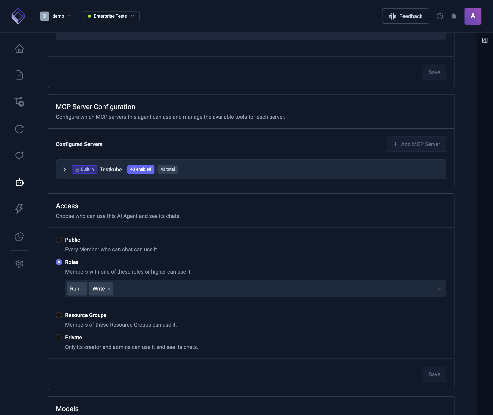
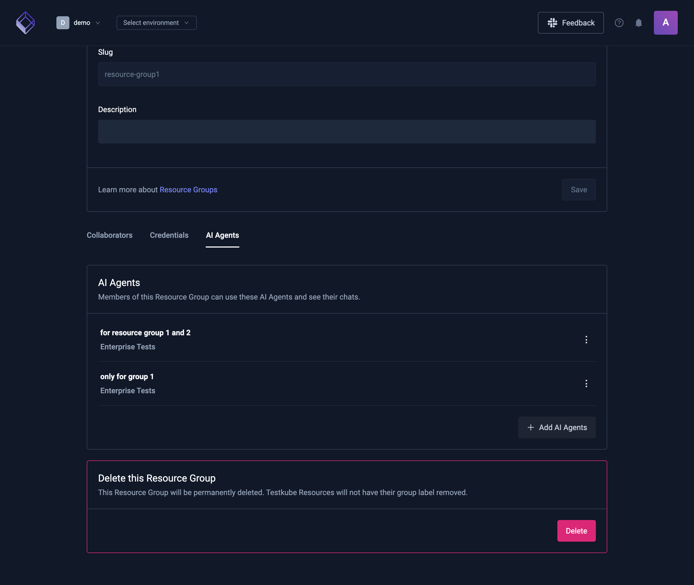
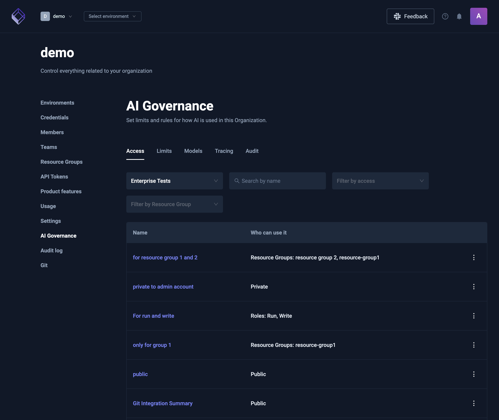
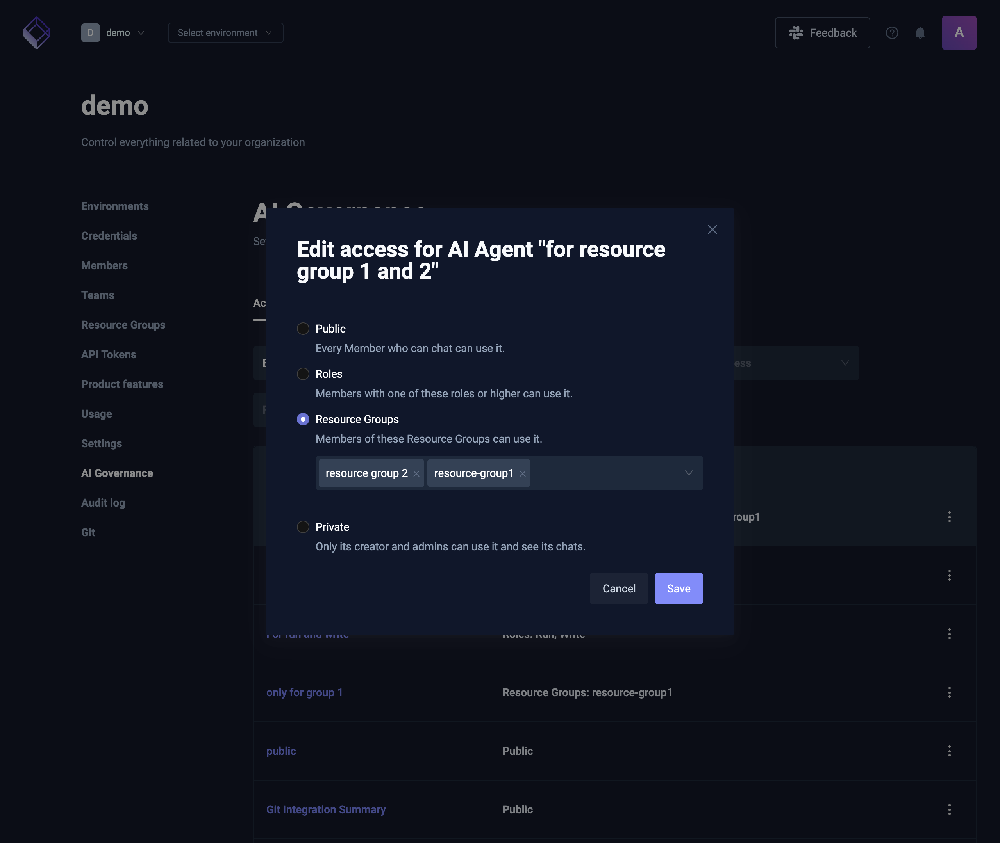

# AI Agent access

Every AI Agent has an access setting that decides who can use it and see its chats. By default an AI Agent is public: every member who can chat in the Environment can use it. You can narrow that to members with a role, to the members of Resource Groups, or to the AI Agent's creator.

:::info
AI Agent access is part of AI governance and needs RBAC in your license. Without RBAC, every member who can chat can use every AI Agent. Access settings that were saved before stay stored and apply again once RBAC is back.

On a self-hosted control plane, AI governance is on by default (`global.features.aiGovernance`) and needs PostgreSQL.
:::

## Who can use an AI Agent

| Access          | Who can use the AI Agent and see its chats                                          |
| --------------- | ----------------------------------------------------------------------------------- |
| Public          | Every member who can chat in the Environment. This is the default.                  |
| Roles           | Members whose Environment role is one of the chosen roles or higher.                |
| Resource Groups | Members of the chosen [Resource Groups](resource-groups), including their teams.    |
| Private         | Only the AI Agent's creator. Private AI Agents ignore any roles or Resource Groups. |

Environment roles go from lowest to highest: Read, Run, Write, Admin. An AI Agent open to the Run role is also open to members with Write or Admin.

Some people can always use every AI Agent, whatever its access:

- Organization admins and owners.
- Environment admins.
- The AI Agent's creator, for their own AI Agents.

## What access changes

- **Chats.** Members only see the AI Agents they can use when they start a chat, and the AI Agent picker in a chat lists only those.
- **Chat history.** A chat belongs to its AI Agent, so members don't see chats of an AI Agent they can't use.
- **AI Triggers.** A trigger always reaches the AI Agent it runs, even a private one. Change the trigger if it should stop using that AI Agent.
- **API tokens.** A token's Environment role and Resource Groups decide which AI Agents it can use, as for a member. A token never counts as an AI Agent's creator.

## Who can change access

- **Organization admins and owners** can set any access.
- **The creator** of an AI Agent can switch it between Public and Private, as long as it has no roles or Resource Groups. Choosing roles or Resource Groups is for Organization admins and owners.
- **Default AI Agents**, such as the ones every Environment starts with, are always public. Their access can't be changed.

## Set access on an AI Agent

1. Open the Environment, then **AI Settings** → **AI Agents**.
2. Open the AI Agent.
3. In the **Access** card, choose **Public**, **Roles**, **Resource Groups**, or **Private**.
4. For **Roles** or **Resource Groups**, pick at least one role or group.
5. Select **Save**.

Changing access replaces the AI Agent's previous roles and Resource Groups. The change applies as soon as it's saved: members who lose access no longer see the AI Agent or its chats.

## Give a Resource Group its AI Agents

You can also choose AI Agents from the Resource Group's side:

1. Go to **Organization management** → **Resource Groups** and open the group.
2. Open the **AI Agents** tab.
3. Select **Add AI Agents** and pick the AI Agents. They can come from any Environment.

Members of the group can then use those AI Agents and see their chats. To take one away, use the AI Agent's **⋮** menu and choose **Remove from Resource Group**. Only Organization admins and owners can change this list.

## Review access across an Environment

**Organization management** → **AI Governance** → **Access** lists the AI Agents of one Environment and who can use each one. It's for Organization admins and owners.

- **Environment** picks the Environment. The first one by name is selected when the page opens.
- **Search by name**, **Filter by access**, and **Filter by Resource Group** narrow the list.
- **Who can use it** shows the access, for example `Roles: Run, Write` or `Resource Groups: Payments`.
- The **⋮** menu on each AI Agent has **Edit access**, which opens the same choices as the Access card, and **Open AI Agent**.

## Related

- [Defining AI Agents](defining-ai-agents)
- [AI Agent Chats](using-ai-agents)
- [Resource Groups](resource-groups)
- [Member Management](member-management)
