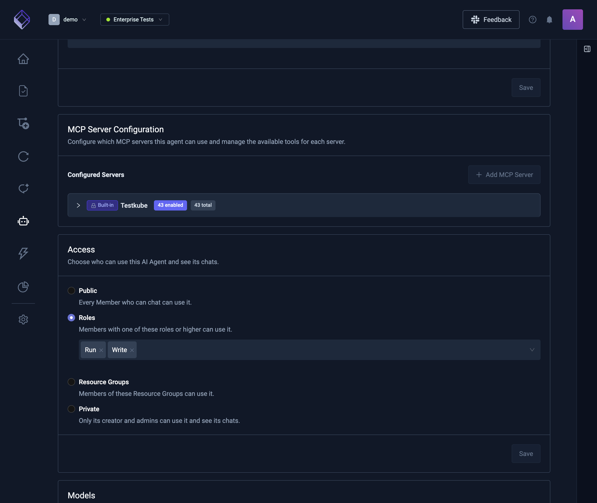
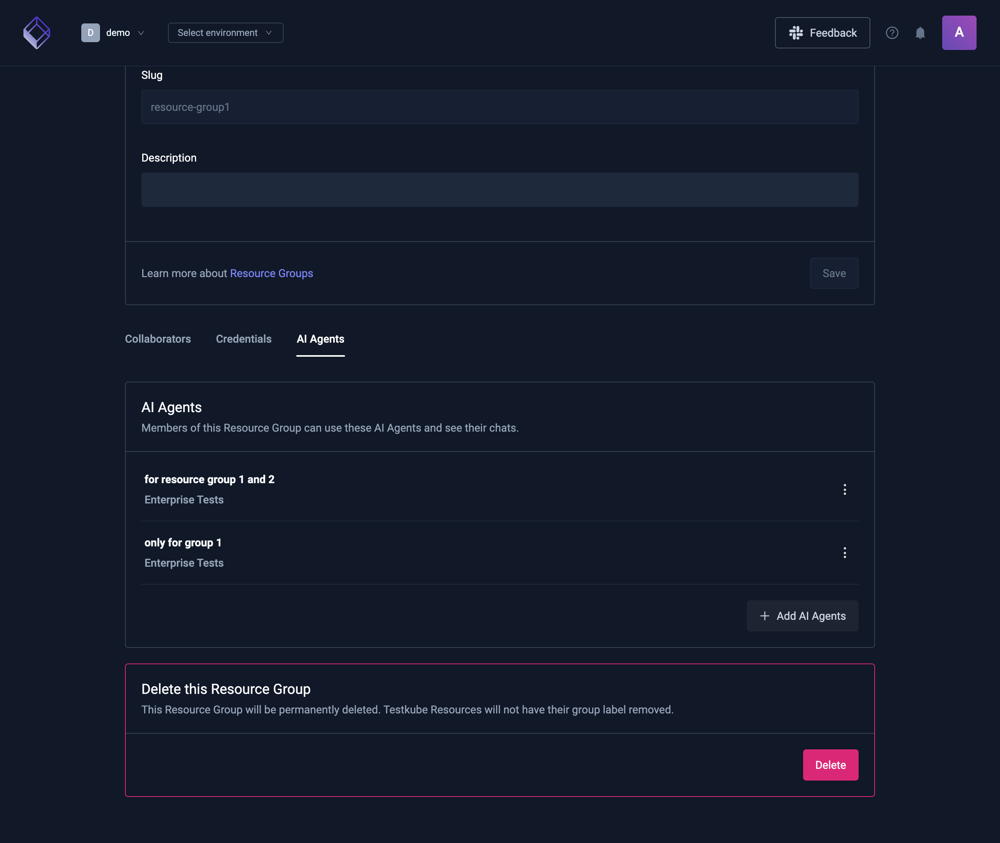
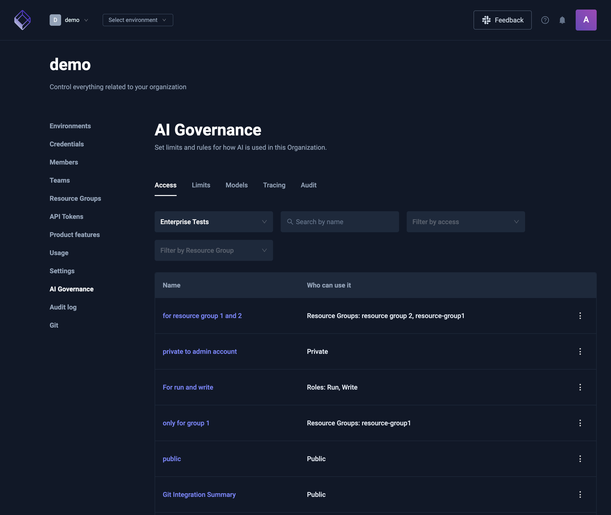
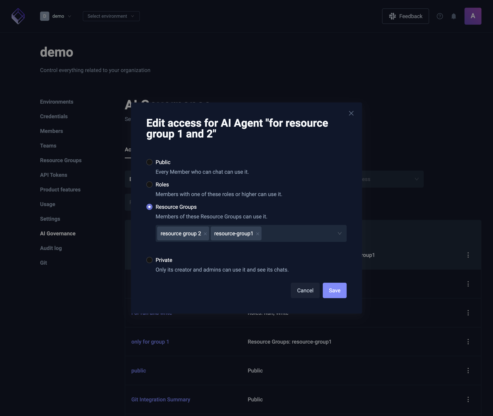

# AI Agent access

Every AI Agent has an access setting that decides who can use it and see its shared chats. By default an AI Agent is public: every member who can chat in the Environment can use it. You can narrow that to members with a role, to the members of Resource Groups, or to the AI Agent's creator.

:::info
AI Agent access is part of AI governance and needs RBAC in your license. Without RBAC, every member who can chat can use every AI Agent. Access settings that were saved before stay stored and apply again once RBAC is back.

On a self-hosted control plane, AI governance needs PostgreSQL.
:::

## Who can use an AI Agent

| Access          | Who can use the AI Agent and see its shared chats                                                                                                                               |
| --------------- | ------------------------------------------------------------------------------------------------------------------------------------------------------------------------------- |
| Public          | Every member who can chat in the Environment. This is the default.                                                                                                              |
| Roles           | Members whose Environment role is one of the chosen roles or higher.                                                                                                            |
| Resource Groups | Members of the chosen [Resource Groups](resource-groups), including their teams.                                                                                                |
| Private         | Only the AI Agent's creator and the members linked to it, such as whoever made it private, plus the admins listed below. Private AI Agents ignore any roles or Resource Groups. |

Environment roles go from lowest to highest: Read, Run, Write, Admin. An AI Agent open to the Run role is also open to members with Write or Admin.

An AI Agent can have roles and Resource Groups at the same time, when it's open to roles and is then added to a Resource Group from the group's side. Anyone who matches either can use it, and the Access tab shows both, for example `Roles: Run · Resource Groups: Payments`. The Access card shows it as **Roles**, and saving the card removes the Resource Groups.

Restrictions fail open: an AI Agent with no roles and no Resource Groups left is public. Deleting a Resource Group removes it from its AI Agents, so an AI Agent that was open only to that group becomes public.

Some people can always use every AI Agent, whatever its access:

- Organization admins and owners.
- Environment admins.
- The AI Agent's creator, for their own AI Agents.

## What access changes

- **Chats.** Members only see the AI Agents they can use when they start a chat, and the AI Agent picker in a chat lists only those.
- **Chat history.** A chat belongs to its AI Agent, so members don't see chats of an AI Agent they can't use. A private chat stays visible only to its owner, whatever the AI Agent's access.
- **AI Triggers.** A trigger always reaches the AI Agent it runs, even a private one. Change the trigger if it should stop using that AI Agent. Hiding the AI Agent stops the trigger too, which is a separate setting: see [Show or hide an AI Agent in an Environment](#show-or-hide-an-ai-agent-in-an-environment).
- **API tokens.** A token's Environment role and Resource Groups decide which AI Agents it can use, as for a member. A token never counts as an AI Agent's creator.

## Show or hide an AI Agent in an Environment

Access decides **who** may use an AI Agent. Visibility decides **whether the Environment offers it at all**. Every AI Agent, the built-in ones included, has a **Show in this Environment** switch, and each Environment keeps its own answer: hiding **Troubleshoot** in a staging Environment leaves it in place everywhere else.

Every AI Agent is shown by default, so nothing changes until someone hides one.

1. Open the Environment, then **AI Settings** → **AI Agents**.
2. Open the AI Agent.
3. Turn **Show in this Environment** off to hide it, or on to show it again.

The switch saves on its own, without the **Save** button the rest of the form uses, so it also works on a built-in AI Agent, whose other fields are read-only. Changing it takes the same permission as editing an AI Agent, so Environment admins, Organization admins and owners can all do it. Access works differently: an Environment admin can hide an AI Agent but can't change who may use it.

Hidden AI Agents stay in this list, dimmed and marked **Hidden**, so you can show them again. Everywhere else in the Environment they are gone.

### What hiding changes

| Where                                      | A hidden AI Agent                                                                                                                               |
| ------------------------------------------ | ----------------------------------------------------------------------------------------------------------------------------------------------- |
| AI Assist and the AI Agent picker in chats | Isn't listed, so no new chat can name it.                                                                                                       |
| AI Analyze                                 | Isn't listed.                                                                                                                                   |
| AI Agent Triggers                          | Can't be chosen for a new or edited trigger. A trigger that already points at it is skipped when it fires: nothing runs and no chat is created. |
| Test Bundles                               | Can't be linked to a Test Bundle, and is left out of the AI Agents that new Test Bundles start with.                                            |
| Pull and merge request analysis            | GitHub pull request analysis and GitLab merge request analysis refuse to run with it.                                                           |
| Existing chats                             | Stay readable, and can be carried on.                                                                                                           |
| The API                                    | Starting a chat, a trigger or a Test Bundle link with it is refused, so hiding also holds for callers that never see a picker.                  |

A refused request says which AI Agent is hidden, so the next step is to show it again or pick another one.

### Hiding is not access

A hidden AI Agent is still an AI Agent of the Environment, and its access is untouched. Hiding takes it out of the pickers and stops it starting anything new; it isn't a privacy boundary and it takes nobody's access away. Use **Private**, roles or Resource Groups when the question is who may use an AI Agent, and hide it when the question is whether this Environment should offer it at all.

The two combine, and the narrower one wins: a member sees an AI Agent only when the Environment shows it **and** their access allows it.

## Who can change access

- **Organization admins and owners** can set any access.
- **The creator** of an AI Agent can switch it between Public and Private, as long as it has no roles or Resource Groups. Choosing roles or Resource Groups is for Organization admins and owners.
- **Environment admins** can use every AI Agent but can't change its access.
- **Default AI Agents**, the built-in ones every Environment starts with, are public, and their Access card can't be changed. Adding one to a Resource Group from the group's side still limits it to that group. Whether the Environment shows them is the one thing that can be changed on them, with the switch above.

## Set access on an AI Agent

1. Open the Environment, then **AI Settings** → **AI Agents**.
2. Open the AI Agent.
3. In the **Access** card, choose **Public**, **Roles**, **Resource Groups**, or **Private**.
4. For **Roles** or **Resource Groups**, pick at least one role or group.
5. Select **Save**.

Changing access replaces the AI Agent's previous roles and Resource Groups. The change applies as soon as it's saved: members who lose access no longer see the AI Agent or its chats.

## Give a Resource Group its AI Agents

You can also choose AI Agents from the Resource Group's side.

:::warning
Adding a public AI Agent to a Resource Group limits it to that group. Everyone else loses the AI Agent and its chats.
:::

1. Go to **Organization Management** → **Resource Groups** and open the group.
2. Open the **AI Agents** tab.
3. Select **Add AI Agents**, choose an Environment, then pick the AI Agents and confirm. They can come from any Environment, but private AI Agents can't be added.

Members of the group can then use those AI Agents and see their shared chats, as long as they also have a role in the AI Agent's Environment: Read to see it, Run to chat with it. To take one away, use the AI Agent's **⋮** menu and choose **Remove from Resource Group**. Only Organization admins and owners can change this list.

## Review access across an Environment

**Organization Management** → **AI Governance** → **Access** lists the AI Agents of one Environment and who can use each one. Only Organization admins and owners can open it.

- **Environment** picks the Environment. The first one by name is selected when the page opens.
- **Search by name**, **Filter by access**, and **Filter by Resource Group** narrow the list.
- **Who can use it** shows the access, for example `Roles: Run, Write` or `Resource Groups: Payments`.
- The **⋮** menu on each AI Agent has **Edit access**, which opens the same choices as the Access card, and **Open AI Agent**.

## Related

- [Defining AI Agents](defining-ai-agents)
- [AI Agent Chats](using-ai-agents)
- [Resource Groups](resource-groups)
- [Member Management](member-management)
