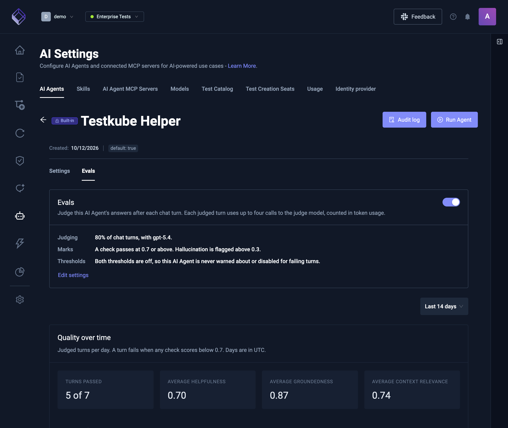
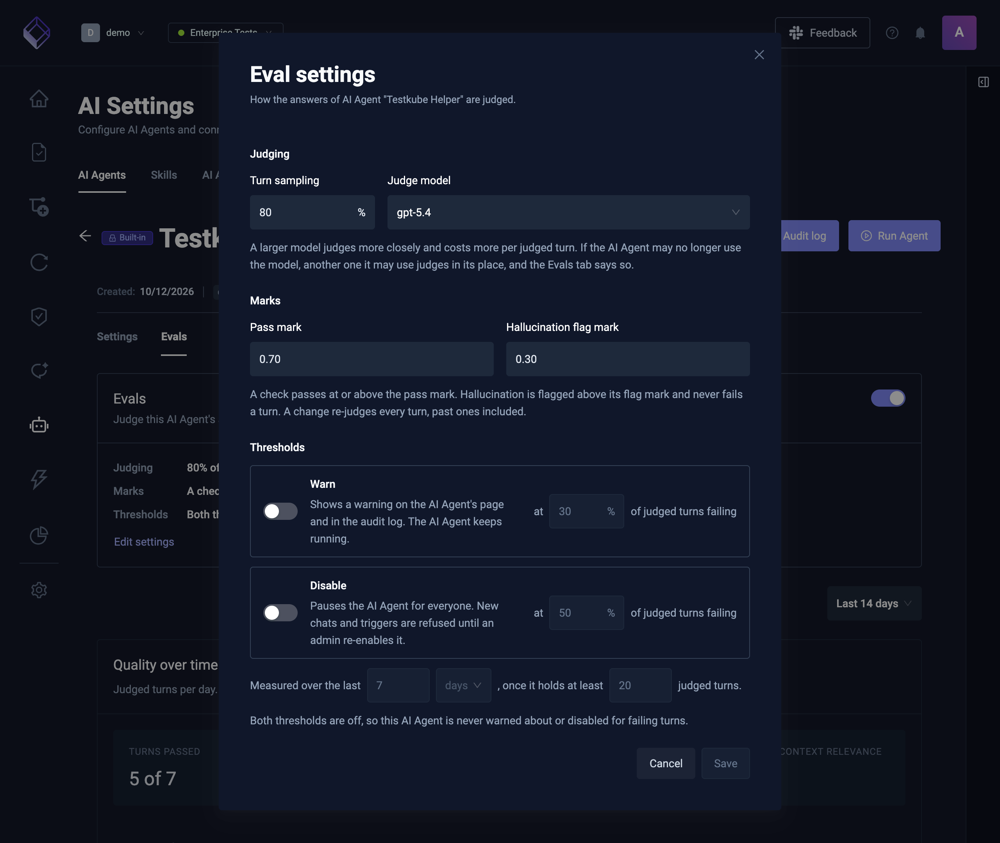
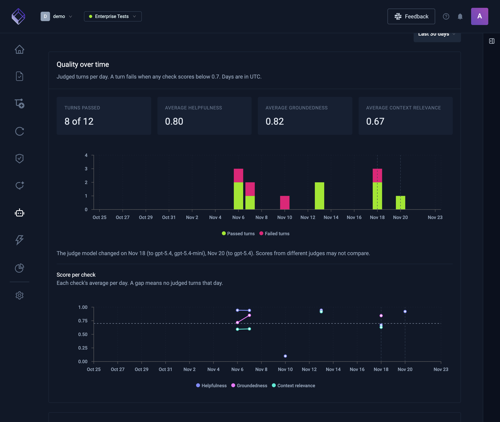
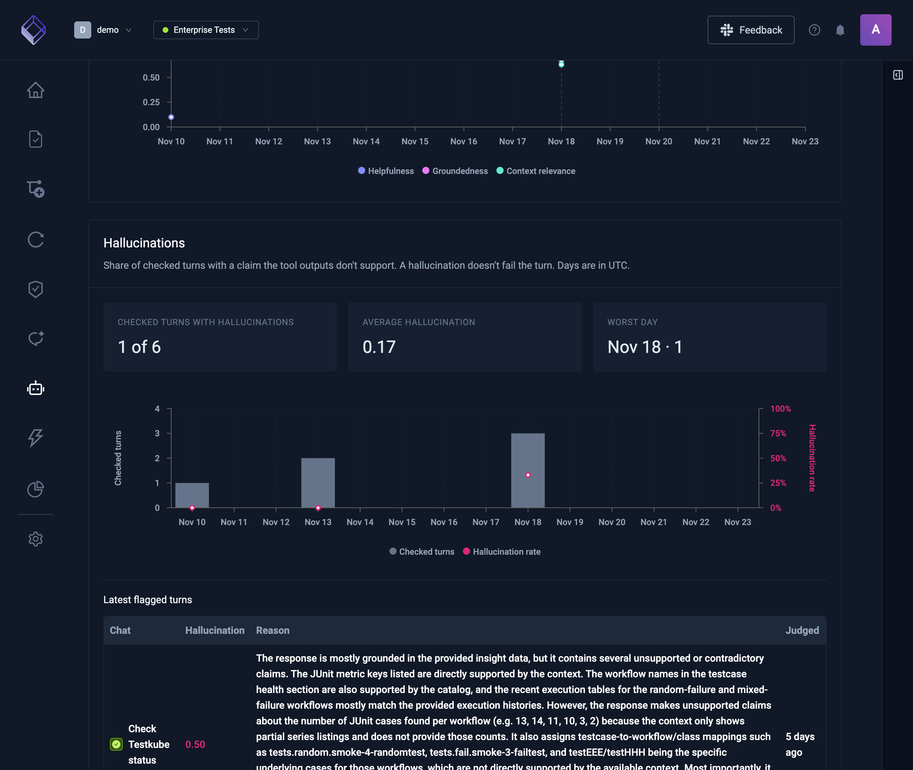
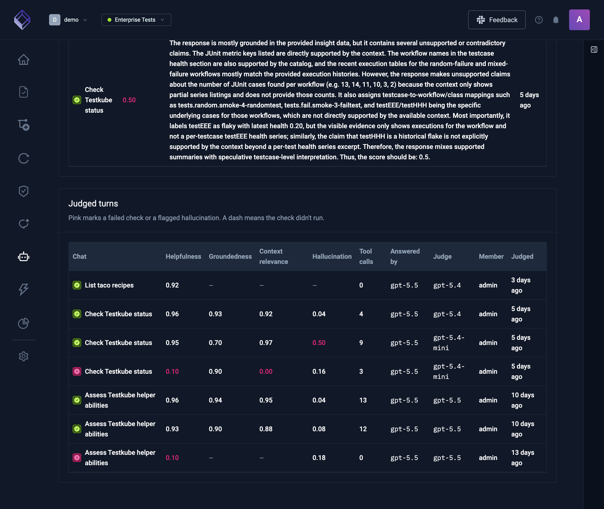
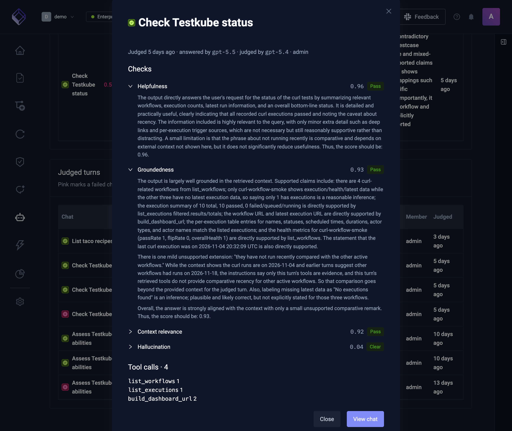

# Evals for AI Agents

Evals judge the answers of an AI Agent. After the AI Agent answers a chat turn, a model reads the question, the answer and what the AI Agent's tools returned, and scores the turn on a few checks. The **Evals** tab of the AI Agent shows how many turns passed, which ones failed and why.

Evals are off for every AI Agent until an Environment admin turns them on for it.

## How evals work

1. A Member chats with the AI Agent, and the AI Agent answers. The answer is never held back for the judges.
2. If evals are on, the turn is picked for judging according to the [turn sampling](#turn-sampling).
3. The judge model scores the turn on each [check](#checks-and-marks) that applies to it, from 0 to 1.
4. The scores are stored with the turn. A turn passes when every check is at or above the pass mark.
5. If the AI Agent has [thresholds](#warn-and-disable-thresholds), they count its failed turns, and can warn about it or disable it.

Judging uses tokens of the judge model. They count in the token usage and toward token limits, like the chat itself. See [Token usage](#token-usage).

## Turn on evals

1. Open the Environment, then **AI Settings** → **AI Agents**, and open the AI Agent.
2. Open the **Evals** tab.
3. Turn on the switch of the **Evals** card.

The card then sums up the settings: how many turns are judged and by which model, the marks, and the thresholds. Select **Edit settings** to change them.

Only Environment admins can turn evals on or off and change the settings. Other people see the card, and the Evals tab if their role lets them view the AI Agent's evals.

Turning evals off stops new turns from being judged. Turns judged before stay on the Evals tab.

## Turn sampling

**Turn sampling** is the share of chat turns that get judged, from 0.01% to 100%. It is 100% by default, so every turn is judged.

Every judged turn costs tokens: one call to the judge model for each check. On a busy AI Agent, a lower rate keeps that cost down and still shows how the AI Agent is doing. For example, at 10% about one turn in ten is judged.

Each turn is picked on its own, not each chat, so a long chat has some turns judged and others not. The pick is fixed for a turn: the same turn is always picked, or never.

Some turns are never judged, whatever the rate:

- Turns that failed or were stopped, and turns stopped by a token limit or a pause
- Turns that wait for an approval
- Turns with an empty answer
- Chats an AI Agent delegated to another one
- A turn that ends while two turns of the AI Agent are already being judged

## Checks and marks

Each check gives a score from 0 to 1:

| Check                 | What it judges                                                                                                                                           | When it runs                                   |
| --------------------- | -------------------------------------------------------------------------------------------------------------------------------------------------------- | ---------------------------------------------- |
| **Helpfulness**       | Whether the answer addresses the question                                                                                                                | Every judged turn                              |
| **Groundedness**      | Whether the answer is supported by what the AI Agent's tools returned                                                                                    | When a tool ran in the turn                    |
| **Context relevance** | Whether the information the AI Agent gathered, from its tools and earlier in the chat, helps answer the question. It does not judge which tools it chose | When a tool ran in this turn or an earlier one |
| **Hallucination**     | Whether the answer makes claims that nothing in the chat supports. A higher score is worse                                                               | When the chat has tool output                  |

Two marks turn the scores into verdicts:

- **Pass mark**, 0.7 by default. A check passes at or above it. A turn passes when every check it ran, apart from Hallucination, passes; one check below the mark fails the turn.
- **Hallucination flag mark**, 0.3 by default. A turn whose Hallucination score is above it is flagged. A flag never fails the turn: it points you to turns worth reading.

Both marks go from 0 to 1. Changing a mark changes the verdicts of every judged turn, past ones included, because the verdicts are worked out from the stored scores. A higher pass mark can also disable the AI Agent at its next judged turn if it has a **Disable** threshold.

## Warn and disable thresholds

Thresholds act on an AI Agent whose judged turns keep failing. Both are off by default.

- **Warn** shows a warning on the AI Agent's page and in the audit log when its share of failed turns reaches the threshold. The AI Agent keeps running.
- **Disable** pauses the AI Agent when its share of failed turns reaches the threshold. New chats and AI Agent triggers are refused, with the reason, until an admin re-enables it.

Both count over the same window and only act once it holds enough turns:

- **Window.** The share is counted over the judged turns of the last minutes, hours or days you set, such as the last 7 days.
- **Minimum judged turns.** A threshold acts only once the window holds at least this many judged turns, so a few early failures can't disable a new AI Agent.

When you turn a threshold on, the dialog starts from 30% for **Warn**, 50% for **Disable**, a window of 7 days and a minimum of 20 judged turns. The **Warn** threshold must be lower than the **Disable** one. The share counts every judged turn of the AI Agent, private chats included.

The thresholds are checked after each judged turn. A warning goes away by itself when the share falls back below the threshold, and when you change the marks or turn evals off.

### Bring back a disabled AI Agent

A disabled AI Agent shows a banner on all its tabs with the date it was disabled and why, for example "This AI Agent is disabled because its share of failing judged turns, 55%, reached the kill threshold of 50% over the last 7 days." Chats and triggers that are refused give the same reason. An Environment admin can select **Re-enable** in the banner. Resuming the AI Agent's pause from [AI Governance](ai-token-limits#pause-ai) does the same.

Re-enabling starts the window again, so the turns that disabled the AI Agent don't disable it again. Before you re-enable it, read its failed turns on the Evals tab, and fix the AI Agent's instructions or tools, or change the marks if they are too strict.

## Judge model

**Judge model** is the model that scores the turns. By default it is **Tasks model**, the lightweight model Testkube uses for small jobs such as chat titles (the `tasks` role in the [AI configuration](ai-configuration#the-inference-configuration-block)). You can pick any model the AI Agent may use. A larger model judges more closely and costs more per judged turn.

If the AI Agent may no longer use the judge model, another model judges in its place: the tasks model, else the first lightweight model the AI Agent may use, else the first primary one. The Evals tab then says how many turns another model judged, and the **Judge** column of the judged turns shows which one. If the AI Agent may use none of them, turns are not judged.

A judge model that is no longer available shows as **not available** in the dialog. Pick another one.

## Token usage

Every check of a judged turn is one call to the judge model, and its tokens are recorded like the chat's own:

- They show in the [token usage](ai-usage#ai-token-usage), for the AI Agent and the Member whose chat was judged.
- They count toward the [token limits](ai-token-limits) of that Member, the AI Agent, the Environment and the Organization.

So with every turn judged, an AI Agent uses noticeably more tokens than its chats alone. Lower the [turn sampling](#turn-sampling) to judge fewer turns, or pick a smaller judge model.

## The Evals tab

The Evals tab shows the judged turns of one AI Agent. The range picker at the top sets the period of every card: the last 7, 14, 30 or 90 days. Days are in UTC.

- **Quality over time.** How many turns passed out of the turns judged, the average score of each check, and a chart of passed and failed turns per day. **Score per check** charts each check's daily average against the pass mark; a gap is a day with no judged turns. When the judge model changed in the range, the card says when and to which model, since scores from different judges may not compare.
- **Hallucinations.** How many checked turns were flagged, the average Hallucination score, the worst day, and a chart of the checked turns and the hallucination rate. **Latest flagged turns** lists the most recent flagged turns with the judge's reason.
- **Judged turns.** Every judged turn in the range: whether it passed, the score of each check, the number of tool calls, the model that answered (**Answered by**), the judge model (**Judge**), the Member, and when it was judged. A score in pink is a failed check or a flagged hallucination, and a dash is a check that didn't run on that turn.

Select a turn to open it. It shows which model answered and which judged, each check's score with **Pass** or **Fail** (**Clear** or **Flagged** for Hallucination) and the judge's reason (expand a check to read it), and the tools the turn called. **View chat** opens the chat at that turn, to read the question and the answer.

The Evals tab leaves out other Members' private chats, for admins too. They still count toward the [thresholds](#warn-and-disable-thresholds).

## Limitations

- **Postgres only.** Evals need PostgreSQL. On a self-hosted control plane that uses MongoDB, nothing is judged or stored.
- **A shortened chat.** The judges read up to about 32,000 tokens of the chat. A longer chat is shortened first: tool descriptions, earlier tool outputs and earlier turns go before the turn itself. An opened turn says what was left out, because a check may fail or flag a claim when it could not see that evidence.
- **A check that fails to run.** When the judge model errors or gives no score for a check, that check is left out of the turn without a note.
- **Turns that are skipped.** Turns that end while two turns of the AI Agent are already being judged are not judged. See [Turn sampling](#turn-sampling) for the other turns that are never judged.

## Related

- [AI Agents](ai-agents)
- [AI Agent Chats](using-ai-agents)
- [Configuring AI Models](ai-models)
- [AI token limits and pauses](ai-token-limits)
- [AI Governance](ai-governance)
