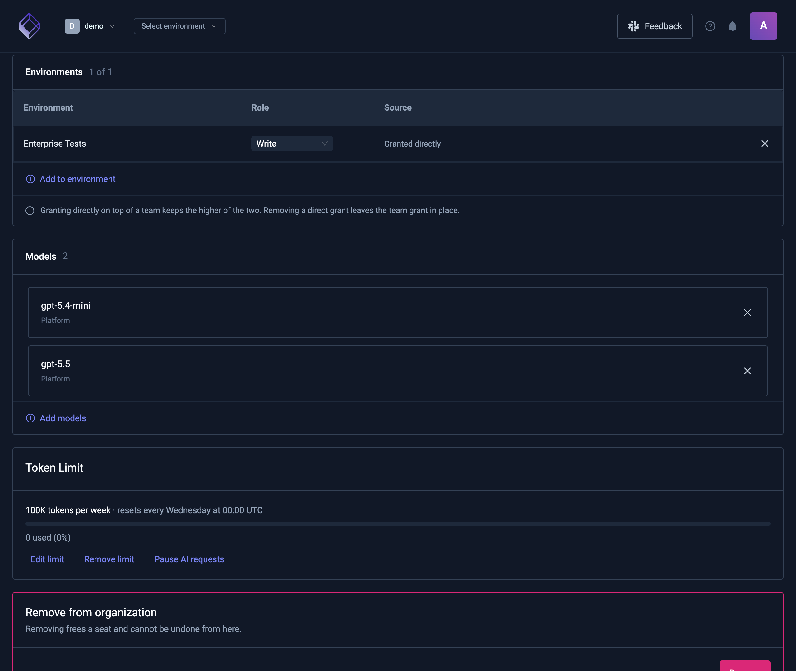
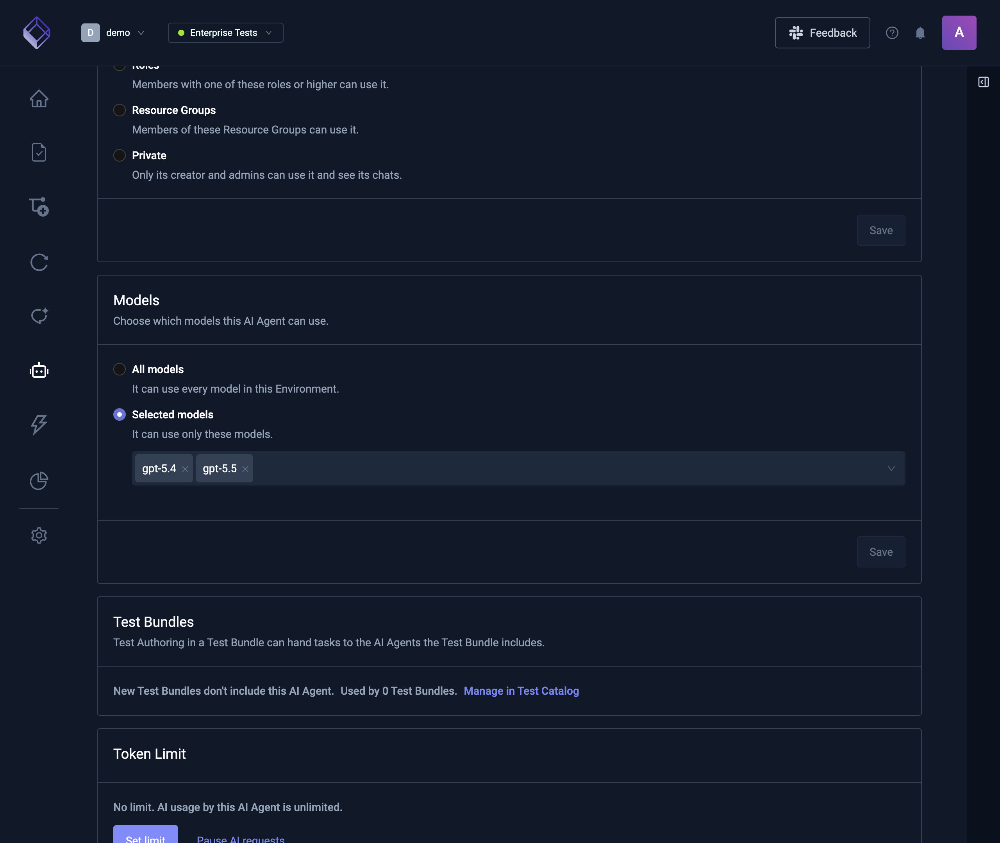
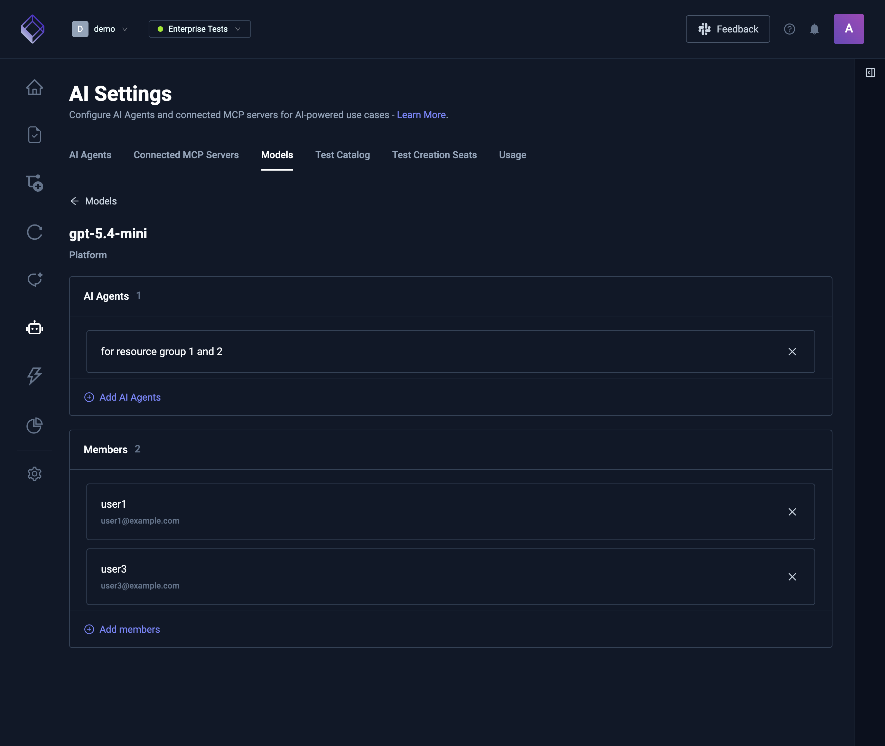
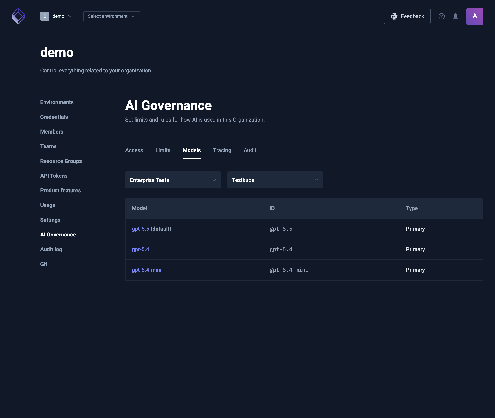

# Model access

By default everyone can use every model of an Environment. You can limit a Member, an AI Agent, or both to a list of models. Members then only see and use the models they're allowed.

:::info
Model access is part of AI governance and needs RBAC in your license. Without RBAC, everyone can use every model.

On a self-hosted control plane, AI governance needs PostgreSQL.
:::

## How model access works

A Member or an AI Agent with no models can use every model. Adding models limits them to those models.

When someone chats with an AI Agent, both lists apply:

| Member's models | AI Agent's models | Models allowed in the chat             |
| --------------- | ----------------- | -------------------------------------- |
| None            | None              | Every model                            |
| Some            | None              | The Member's models                    |
| None            | Some              | The AI Agent's models                  |
| Some            | Some              | Only the models that are in both lists |

A Member's models apply in every Environment of the Organization. An AI Agent's models apply to that AI Agent only.

Some chats only follow the AI Agent's models:

- Organization admins and owners, and Environment admins, aren't limited by their own Member models.
- Chats started with an API token, including AI Triggers and the quality loop, only follow the AI Agent's models.

## What people see in chats

- **The model picker** in a chat only lists the models the person may use with that AI Agent.
- **A model that's no longer allowed.** If a chat's model is removed from a list, the chat moves to an allowed model on its next message: Testkube's default model when it's allowed, otherwise another allowed one.
- **No model left.** If the two lists have no model in common, the chat can't run and shows that no model the person may use is available. Ask an Organization admin to add a model both lists share.

## Who can change model access

Only Organization admins and owners can add or remove models for Members and AI Agents. Environment admins can see a model's AI Agents but can't change model access or see its Members.

The Environment's default AI Agent always uses every model: its **Models** card can't be changed.

## Give models to a Member

1. Go to **Organization Management** → **Members** and open the Member.
2. In the **Models** card, select **Add models** and pick the models.

To give the Member every model again, remove all models from the card.

Deleting a model provider removes its models from every list. A Member or AI Agent whose only models came from that provider can then use every model.

## Give models to an AI Agent

1. Open the Environment, then **AI Settings** → **AI Agents**.
2. Open the AI Agent.
3. In the **Models** card, choose **Selected models**, pick at least one model, and select **Save**.

To let the AI Agent use every model again, choose **All models**.

The AI Agent's default model should be one of its chosen models. If it isn't, the card warns you, and new chats with the AI Agent use another chosen model.

## See who is limited to a model

Open a model from the **Models** tab of **AI Settings**. Its details page lists:

- **AI Agents** in this Environment limited to this model.
- **Members** limited to this model. Only Organization admins and owners see this list.

Use **Add AI Agents** and **Add members** to limit more of them to the model, or remove one from a list.

## Review models across an Environment

**Organization Management** → **AI Governance** → **Models** lists the models of one Environment. It's for Organization admins and owners.

- **Environment** picks the Environment.
- **Provider** picks the model provider, starting with Testkube's own models.
- Each model shows its ID and type, and Testkube's default model is marked.
- With RBAC in your license, select a model to open its details page and see who is limited to it.

## Related

- [Configuring AI Models](ai-models)
- [Defining AI Agents](defining-ai-agents)
- [Member Management](member-management)
