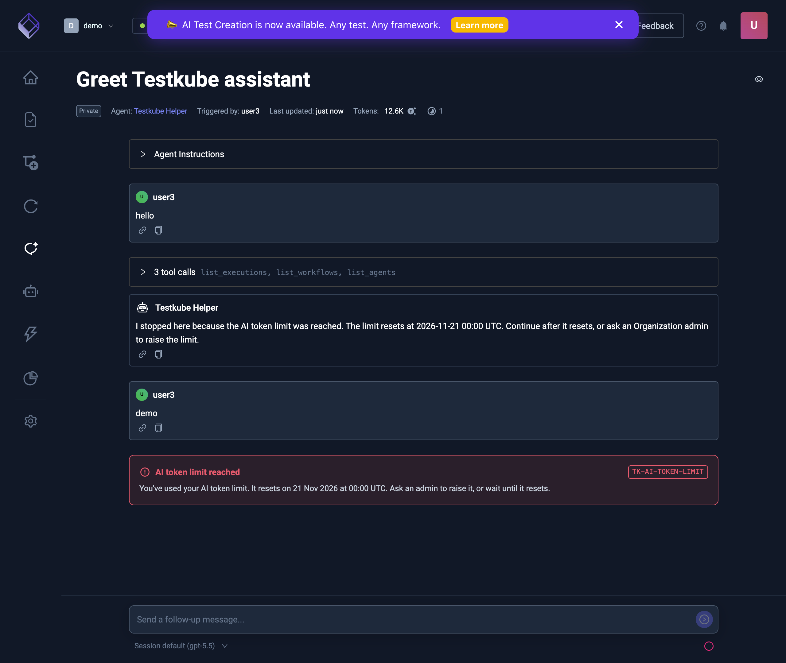
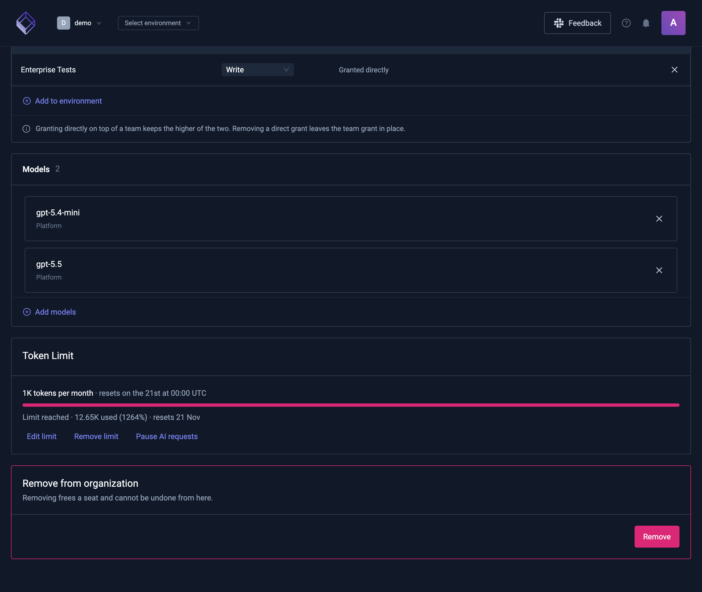
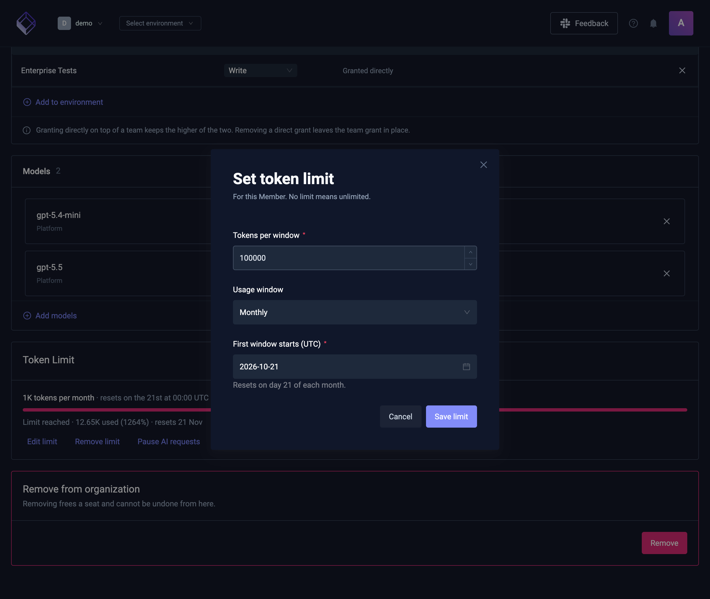
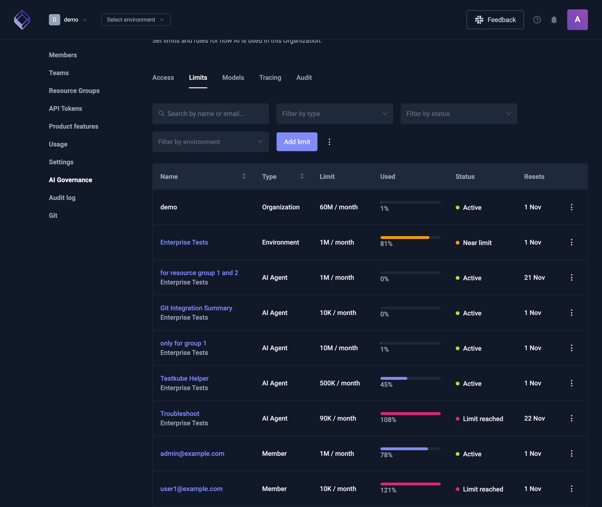
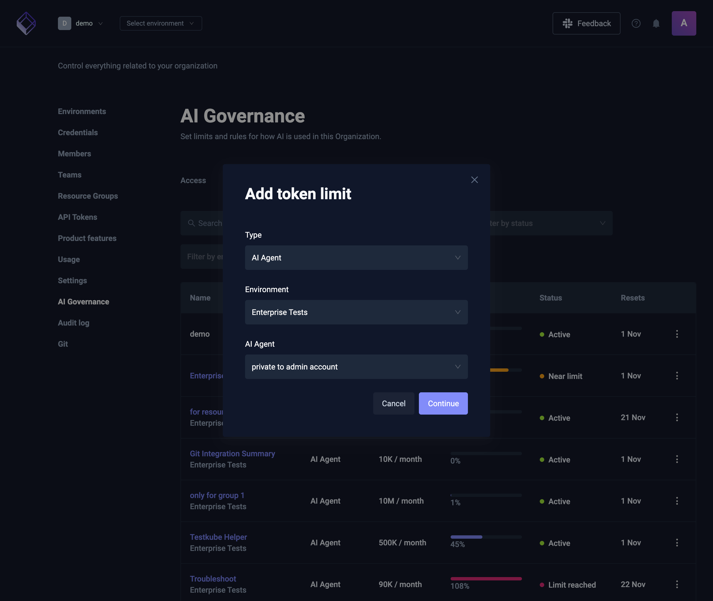

# AI token limits and pauses

A token limit caps how many AI tokens can be used in a window, such as a month. You can set one for a Member, an AI Agent, an Environment or the whole Organization. You can also pause AI at any of those levels, which stops it until someone resumes it.

Token limits are yours to set. They are separate from the [AI sessions and MCP calls of your plan](ai-usage), which Testkube sets.

:::info
Token limits and pauses are part of AI governance. They don't need RBAC in your license.

On a self-hosted control plane, AI governance needs PostgreSQL.
:::

## How token limits work

Each level counts different usage:

| Level        | What its limit counts                                                                                                       |
| ------------ | --------------------------------------------------------------------------------------------------------------------------- |
| Member       | That Member's chats, including when an AI Trigger or an API token continues one of them. A trigger's own chats don't count. |
| AI Agent     | Everyone's use of that AI Agent.                                                                                            |
| Environment  | All AI use in that Environment.                                                                                             |
| Organization | All AI use in the Organization.                                                                                             |

Every limit that applies to a request is checked, and the first one that's reached blocks it. For example, a Member with room left is still blocked when the AI Agent they chat with has reached its limit.

A limit has three settings:

- **Tokens per window.** Input and output tokens of the model calls, added up.
- **Usage window.** **Monthly**, **Weekly** or **Hourly**. Usage goes back to zero when a new window starts.
- **First window starts (UTC).** The windows repeat from that moment. A weekly limit that starts on a Wednesday resets every Wednesday at 00:00 UTC.

A limit is **near** once 80% of it is used.

## Pause AI

Pausing stops all AI requests at that level until it's resumed, whatever its limit says. Pausing a Member stops their chats; pausing an AI Agent stops it for everyone; pausing an Environment or the Organization stops all AI there.

Use **Pause AI requests** on a Token Limit card or a limit's **⋮** menu, and **Resume AI requests** to undo it. Saving a limit doesn't resume a pause.

## What people see

| Where                    | When a limit is reached or AI is paused                                                                                                                                         |
| ------------------------ | ------------------------------------------------------------------------------------------------------------------------------------------------------------------------------- |
| A new chat message       | The message isn't answered. The chat shows **AI token limit reached** or **AI is paused**, whose limit it is and when it resets, and to ask an admin.                           |
| A long answer            | The answer stops with a message saying the limit was reached. A running answer checks again about every 30 seconds, so a pause or a limit reached by someone else stops it too. |
| An AI Trigger            | The run doesn't start. The trigger's chats show a failed chat with the reason.                                                                                                  |
| A GitHub PR analysis     | The **AI Analysis** row is skipped with "AI analysis skipped; an AI token limit is reached or AI is paused".                                                                    |
| Generating an AI Agent   | The generation is refused with a message saying why.                                                                                                                            |
| Test Authoring Sandboxes | A Sandbox doesn't start.                                                                                                                                                        |

The usage ring next to the chat input also shows how close the tightest limit is.

## Set a limit

Limits are set on the thing they limit:

| Level        | Where                                                                                   |
| ------------ | --------------------------------------------------------------------------------------- |
| Member       | **Organization management** → **Members** → the Member → **Token Limit** card           |
| AI Agent     | The Environment → **AI Settings** → **AI Agents** → the AI Agent → **Token Limit** card |
| Environment  | The Environment → **AI Settings** → **Usage** → **Token Limit** card                    |
| Organization | **Organization management** → **AI Governance** → **Limits**                            |

On a Token Limit card:

1. Select **Set limit**, or **Edit limit** if there is one.
2. Enter the **Tokens per window**, pick the **Usage window**, and choose when the **First window starts (UTC)**.
3. Select **Save limit**.

The card shows how much of the current window is used and when it resets. **Remove limit** takes the limit away.

## Review all limits

**Organization management** → **AI Governance** → **Limits** lists every limit and pause in the Organization. It's for Organization admins and owners.

- Each row shows the name, type, limit, tokens used, status and when it resets.
- **Search by name or email**, **Filter by type**, **Filter by status** (**Active**, **Near limit**, **Limit reached**, **Paused**) and **Filter by environment** narrow the list.
- **Add limit** sets a limit for any type: pick the **Type**, then the Environment, AI Agent or Member, select **Continue**, and set the limit.
- Each row's **⋮** menu has **Edit limit**, **Pause AI requests** or **Resume AI requests**, and **Remove limit**.
- The **⋮** next to **Add limit** pauses or resumes AI in the whole Organization.

## Who can change limits

- **Organization admins and owners** can set limits and pauses at every level.
- **Environment admins** can set them for their Environment and its AI Agents.

## Limitations

- **Unreachable control plane.** If the AI service can't reach the control plane to check limits, AI keeps working. A limit can be exceeded while it's unreachable.
- **The call that crosses the limit.** Limits are checked before each model call, so an answer can go over by the call that reaches the limit.
- **Usage that isn't counted.** Context compaction, chat titles, documentation and example search, moderation, AI briefs and the AI Agent configuration generator use tokens that no limit counts.

## Related

- [AI usage, seats, and limits](ai-usage)
- [Configuring AI Models](ai-models)
- [AI Triggers](ai-triggers)
- [Member Management](member-management)
