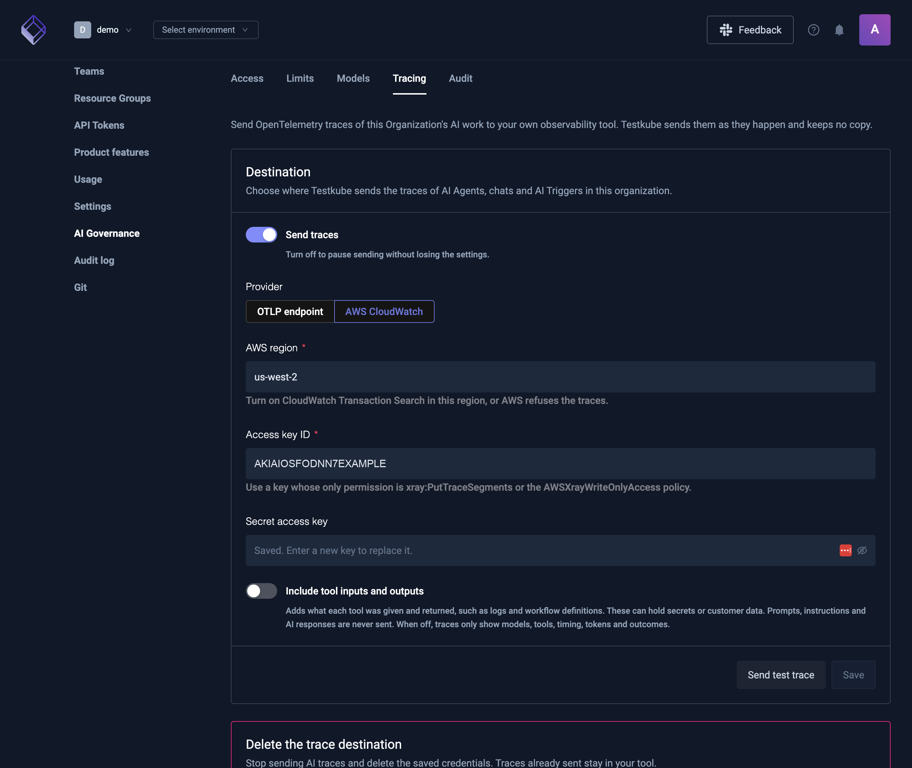

# AI tracing

AI tracing sends OpenTelemetry traces of your organization's AI work to your own observability tool, such as AWS CloudWatch, Datadog, Honeycomb or Grafana. Each AI turn becomes one trace. It shows which models and tools ran, how long they took, how many tokens they used, and how the turn ended.

Testkube sends the traces as they happen and keeps no copy of them.

:::info Availability
AI tracing is part of AI governance. It is in **Organization management → AI Governance → Tracing**, and saving a destination needs a control plane that stores its data in PostgreSQL. Only organization admins and owners can see and change it. For self-hosted control planes, see [Self-hosted control planes](#self-hosted-control-planes).
:::

## What is traced

Every turn the Testkube AI service runs for your organization:

- AI Agent chats, including approvals and answers to an agent's questions
- AI test creation
- [AI Agent Triggers](/articles/ai-triggers)
- AI Agents that hand work to other AI Agents
- Session titles, commit messages for AI test creation, and the summaries made when a long chat is shortened

Moderation checks are sent as their own short trace. They show whether a message was blocked and why, never the message.

Not traced yet: the specialist agents that write tests inside a sandbox, and AI briefs of shared executions.

## What a trace contains

Spans follow the [OpenTelemetry semantic conventions for generative AI](https://opentelemetry.io/docs/specs/semconv/gen-ai/), so tools that understand them show model calls, tokens and tools without extra setup. Testkube identifiers use the `testkube.*` prefix.

| Span                                  | Always included                                                                                                  | Only with **Include tool inputs and outputs** |
| ------------------------------------- | ---------------------------------------------------------------------------------------------------------------- | --------------------------------------------- |
| `invoke_agent`, the turn              | Organization, Environment, session, AI Agent, user, kind of work, status, model, input, output and cached tokens | –                                             |
| `chat <model>`, each model call       | Requested and responding model, provider, input, output and cached tokens, finish reason, duration, error type   | –                                             |
| `execute_tool <tool>`, each tool call | Tool name, call ID, duration, error type                                                                         | Tool arguments and result                     |
| `moderate`, a separate trace          | Whether the message was blocked, and the category                                                                | –                                             |

Traces never contain prompts or AI responses: not what people wrote in chats, not AI Agent instructions, and not what the AI answered. Error messages are left out too; a failed call only shows its error type.

:::warning Tool inputs and outputs
**Include tool inputs and outputs** adds what each tool was given and returned, such as logs, workflow definitions and query results. These can contain secrets and customer data, and tool arguments are written by the AI, so they can repeat what someone asked for. Turn it on only when your destination is allowed to hold that data. Each value is cut to 32,000 characters. When one AI Agent hands work to another, only the outcome of the handoff is included.
:::

## Send traces to AWS CloudWatch

Testkube sends traces to the AWS X-Ray OTLP endpoint of the region you choose, signed with your access key. CloudWatch shows them in **Transaction Search**.

1. In the AWS console, turn on **CloudWatch Transaction Search** in the region you will send traces to. AWS refuses traces sent to the OTLP endpoint without it.
2. Create an access key for an IAM user that can only write traces, for example with the `AWSXrayWriteOnlyAccess` managed policy. Don't reuse a key with wider permissions.
3. In Testkube, open **Organization management → AI Governance → Tracing**.
4. Choose **AWS CloudWatch** and enter the **AWS region**, **Access key ID** and **Secret access key**.
5. Choose whether to **Include tool inputs and outputs**.
6. Select **Send test trace**, then look for `testkube test trace` in CloudWatch → **Transaction Search**.
7. Save.

## Send traces to an OTLP endpoint

Any tool or OpenTelemetry Collector that accepts OTLP over HTTP can receive the traces.

1. Open **Organization management → AI Governance → Tracing** and choose **OTLP endpoint**.
2. Enter the **Traces endpoint**: the full HTTPS URL, usually ending in `/v1/traces`, for example `https://collector.example.com/v1/traces`.
3. Add the **Headers** your tool needs, such as an API key.
4. Select **Send test trace** and check that the span arrived, then save.

The endpoint must use HTTPS and resolve to a public address. Testkube refuses private, loopback and link-local addresses when you test or save, and every time it sends. Traces are sent as OTLP protobuf (`application/x-protobuf`).

**Send test trace** checks what the form holds, so you can test before saving. A secret field left empty uses the saved secret, as saving would. The test does not save anything.

## Change, pause or stop

- **Pause:** turn off **Send traces** and save. The settings are kept.
- **Replace a secret:** enter a new secret access key or header value and save. Leaving the secret field empty keeps the saved one. Switching to another provider asks for its credentials again.
- **Stop:** select **Delete** under **Delete the trace destination**. Testkube stops sending and deletes the saved credentials and headers. Traces already sent stay in your tool.

A new destination applies within seconds, and changes to a saved one within a minute. AI work that is already running finishes on the destination it started with.

## How traces are sent

- Spans are batched and sent a few seconds after they end. A trace can arrive in more than one batch.
- If the destination can't be reached or refuses a batch, that batch is dropped and not retried. Sending traces never slows down or fails an AI turn.
- Secrets are stored encrypted and are never shown again in the dashboard.
- Each organization's traces go only to that organization's destination.

## Self-hosted control planes

AI tracing is part of AI governance, which every self-hosted control plane with the AI service includes. The control plane must use PostgreSQL. The control plane and the AI service share the AI internal secret, which the chart generates unless you set `global.ai.internalSecret.existingSecret`. The AI service uses it to read the trace destination, and the control plane uses it to ask the AI service to send a test trace. The control plane finds the AI service at `https://<aiApiSubdomain>.<domain>`; set `global.ai.serviceUrl` if yours is elsewhere.

The Testkube AI service sends the traces, so its pods need outbound HTTPS to your destination: `xray.<region>.amazonaws.com` for CloudWatch, or your OTLP endpoint. If outbound traffic goes through a proxy, set it on the AI service as described in [Network Requirements](/articles/ai-configuration#network-requirements).

## Troubleshooting

| What you see                                              | What to check                                                                                |
| --------------------------------------------------------- | -------------------------------------------------------------------------------------------- |
| **AI Governance** or its **Tracing** tab is missing       | You are not an organization admin or owner.                                                  |
| The test trace fails with `answered 403` from CloudWatch  | The access key can't write to X-Ray, or **Transaction Search** is off in that region.        |
| The test trace fails with `resolves to a private address` | The endpoint's host points to a private network. Use an address reachable over the internet. |
| The test trace fails with a timeout or connection error   | The AI service can't reach the destination. Check outbound network rules and proxies.        |
| Testing says the AI service is not available              | The control plane can't reach the AI service, or the AI internal secret is missing.          |
| The test trace works but chats send nothing               | **Send traces** is off, or the last save was less than a minute ago.                         |
| Traces arrive without tool arguments or results           | **Include tool inputs and outputs** is off. This is the default.                             |
