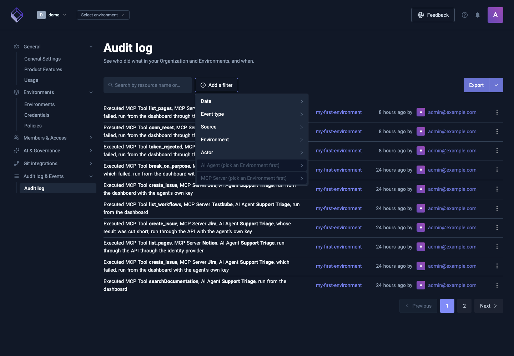
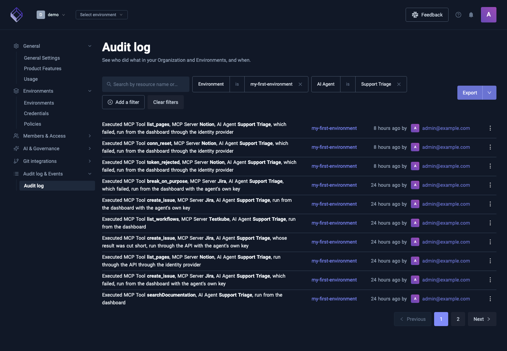
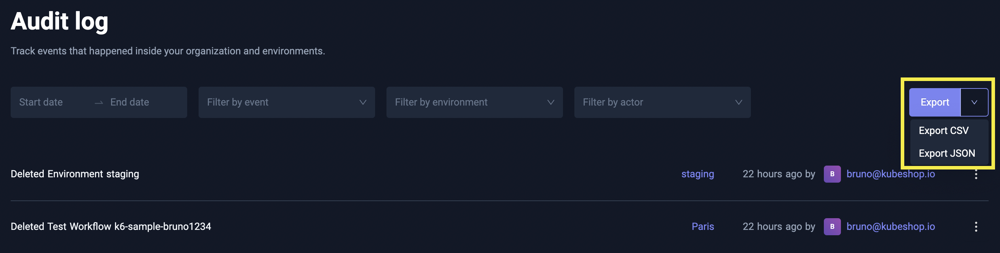

# Testkube Audit Logs

**Testkube** records significant events in its internal **Audit Log**,
providing **Organization Owners**, **Admins** and **Billers** with valuable insights into
how **Organization Members** are using the platform.

These logs can help monitor usage patterns, identify security risks, and ensure compliance with internal policies.

## Accessing Audit Logs

**Audit Logs** can be accessed via the **Audit log** menu item under the **Organization Management** page.

Here, **Organization Owners**, **Admins** and **Billers** can review detailed records of user actions. No other Organization role can read or export the Audit Log, whatever its Environment roles.

## Filtering Audit Logs

The search box above the list finds events by the name or ID of the resource they changed. Everything else is a filter you add from the **Add a filter** dropdown.

An added filter becomes a chip next to the dropdown. Click the chip to change its value, pick the same value again to clear that one filter, or use **Clear filters** to remove all of them at once.

| Filter          | What it narrows to                                                                                                                                                                                                                                           |
| --------------- | ------------------------------------------------------------------------------------------------------------------------------------------------------------------------------------------------------------------------------------------------------------ |
| **Date**        | **Today**, **Last 7 days**, **Last 30 days**, **Last 90 days**, or **Custom range** to pick a first and last day. A range always covers whole days.                                                                                                          |
| **Event type**  | One kind of event, for example **Environment Deleted** or **Test Workflow Executed**.                                                                                                                                                                        |
| **Source**      | Where the event came from: **UI**, **CLI**, **API Token**, **GitOps Agent**, **MCP**, **A2A** or **AI Agent**. A call made with an API token through MCP has the **MCP** source, and a tool an AI Agent called on an MCP Server has the **AI Agent** source. |
| **Environment** | One environment of the organization.                                                                                                                                                                                                                         |
| **Actor**       | The user or service that started the event.                                                                                                                                                                                                                  |
| **AI Agent**    | Everything one AI Agent did, including every tool it called.                                                                                                                                                                                                 |
| **MCP Server**  | Everything that went out to one MCP Server, whichever AI Agent called it.                                                                                                                                                                                    |

**AI Agent** and **MCP Server** need an **Environment** picked first, and their labels say so until you pick one. Both belong to an environment, so there is no list to choose from before that.

### Sharing a filtered view

The filters and the page you're on are kept in the URL, so a bookmarked or shared link opens the same view. For example, adding `?source=mcp` to the Audit log's address shows only the events that came through MCP, and `?environmentId=<environment ID>&aiAgentId=<AI Agent ID>` opens one AI Agent's trail. **Organization Management**, **AI & Governance**, **AI Audit Log** opens every tool call, both directions at once, by filtering on the **MCP Tool Called** event type. That item is only there for people who can see both AI & Governance and the Audit log.

## AI and MCP events

A tool call is recorded as an **MCP Tool Called** event in both directions:

- A call that arrives at an Environment's [MCP endpoint](/articles/mcp-hosted). Its source is **MCP**.
- A call an AI Agent makes outward, to one of its [MCP Servers](/articles/mcp-servers-for-ai-agents) or to a tool it carries itself. Its source is **AI Agent**.

One event type covers both, so one filter reads both directions and **Source** separates them.

In the list, the event reads **Executed MCP Tool** followed by the tool's name, then the MCP Server and the AI Agent when the call names them. Next comes **which failed** when the call failed, or **whose result was cut short** when the result was too long to keep; hover that for the reason, and a refused call shows neither. A call an AI Agent made ends with how the run started and how the agent signed in, so a whole row reads **Executed MCP Tool conn_reset, MCP Server Notion, AI Agent Support Triage, which failed, run from the dashboard through the identity provider**.

### Calls into an Environment's MCP endpoint

Each one records:

- The tool that was called, who called it, and the Environment.
- Whether the call succeeded, failed, or was refused before it ran (for example over a limit), and the reason, cut to 500 characters.
- How long the call took, for calls that ran.
- How the caller signed in: an API token or OAuth.
- The tool's identifier arguments, such as workflow, template, execution, file, Resource Group, report, board and insight series names or IDs, cut to 200 characters.

Workflow YAML, run configuration, tags, filters and log searches can hold secrets, so they're never recorded.

Every event recorded while serving one of these calls has the **MCP** source, including the actions the tool takes. A workflow run started through MCP is recorded as **Test Workflow Executed** with the **MCP** source, next to its **MCP Tool Called** event.

## AI Agent tool calls

The section above covers calls that come **in** through an Environment's MCP endpoint. An
[AI Agent](/articles/ai-agents) also calls **out**, to the [MCP Servers](/articles/mcp-servers-for-ai-agents)
it was given. Those calls are recorded as **MCP Tool Called** events too, with the **AI Agent** source. An
installation with MCP Servers for AI Agents turned off records only the calls that arrive at its
own MCP endpoint.

### What a record contains

- The **tool** that was called and the **MCP Server** it reached, including the built-in Testkube one.
- The **AI Agent** that called it.
- The **identity whose token was presented**, which is the actor of the event. For a run nobody
  started, such as an AI Trigger, that is the trigger's own token rather than a person.
- Whether it **succeeded, failed or was cut short**, how long it took, and the reason when it failed.
- **How the run started**: from the dashboard, the API, a trigger, a Git integration, MCP or A2A.
- **What was presented to the MCP Server**: no sign-in, the agent's own key, the person who asked,
  or your [identity provider](/articles/ai-identity-provider-sign-in).
- The **argument key names**, so a reviewer can see the shape of the call.

In the list, a row reads **Executed MCP Tool** followed by the tool, the MCP Server and the AI Agent,
and ends with how the run started and what was presented, for example _run from the dashboard through
the identity provider_. Use **Open details** on the row for the full record.

A tool the AI Agent carries itself, rather than one from an MCP Server, is recorded with no MCP
Server. It still shows under the **AI Agent** filter; it is the **MCP Server** filter that does not
reach it.

### What it deliberately omits, and why

**Argument values and the result body are not recorded.** For an MCP Server you connected, Testkube
does not know its tools, so it cannot decide in advance which of their arguments are safe to keep.
Recording the argument **key names** gives a reviewer the shape of a call without its contents.

This is also what keeps the trail readable by administrators without opening up the AI chats
themselves: the trail says **that** a tool was called, never what was said.

### When a trail is known to be incomplete

Recording a tool call is best effort, so that auditing never stops an agent from working. When a
record could not be written, the chat is marked, and every event of that chat then says
**this chat's trail has known gaps**, in the list, through the API and in the export.

Treat it as it reads. A chat without the mark is one where no gap is known, which is not the same as
a chat where one is impossible.

### Who may read it

Only **Organization Owners**, **Admins** and **Billers**, the same people who can already read the
rest of the Audit Log. Configuring an AI Agent is an Environment permission, so somebody can create
an agent and give it MCP Servers without being able to read its trail. An AI Agent's page carries an
**Audit log** link, filtered to that agent, and it is shown only to people who can follow it.

### Reading it outside the dashboard

`GET /organizations/{id}/audit` and `/audit/export` take `aiAgentId` and `mcpServerId`, so
"everything this agent did" is a query rather than a separate report. The CSV export carries the
same fields, with the incomplete-trail mark in a `trail_incomplete` column.

### What the trail does not answer

The trail answers what ran, where, under whose authority, and how slowly. It does not answer which
**arguments** caused a failure, because it does not keep them. That belongs to the trace Testkube
forwards to your own observability backend, which comes from the same instrumentation point. Use the
trail for who and whether, and the trace for why.

## Exporting Audit Logs

**Audit Logs** can also be exported for further analysis. Supported formats are:

- **CSV**
- **JSON**

The export carries whatever the list is narrowed to, search and every filter included, so one AI
Agent's or one MCP Server's trail can be taken out on its own. Clear the filters first to export
everything.

This makes it easy to integrate the audit log events with other reporting or analysis tools.

## Retention Period

By default, audit log events are retained for **30 days**. After this period, the logs are automatically
cleaned up to optimize storage. On Testkube On-Prem the Helm chart always sets the period from
`audit.cleanup.retentionPeriod`, so that value decides it, and the control plane's own 180-day default
never takes effect. Change it in the configuration below.

## Console Logging

By default, Testkube does **not** emit audit events to the console. Turning this on can help with real-time debugging and monitoring—but may expose sensitive user data.

- **Enable Console Logging**  
  Streams audit events to stdout.

- **Anonymize User Information**  
  When console logging is enabled, log only the user’s internal ID (not their username/email).

> ⚠️ Console logs can leak sensitive details. If you need privacy, enable anonymization.

See the **Configuration** section for the corresponding Helm parameters or environment variables.

## Configuration

If you are using **Testkube On-Prem**, audit log settings can be configured during installation via **Helm** parameters:

- **Retention Period**: Customize the number of days to retain audit log events - `audit.cleanup.retentionPeriod` (default: `30`)
- **Audit Log Cleanup**: Control whether automatic cleanup is enabled - `audit.cleanup.enabled` (default: `true`)
- **Cleanup Interval**: Define how often the cleanup job runs, using a cron expression - `audit.cleanup.cronInterval` (default: `0 3 * * *`)
- **Enable Console Logging**: Toggle whether audit log events should also be logged to console - `audit.logger.enabled` (default: `false`)
- **Anonymize User Information**: If console logging is enabled and this toggle is enabled, audit log events console logs will only contain user ID and not username/email - `audit.logger.forceIdentifyUsersById` (default: `false`)
