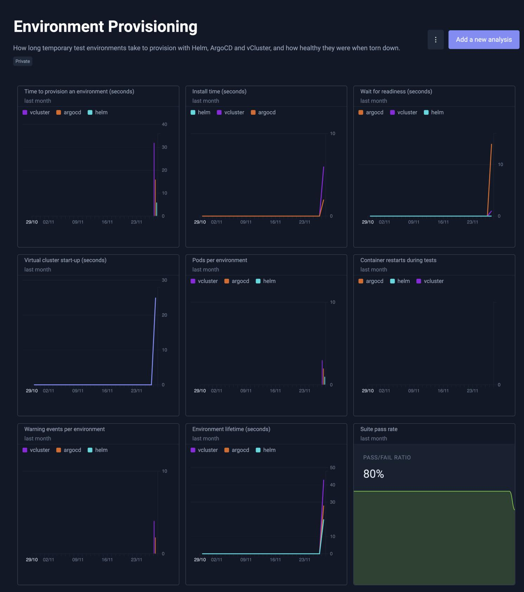

import RequiresCommercialWorkflows from "../_commercial-workflows-note.mdx";

# Provisioning Test Environments

A Test Workflow can do more than run tests. It can also install the application under test into a temporary namespace,
hand that environment to other Workflows and remove it when they are done. Every execution then tests a fresh copy of
the application, and parallel executions do not share state.

This section is about environments that a Workflow provisions itself. If your environments are provisioned outside
Testkube, for example by a CI/CD pipeline for every pull request, see
[Ephemeral Environments](/articles/ephemeral-environments) for how to run Workflows in them.

The examples in this section provision an environment in three ways:

- [Helm](environment-provisioning-helm) - installs a Helm chart into a temporary namespace.
- [ArgoCD](environment-provisioning-argocd) - creates an ArgoCD Application that deploys into a temporary namespace.
- [vCluster](environment-provisioning-vcluster) - creates a virtual cluster in a temporary namespace and installs a
  Helm chart into it.

All of them follow the pattern described below.

An AI tool or agent can also run these Workflows one by one, in place of the composite Workflow. See
[Provisioning an Environment from an AI Agent](environment-provisioning-agent).

## Namespace or Virtual Cluster

Two decisions shape an environment: where it lives, and how the application gets into it.

A temporary namespace is the fastest and cheapest place for an environment, and enough for an application that only
creates namespaced resources. A virtual cluster in a temporary namespace takes longer to create, but gives every
environment its own API server. Use one when the application installs CustomResourceDefinitions or other
cluster-scoped resources, deploys into several namespaces, or needs another Kubernetes version than the cluster of
the Runner.

In both cases the application is installed with the tool you already deploy it with. The Helm and ArgoCD examples
install into a namespace, and the vCluster example runs the Helm installation against the virtual cluster.

<RequiresCommercialWorkflows />

## The Pattern

Three Workflows do the work, and a fourth one orchestrates them with [`execute`](/articles/test-workflows-test-suites):

1. A **provisioning Workflow** takes the name of a namespace as a configuration parameter, deploys the application
   into it and waits until the application is ready. It publishes the URL of the application as an
   [output value](/articles/test-workflows-execution-sharing#publishing-output-values).
2. One or more **test Workflows** take that URL as a configuration parameter and run against it.
3. A **teardown Workflow** takes the name of the namespace and removes the environment.
4. A **composite Workflow** runs the three in sequence.

```yaml title="Composite Workflow"
apiVersion: testworkflows.testkube.io/v1
kind: TestWorkflow
metadata:
  name: env-helm-suite
spec:
  steps:
    - name: Provision environment
      execute:
        workflows:
          - name: env-helm-provision
            as: env
            config:
              namespace: "env-{{ execution.id }}"
    - name: Run tests
      execute:
        workflows:
          - name: env-smoke-test
            config:
              url: '{{ execution("env").outputs.url }}'
    - name: Tear down environment
      condition: always
      execute:
        workflows:
          - name: env-helm-teardown
            config:
              namespace: "env-{{ execution.id }}"
```

- `env-{{ execution.id }}` gives every execution of the composite Workflow its own namespace. The
  [execution ID](/articles/test-workflows-expressions) is unique and a valid part of a namespace name.
- `as: env` names the provisioning execution, so that the next step can read the URL it published with
  `execution("env").outputs.url`. See [Sharing Data Between Executions](/articles/test-workflows-execution-sharing).
- `condition: always` runs the teardown when the provisioning or a test fails. The composite Workflow still fails
  in that case.
- The `Run tests` step can list any number of Workflows, which then run in parallel against the same environment.

### The test Workflow

The test Workflow knows nothing about how the environment was provisioned. It only needs the URL of the application,
which makes it reusable against any environment, temporary or not. The examples use this one:

```yaml title="Test Workflow"
apiVersion: testworkflows.testkube.io/v1
kind: TestWorkflow
metadata:
  name: env-smoke-test
spec:
  config:
    url:
      type: string
  steps:
    - name: Call the application
      run:
        image: curlimages/curl:8.11.1
        shell: |
          curl -sS --fail-with-body "{{ config.url }}/healthz"
          curl -sS --fail-with-body "{{ config.url }}/version"
```

## Where the Tests Run

The test Workflows run in the namespace of the Runner and reach the application through its in-cluster DNS name,
`<service>.<namespace>.svc.cluster.local`. They do not run inside the temporary namespace.

A Runner only schedules executions in the namespaces it was configured for when it was installed
([Execution Namespace](/articles/test-workflows-job-and-pod#execution-namespace)). A Workflow that sets `job.namespace`
to a namespace created during the execution is aborted with `namespace <name> not supported`.

To run tests inside an environment instead, the Runner has to know its namespace beforehand, or the environment needs
a Runner of its own. [Ephemeral Environments](/articles/ephemeral-environments) describes both setups.

An application in a virtual cluster is reachable in the same way, through the copy of its Service that vCluster
creates in the temporary namespace. See [Reaching the application](environment-provisioning-vcluster#reaching-the-application).

If a NetworkPolicy in the temporary namespace restricts incoming traffic, allow traffic from the namespace of the Runner.

## Permissions

The default ServiceAccount of a Workflow execution cannot create namespaces or deploy applications. The provisioning
and teardown Workflows therefore run with a dedicated ServiceAccount, which they select with
[`pod.serviceAccountName`](/articles/test-workflows-job-and-pod#service-account). The test Workflows keep the default one.

Each example lists the permissions that ServiceAccount needs. Creating it requires access to the cluster of the Runner
and is done once, not by a Workflow.

## Environment Metrics

The provisioning and teardown Workflows of the examples also measure the environment. Each writes a file in
[Influx Line Protocol](/articles/custom-metrics-in-insights) and uploads it as an artifact, which makes the values
available as custom metrics in [Insights](/articles/test-insights).

| Metric                                        | Written by   | Meaning                                                                    |
| --------------------------------------------- | ------------ | -------------------------------------------------------------------------- |
| `environment_provisioning_total_seconds`      | Provisioning | Time from the start of the provisioning until the application is ready     |
| `environment_provisioning_install_seconds`    | Provisioning | Time for the Helm installation, or until ArgoCD reports `Synced`           |
| `environment_provisioning_ready_wait_seconds` | Provisioning | Time from the end of the installation until every Pod is available         |
| `environment_provisioning_cluster_seconds`    | Provisioning | Time to create the virtual cluster (vCluster only)                         |
| `environment_provisioning_pods`               | Provisioning | Number of Pods in the temporary namespace                                  |
| `environment_provisioning_resources`          | Provisioning | Number of resources the Application manages (ArgoCD only)                  |
| `environment_health_container_restarts`       | Teardown     | Container restarts in the environment, counted before it is removed        |
| `environment_health_warning_events`           | Teardown     | Kubernetes `Warning` events in the namespace, counted before it is removed |
| `environment_health_lifetime_seconds`         | Teardown     | Age of the temporary namespace when it is removed                          |

The two health metrics show how the application behaved while it was tested. A restart or a `Warning` event, such as
a failed probe or an out-of-memory kill, points at a problem even when every test passed.

Every record carries a `provisioner` tag (`helm`, `argocd` or `vcluster`) and an `app` tag, so a report in Insights
can segment a metric by them, for example to compare how long the three ways of provisioning take. The name of the
namespace is not a tag on purpose: it is unique for every execution and would create a new series each time.

The board below charts these metrics for the three examples, each report segmented by the `provisioner` tag. See
[Test Insights](/articles/test-insights) for how to build a board.



## Cleaning Up after Aborted Executions

`condition: always` covers failures and timeouts. It does not cover an abort: when a composite Workflow is aborted or
canceled, its remaining steps do not run, and the environment stays behind.

To remove these orphaned environments, the provisioning Workflows label everything they create with
`testkube.io/ephemeral-environment: "true"`. A cleanup Workflow, [scheduled](/articles/scheduling-tests) to run every
hour, deletes the labeled environments that are older than a configurable age. Each example includes its cleanup
Workflow.

:::warning
The cleanup Workflow goes by age alone. Set `maxAgeSeconds` higher than the longest time your tests need, or it removes
an environment that is still in use.
:::
