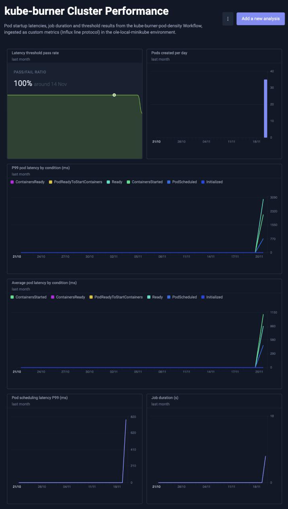

import KubeBurnerWorkflow from "../../workflows/kube-burner-workflow.md";
import KubeBurnerRbac from "../../workflows/kube-burner-rbac.md";
import StandaloneMetricsNote from "./_standalone-metrics-note.mdx";

# Basic kube-burner Example

[kube-burner](https://kube-burner.github.io/kube-burner/) is a Cloud Native Computing Foundation (CNCF) tool that stresses a Kubernetes cluster by creating, deleting and patching objects at scale, and measures how the cluster responds. Running it from Testkube lets you track control plane and kubelet performance over time, run it on a schedule or after a cluster upgrade, and fail an execution when latencies cross a threshold.

The example below runs a small pod density test: it creates a number of namespaces, each with one pod, measures how long the scheduler and kubelet take to start the pods, and deletes everything afterwards.

## Prerequisites

kube-burner talks to the Kubernetes API of the cluster it runs in, so the execution pod needs a ServiceAccount allowed to create and delete the objects of the test. The default ServiceAccount that Testkube uses for executions does not have these permissions.

Apply the following to the cluster where your Testkube Runner Agent runs, in the namespace where it runs executions (`testkube` in this example):

<KubeBurnerRbac />

```bash
kubectl apply -f kube-burner-rbac.yaml
```

The ClusterRole only covers what this example creates: namespaces and pods, the events the `podLatency` measurement watches, and read access to nodes. If you change the workload to create other objects, such as Deployments or Services, add them to the ClusterRole.

:::warning
kube-burner generates real load on the cluster it runs against. Start with a small number of iterations and run it against a test or staging cluster before you point it at a shared one.
:::

## The Workflow

Below is the Workflow. You can paste it into the YAML of a new or existing Workflow, after updating `metadata.namespace` to the namespace of your Testkube Agent.

<KubeBurnerWorkflow />

- `spec.config` defines three parameters you can set when you run the Workflow: the number of iterations, the queries per second that kube-burner sends to the API server, and the P99 pod ready latency threshold.
- `spec.pod.serviceAccountName` runs the execution pod with the `kube-burner` ServiceAccount from the prerequisites.
- `spec.content.files` writes three files into the execution pod:
  - `/data/config.yml` is the kube-burner configuration. It enables the `podLatency` measurement with a threshold on the P99 `Ready` latency, writes the collected metrics to `/data/metrics` with the `local` indexer, and defines one `pod-density` job that creates a namespace per iteration. `gc: true` deletes the namespaces when the test ends, and `preLoadImages: false` skips the DaemonSet kube-burner otherwise creates to pull images in advance.
  - `/data/pod.yml` is the object template that kube-burner creates in each iteration.
  - `/data/kube-burner-to-lp.py` converts the kube-burner metrics to custom metrics for Insights, as described in [Custom metrics in Insights](#custom-metrics-in-insights).
- The `Run kube-burner` step uses the official `quay.io/kube-burner/kube-burner` image, whose entrypoint is the `kube-burner` binary, and passes it the `init` command. It passes the execution ID as the kube-burner run ID (`--uuid`), which ties the collected metrics to the execution.
- The `Convert metrics to line protocol` step runs the conversion script in a `python` image. `condition: always` runs it even when kube-burner fails on a latency threshold, so that a failed execution still records its metrics.
- `artifacts` uploads the JSON files that kube-burner writes to `/data/metrics`, and the `kube-burner.lp` file that the conversion script writes next to them.

### Go templates in content files

kube-burner object templates are Go templates, such as `{{.Iteration}}`, and Testkube evaluates [expressions](/articles/test-workflows-expressions) inside double curly brackets in content files. To pass a Go template through to kube-burner unchanged, wrap it in a Testkube string expression:

```yaml
name: pod-density-{{ "{{.Iteration}}" }}-{{ "{{.Replica}}" }}
```

Testkube renders this as `pod-density-{{.Iteration}}-{{.Replica}}`, which kube-burner then fills in. Expressions without the quotes, such as `{{ config.iterations }}` in the configuration file, work as usual.

## Running the Workflow

Create and run the Workflow with the Testkube CLI:

```bash
testkube create testworkflow -f kube-burner-workflow.yaml
testkube run testworkflow kube-burner-pod-density -f
```

Override the parameters with `--config`, for example to create more pods:

```bash
testkube run testworkflow kube-burner-pod-density --config iterations=50 --config qps=10 -f
```

The log output shows the iterations, the latency quantiles of each pod condition and the garbage collection of the created namespaces:

```text
level=info msg="Triggering job: pod-density"
level=info msg="Waiting up to 5m0s for actions to be completed"
level=info msg="Job pod-density took 6s"
level=info msg="Evaluating latency thresholds"
level=info msg="pod-density: PodScheduled 99th: 875 ms max: 976 ms avg: 529 ms"
level=info msg="pod-density: Ready 99th: 4500 ms max: 5000 ms avg: 3000 ms"
level=info msg="File /data/metrics/podLatencyQuantilesMeasurement-pod-density.json now contains 6 documents"
level=info msg="Deleting 10 namespaces with label: kube-burner.io/job=pod-density"
```

When the P99 `Ready` latency is higher than `readyThreshold`, kube-burner logs an error and exits with code 1, so the execution fails:

```text
level=error msg="podLatencyQuantilesMeasurement: P99 Ready latency (0.50s) higher than configured threshold: 100ms"
```

Testkube uploads the artifacts whether the execution passes or fails:

- `metrics/podLatencyMeasurement-pod-density.json` has the latencies of every pod.
- `metrics/podLatencyQuantilesMeasurement-pod-density.json` has the P50, P95, P99, maximum and average latency of each pod condition.
- `metrics/jobSummary.json` has the duration, settings and result of the job, and the Kubernetes version and node count of the cluster.
- `metrics/kube-burner.lp` has the same results as custom metrics for Insights.

## Custom metrics in Insights

The JSON files in the artifacts are kube-burner's own format. To chart the results across executions, the `Convert metrics to line protocol` step turns them into [custom metrics](/articles/custom-metrics-in-insights): it writes InfluxDB Line Protocol to `metrics/kube-burner.lp`, and Testkube ingests the file when it uploads the artifacts. The upload logs a `Processing InfluxDB line protocol report: metrics/kube-burner.lp` line when it detects the file.

<StandaloneMetricsNote />

The script writes one record per pod condition, with the condition and the job name as tags, and one record for the job:

```text title="metrics/kube-burner.lp"
kube_burner_pod_latency_ms,job=pod-density,condition=PodScheduled p50=356.0,p95=753.0,p99=753.0,max=860.0,avg=415.0
kube_burner_pod_latency_ms,job=pod-density,condition=Ready p50=0.0,p95=1000.0,p99=1000.0,max=1000.0,avg=400.0
kube_burner_job,job=pod-density elapsed_seconds=4.0,iterations=10i,qps=5i,nodes=1i,passed=1i
```

This creates the following metrics in Insights:

| Metric                                                           | Identity           | Value                                                            |
| ---------------------------------------------------------------- | ------------------ | ---------------------------------------------------------------- |
| `kube_burner_pod_latency_ms_p50`, `_p95`, `_p99`, `_max`, `_avg` | `job`, `condition` | Latency quantiles of each pod condition, in milliseconds         |
| `kube_burner_job_elapsed_seconds`                                | `job`              | Duration of the job                                              |
| `kube_burner_job_iterations`, `kube_burner_job_qps`              | `job`              | Settings of the run, to tell runs of different sizes apart       |
| `kube_burner_job_nodes`                                          | `job`              | Number of nodes in the cluster                                   |
| `kube_burner_job_passed`                                         | `job`              | `1` when the run met the latency thresholds, `0` when it did not |

In [Insights](/articles/test-insights), the metrics appear under **Custom Report Metrics**. Segment a latency metric by `condition` to compare, for example, the scheduling and ready latencies across executions.

To follow them together, add them to an [Insights board](/articles/test-insights#insights-boards). The board below has these analyses, each filtered to the `kube-burner-pod-density` Workflow:

- The pass/fail ratio of the Workflow, which shows how often the run met its latency threshold.
- `kube_burner_job_iterations` with the `sum` aggregate, for the number of pods created per day.
- `kube_burner_pod_latency_ms_p99` with the `max` aggregate, and `kube_burner_pod_latency_ms_avg` with the `avg` aggregate, both segmented by `condition`.
- `kube_burner_pod_latency_ms_p99` filtered to `condition` `PodScheduled`, which kube-burner measures in milliseconds rather than whole seconds.
- `kube_burner_job_elapsed_seconds`, for the duration of the job.



:::note
kube-burner computes most pod condition latencies from the condition timestamps of the pods, which Kubernetes records in whole seconds. Small runs on a fast cluster can therefore show a latency of `0`, and the values move in steps of 1000 milliseconds.
:::

To chart more of kube-burner's output, extend the script: for example, read other measurement files from `/data/metrics`, or add tags such as the cluster name. Keep tag values to a small, fixed set, as the [custom metrics](/articles/custom-metrics-in-insights#segmentation-and-filtering) page recommends.

## Going further

- Use one of the [kube-burner example workloads](https://github.com/kube-burner/kube-burner/tree/main/examples/workloads), such as `api-intensive` or `crd-scale`, by checking out the kube-burner repository with [`content.git`](/articles/test-workflows-content#git-repository) and passing the path of its configuration file to `--config`. Extend the ClusterRole with the objects the workload creates.
- Add [Prometheus metrics](https://kube-burner.github.io/kube-burner/latest/observability/metrics/) to the run by adding a `metrics` profile and the URL of your Prometheus server to the `metricsEndpoints` section. kube-burner then indexes API server, etcd and kubelet metrics for the time window of the test.
- Run the Workflow on a schedule, or after a cluster or network plugin upgrade with a [Test Trigger](/articles/test-triggers), to catch regressions in cluster performance.
