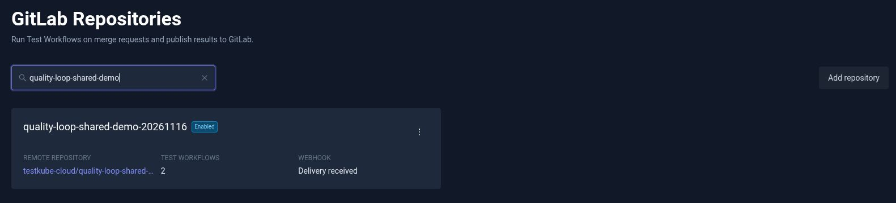
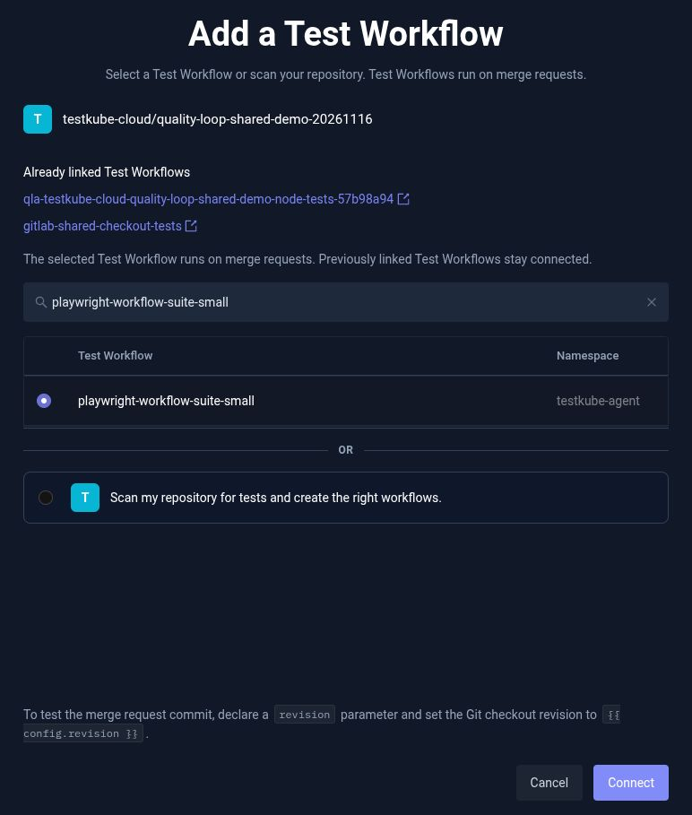
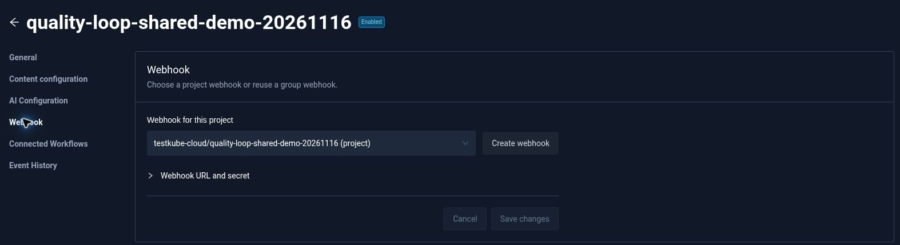
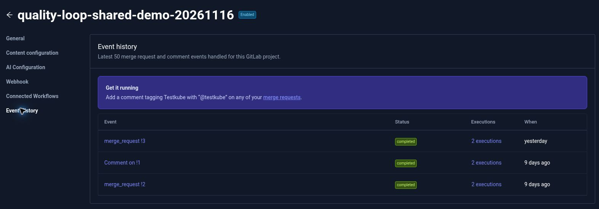
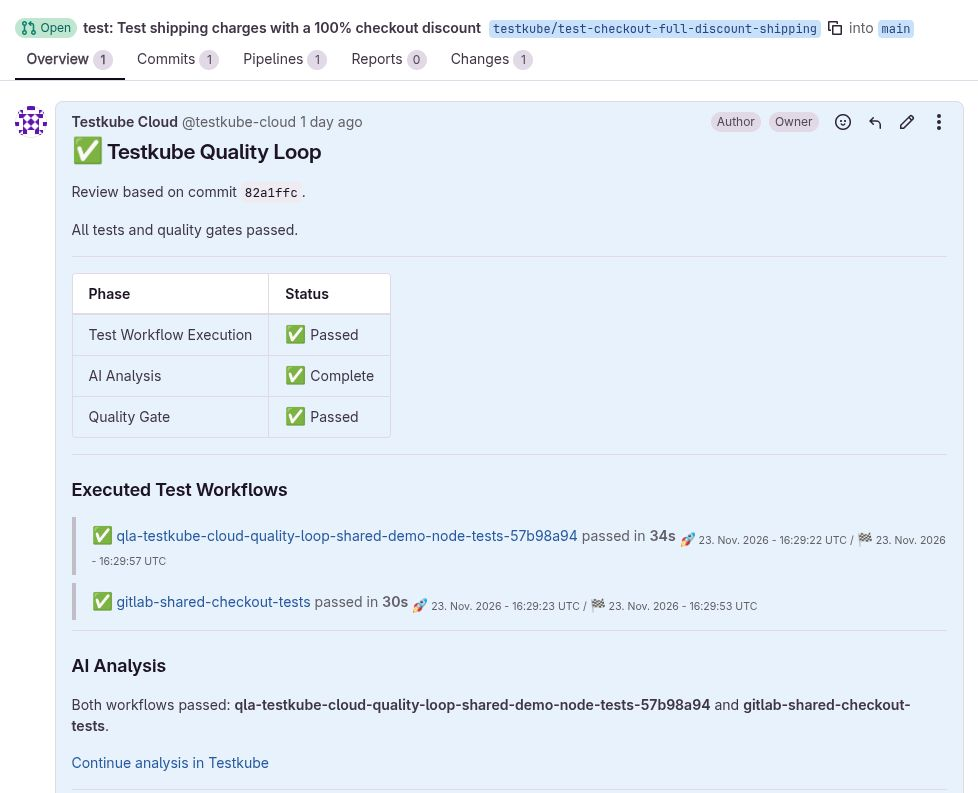
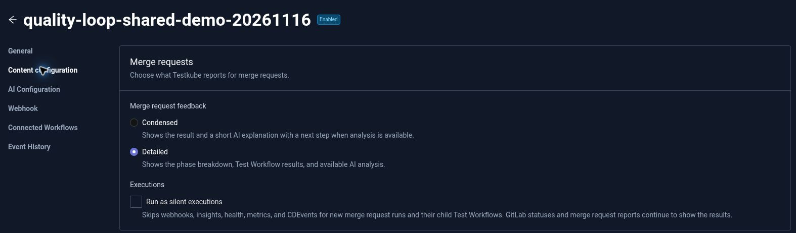
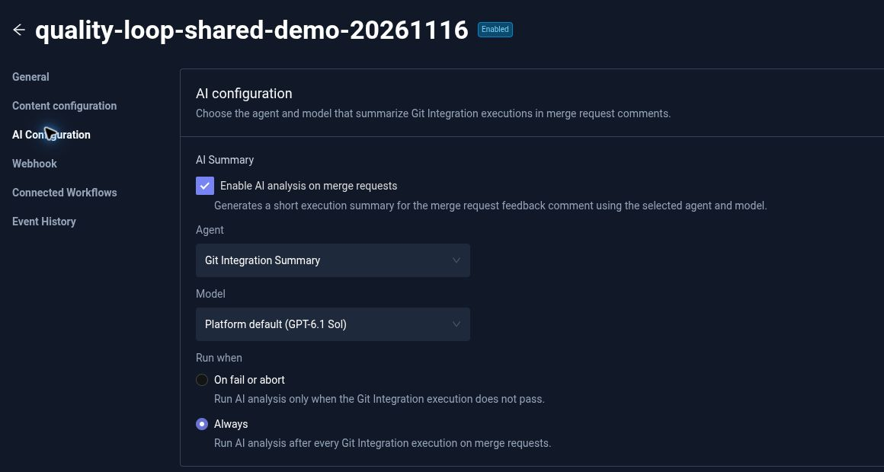
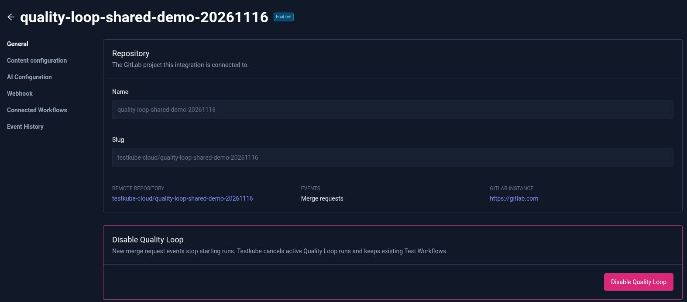
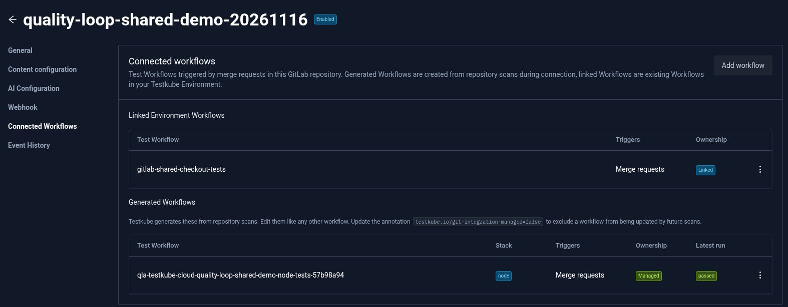

<!-- Before publishing, confirm production Cloud availability and update the version requirements to the first supported stable self-hosted release. -->

# GitLab Quality Loop

Connect a GitLab project to a Testkube environment to run Test Workflows on merge requests. Testkube posts commit statuses and updates a merge request comment with results, links to executions, and an optional AI summary.

To call Testkube from a GitLab CI job, see [Testkube GitLab CI](/articles/gitlab).

## Before you start

- A Testkube environment with a connected [Runner](/articles/agents-overview).
- A Testkube organization Admin or Owner to set up the GitLab connection, and an environment Admin to manage the repository integration.
- For self-hosted Testkube, set `global.features.gitIntegration: true` in your Control Plane Helm values. The default Helm values hide **GitLab Repositories** in the dashboard.
- The **Maintainer** or **Owner** role in GitLab to create a project webhook. Group webhooks require the group **Owner** role. See [GitLab webhook prerequisites](https://docs.gitlab.com/user/project/integrations/webhooks/#create-a-webhook).

:::warning Version requirements
Generated workflows and workflows using `authType: gitlab` require a Control Plane that supports GitLab checkout and Runner **2.16.0-rc.1** or later. Runner **2.15.3** lacks support for this checkout method.
:::

## Connect GitLab

Open **Organization Management > Git integrations > GitLab** and select **Connect GitLab**.

1. Choose **OAuth**, enter your GitLab instance URL, select **Enable Quality Loop**, and copy the **Callback URL**.
2. In GitLab, create a [confidential OAuth application](https://docs.gitlab.com/integration/oauth_provider/) with that redirect URI and the `api`, `read_api`, and `write_repository` scopes.
3. Enter the **Application ID** and **Client secret** in Testkube. Select **Connect with OAuth** and authorize the application.
4. Under **Repositories**, turn on **Repository access** for your project.

For an existing OAuth connection, add the `api` scope to its GitLab application and select **Upgrade GitLab access** in Testkube. You can also connect with a GitLab access token that has the `api` scope and access to the project. GitLab grants the `api` scope across the projects and groups accessible to the authorizing account. Testkube uses the repositories you enable.

## Connect a repository

In your environment, open **Manage > Events & Triggers > GitLab Repositories** and select **Add repository**. Pick the connection and project, then choose one of these options and select **Connect**.

- **Select an existing Test Workflow** to run it with its own checkout settings.
- **Scan my repository for tests and create the right workflows** to generate workflows from tests detected on the default branch. Review the generated commands and Runner selection before using them.

To add another workflow later, use **Connected Workflows > Add workflow**, as shown below.

To run an existing workflow against the merge request's head commit, declare a string `revision` parameter under `spec.config` and set `spec.content.git.revision` to `{{ config.revision }}`. Testkube supplies the commit SHA. Use `authType: gitlab` to let Quality Loop provide checkout credentials for the connected project.

## Configure the webhook

1. In the repository's **Webhook** tab, select **Create webhook**. Choose **Project webhook**, or use a **Group webhook** for multiple projects on the same GitLab connection and Testkube environment.
2. Choose it under **Webhook for this project** and select **Save changes**. Expand **Webhook URL and secret**.
3. In GitLab, go to **Settings > Webhooks** and paste the Testkube URL and secret token. To use a [GitLab signing token](https://docs.gitlab.com/user/project/integrations/webhooks/#signing-tokens), provide that token under **Use an existing secret or signing token** when creating the webhook in Testkube.
4. Enable **Merge request events** and **Comments** in GitLab, leave SSL verification enabled, and save.

Once Testkube receives a delivery, the repository list shows **Delivery received**.

## What triggers a run

| Event         | When Testkube runs the connected workflows                                                                                                                                        |
| ------------- | --------------------------------------------------------------------------------------------------------------------------------------------------------------------------------- |
| Merge request | You open or reopen a non-draft merge request, mark a draft ready for review, or push a new commit to an open non-draft merge request.                                             |
| Comment       | An active project member with **Developer** access or higher posts a new `@testkube` comment on an open, non-draft merge request. Post a new comment to rerun the current commit. |

Merge requests from forks and edits to existing comments do not trigger runs. Open **Event History** and select an execution count to inspect the runs for that event.

## Results on GitLab

Testkube posts a commit status and updates the merge request comment as workflows run. From the comment, open a workflow result to see its logs in Testkube. When AI analysis is available, use **Continue analysis in Testkube** to open the conversation.

## Configuration

### Merge request feedback

Under **Content configuration**, choose **Condensed** for a short result with collapsible workflow details or **Detailed** for the phase breakdown, workflow timings, and full AI summary. **Detailed** is the default.

**Run as silent executions** skips Testkube execution webhooks, insights, health, metrics, and CDEvents. GitLab still receives statuses and comments.

### AI summary

Under **AI Configuration**, enable AI analysis and select an agent and model. Choose **On fail or abort** to analyze unsuccessful runs or **Always** to include successful runs.

### Enable or disable Quality Loop

Use **General** to disable Quality Loop. This stops new runs and cancels active ones. You can enable it again when at least one workflow is connected.

## Generated workflows

Open **Connected Workflows** to see linked and generated workflows. To scan again, choose **Add workflow** and select the scan option.

Rescanning replaces managed workflow definitions, including custom Runner targeting. Set the workflow annotation `testkube.io/git-integration-managed: "false"` to preserve your edits on future scans.

## Troubleshooting

- **The project is missing from the picker.** Check that the GitLab connection has API write access and that the project is enabled under **Repositories**.
- **The repository is awaiting a webhook.** Check the URL, token, and enabled events in GitLab's **Recent events**. Check **Event History** in Testkube for the resulting run.
- **The checkout fails or uses the wrong commit.** Verify the Runner supports GitLab checkout and that the workflow uses `{{ config.revision }}`. Testkube supplies Quality Loop checkout credentials during integration runs.
