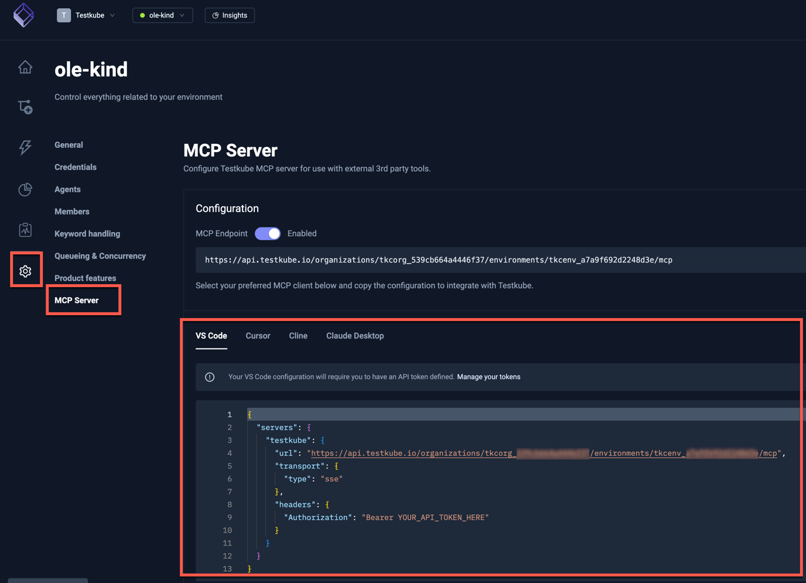

# Testkube Control Plane MCP Endpoint

The Testkube Control Plane provides an MCP endpoint that allows you to connect directly to Testkube without running a local MCP server. This is the recommended approach for most users.

:::tip
This is the easiest way to get started with the Testkube MCP Server - no local installation required!
:::

## Why Use the Control Plane MCP Endpoint?

- **No local setup** - No need to install the Testkube CLI or Docker
- **Remote access** - Connect to Testkube from any location without local setup
- **Always available** - The endpoint is always running and accessible
- **Simplified deployment** - No need to manage a local MCP server process
- **Centralized configuration** - Manage authentication and permissions through the Control Plane
- **Team collaboration** - Multiple users can connect to the same endpoint
- **Automatic updates** - Control Plane updates are handled automatically
- **Consistent performance** - Leverages the Control Plane's infrastructure

## Prerequisites

- **Access to a Testkube Environment** - You need an active Testkube organization and environment
- **An AI tool that supports MCP** - Such as Claude Code, VS Code with GitHub Copilot, Cursor, or Claude Desktop

## Authentication

The hosted MCP endpoint supports two authentication methods:

### OAuth (Recommended)

OAuth lets MCP clients authenticate through your browser — no tokens to create or manage. Your MCP client handles discovery and authentication automatically. You just see a browser popup to log in.

This is the recommended approach for individual users because:

- No API keys to create, copy, or rotate
- Per-user identity for seat tracking and audit trails
- Works with your existing SSO provider (Google, GitHub, SAML, etc.)

### API Token

API tokens are better for automation, CI/CD, or shared environments where browser login isn't practical. See [Obtaining an API Token](#obtaining-an-api-token) below.

## Endpoint URL Structure

The Control Plane MCP endpoint follows this URL pattern:

```
https://api.testkube.io/organizations/{organization_id}/environments/{environment_id}/mcp
```

Replace:

- `{organization_id}` with your Testkube organization ID (e.g., `tkcorg_076487a004a7f6fb`)
- `{environment_id}` with your environment ID (e.g., `tkcenv_d19e797ff2c1449b`)

:::tip Finding Your IDs
You can find your organization and environment IDs in the Testkube Dashboard URL or by running:

```bash
testkube get context
```

:::

## Configuration with OAuth

With OAuth, you just provide the endpoint URL. No headers, no tokens — your MCP client handles authentication automatically via a browser login.

### Claude Code

Adding the server and authenticating are two separate steps.

**1. Register the server.** This only saves the configuration — it does not authenticate:

```bash
claude mcp add --transport http testkube https://api.testkube.io/organizations/{organization_id}/environments/{environment_id}/mcp
```

**2. Check the status.** Running `claude mcp list` shows the server as `Needs authentication`:

```bash
claude mcp list
# testkube: https://api.testkube.io/organizations/.../mcp (HTTP) - ! Needs authentication
```

:::info `Needs authentication` is expected
This status is **not** an error. `claude mcp add` only registers the endpoint — it does not sign you in. The endpoint correctly responds that a login is required, and Claude Code surfaces that as `Needs authentication` until you complete the next step.
:::

**3. Authenticate.** Start Claude Code, then open the MCP manager and sign in:

```bash
claude
```

Inside the session, run `/mcp`, select **testkube**, choose **Authenticate**, and complete the login in the browser window that opens. Claude Code stores the token, so you won't need to repeat this in future sessions.

**4. Confirm.** Back in Claude Code, the server status changes to `connected` and the Testkube tools become available. You can verify any time with `/mcp`.

### VS Code (GitHub Copilot)

Add to your MCP settings (`~/Library/Application Support/Code/User/mcp.json` on macOS):

```json
{
  "servers": {
    "testkube": {
      "type": "http",
      "url": "https://api.testkube.io/organizations/{organization_id}/environments/{environment_id}/mcp"
    }
  }
}
```

### Cursor / Claude Desktop

These clients also support OAuth automatically. Add a remote MCP server with the endpoint URL — the client will handle the OAuth flow.

## Configuration with API Token

If you prefer API tokens (for automation or shared environments), provide the token in an `Authorization` header. The endpoint uses the Streamable HTTP transport, so configure it as an HTTP server, not an SSE one. In VS Code:

```json
{
  "servers": {
    "testkube": {
      "type": "http",
      "url": "https://api.testkube.io/organizations/{organization_id}/environments/{environment_id}/mcp",
      "headers": {
        "Authorization": "Bearer YOUR_API_TOKEN_HERE"
      }
    }
  }
}
```

In Claude Code:

```bash
claude mcp add --transport http testkube https://api.testkube.io/organizations/{organization_id}/environments/{environment_id}/mcp \
  --header "Authorization: Bearer YOUR_API_TOKEN_HERE"
```

Replace:

- `{organization_id}` with your actual organization ID
- `{environment_id}` with your actual environment ID
- `YOUR_API_TOKEN_HERE` with your Testkube API token

## Obtaining an API Token

1. Log in to your Testkube Dashboard
2. Navigate to **Organization Settings** → **API Tokens**
3. Create a new API token with appropriate permissions
4. Copy the generated API token (you won't be able to see it again)

See [API Token Management](/articles/organization-management#api-tokens) for more details.

## Control Plane Endpoint in the Testkube Dashboard

The Testkube Dashboard provides convenient access to the Control Plane MCP endpoint for your Testkube Environments together with
configuration examples for common IDEs, simply navigate to the Environment Settings page and select the **Testkube MCP Server** tab:



:::info Testkube Cloud vs Self-Hosted
The MCP endpoint feature shown in the screenshots above is **enabled by default** in Testkube Cloud.

For **self-hosted installations**, you must enable this feature in your Helm configuration (see below) before the **Testkube MCP Server** settings tab and endpoint become available.
:::

## Enabling MCP for Self-Hosted Deployments

:::warning Self-Hosted Configuration Required
For self-hosted Testkube Enterprise installations, the MCP endpoint is **disabled by default**. You must enable it via Helm configuration before it becomes available.
:::

### Step 1: Enable MCP in Helm Configuration

Add the following environment variables to your Helm values file:

```yaml
testkube-cloud-api:
  additionalEnvVars:
    - name: MCP_ENABLED
      value: "true"

testkube-cloud-ui:
  additionalEnv:
    MCP_ENABLED: true
```

### Step 2: Secure the OAuth Sign-In (Optional)

OAuth works without further configuration. When an MCP client signs in, the Control Plane sends the browser to a consent page in the Testkube Dashboard, where the person signs in with any sign-in method the Dashboard offers and approves the client. Dex needs no extra redirect URI for this.

The Control Plane seals each sign-in request with a key. If you don't provide one, it generates a key once and keeps it in its database, encrypted with the credentials master password when one is set. To keep a read of the database from being enough to forge a sign-in, store the key in a Kubernetes Secret, under `key`, and name the Secret in your Helm values:

```bash
kubectl create secret generic testkube-oauth-sign-in --namespace testkube \
  --from-literal=key="$(openssl rand -base64 32)"
```

```yaml
testkube-cloud-api:
  api:
    oauthSignIn:
      existingSecret: testkube-oauth-sign-in
```

To rotate the key, put the new key under `key` and the old one under `previous-key`. Sign-ins and clients sealed with the old key keep working while it's there.

:::note
Before 2.16.0, MCP clients signed in through Dex, at `/mcp/auth/callback`. That redirect URI is no longer used, and you can remove it from your Dex configuration. Clients configured with the older `/mcp/auth/` endpoints keep working.
:::

### Step 3: Enable MCP per Environment

After deploying with MCP enabled, you need to enable it for each environment:

1. Log in to your Testkube Dashboard
2. Navigate to **Environment Settings** → **Testkube MCP Server**
3. Turn the switch on, so that it shows **Enabled**
4. Copy the configuration for your preferred IDE

### Step 4: Configure Your AI Tool

For self-hosted instances, use your custom control plane URL:

If your control plane or connected MCP integrations rely on certificates signed
by a private CA, configure trust using
[Using a private certificate authority (CA)](/articles/private-ca).

**With OAuth (recommended):**

```json
{
  "servers": {
    "testkube": {
      "type": "http",
      "url": "https://your-control-plane.example.com/organizations/{organization_id}/environments/{environment_id}/mcp"
    }
  }
}
```

**With API Token:**

```json
{
  "servers": {
    "testkube": {
      "type": "http",
      "url": "https://your-control-plane.example.com/organizations/{organization_id}/environments/{environment_id}/mcp",
      "headers": {
        "Authorization": "Bearer YOUR_API_TOKEN_HERE"
      }
    }
  }
}
```

Replace `your-control-plane.example.com` with your self-hosted control plane domain, and use your actual organization ID, environment ID, and API token.

## Troubleshooting

The endpoint checks each request before any tool runs. When it refuses one, it answers with an HTTP error rather than a tool result, and whether you see the message depends on your MCP client.

| Response                | Cause                                                                                                                                                                                         |
| ----------------------- | --------------------------------------------------------------------------------------------------------------------------------------------------------------------------------------------- |
| `404 Not Found`         | MCP is not enabled on the Control Plane. On a self-hosted install, set `MCP_ENABLED` as in [Step 1](#step-1-enable-mcp-in-helm-configuration).                                                |
| `403 Forbidden`         | MCP is turned off for this environment ([Step 3](#step-3-enable-mcp-per-environment)), or you don't have read access to the environment.                                                      |
| `402 Payment Required`  | The organization is blocked.                                                                                                                                                                  |
| `429 Too Many Requests` | The organization reached the [MCP calls of its plan](/articles/ai-usage#mcp-calls), either for the period or for the rolling rate. Only tool calls count, and a refused call doesn't use one. |

A tool call that the endpoint lets through is then authorized like the API call it makes. Reading needs read access to the environment, running and aborting executions or changing their tags needs Run, and creating or updating workflows and templates needs Write. When your role doesn't allow it, the tool returns an error that the AI tool can read.
