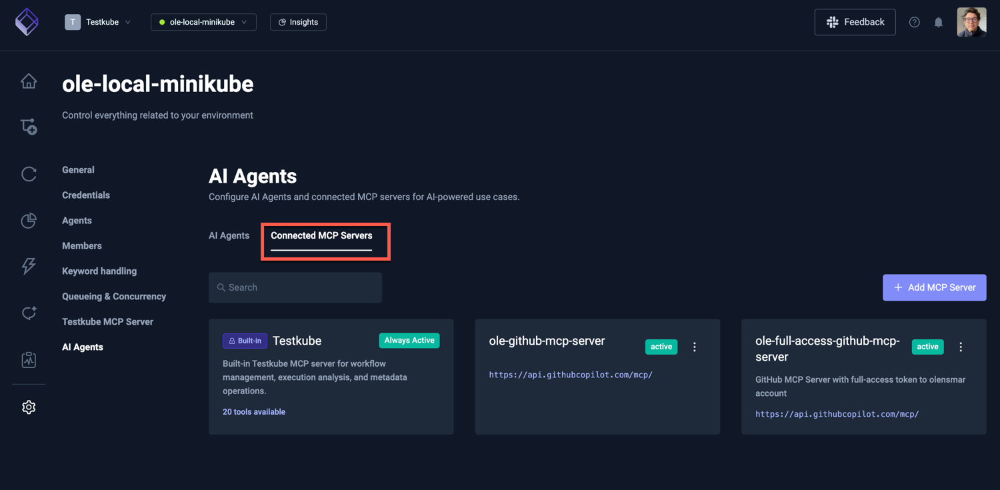
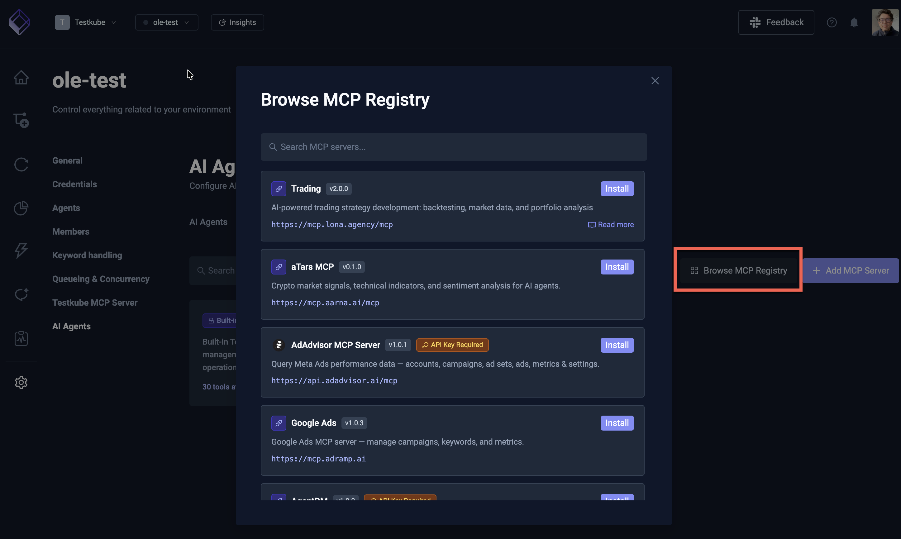
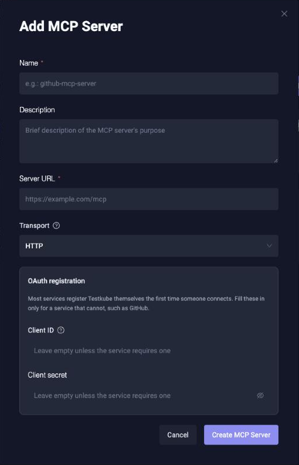
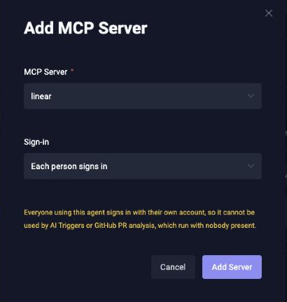
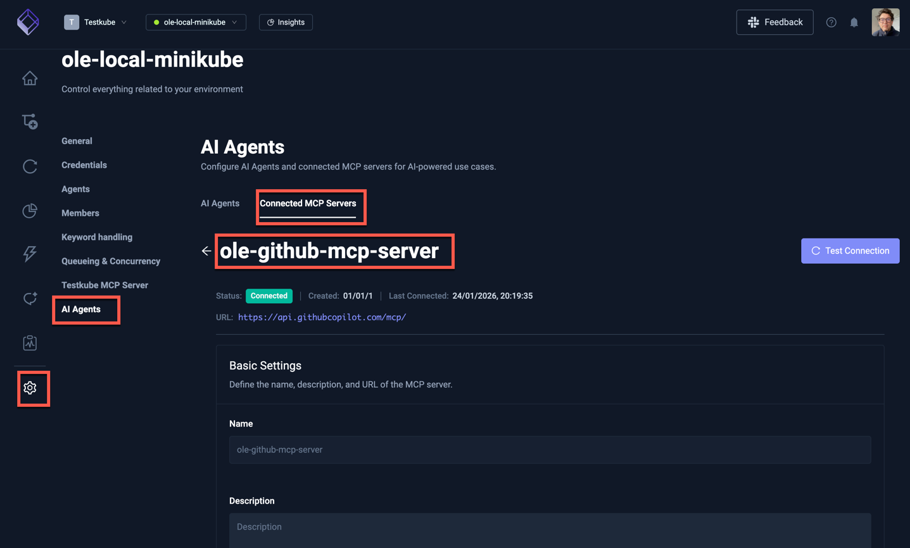
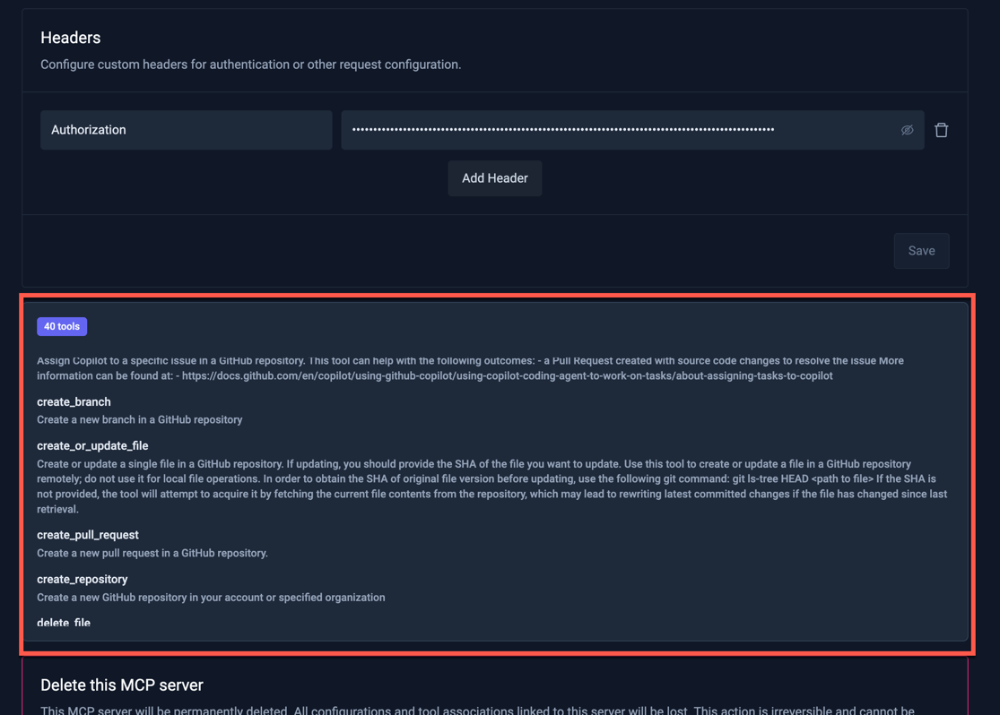

# Connected MCP Servers for AI Agents

For an AI Agent to have access to MCP Server(s) to perform its tasks, these MCP Servers need to be connected to the
Testkube platform. Once connected, they can be used by an AI Agent as described in [Configuring MCP Servers](/articles/defining-ai-agents#configuring-mcp-servers).

Connected MCP Servers are shown in the Connected MCP Servers panel:



## Adding a New MCP Server

There are two ways to add an MCP Server: browse the MCP Server Registry for popular servers, or
configure one manually by providing its URL and authentication details.

### From the MCP Server Registry

Select the **Browse Registry** button to open the MCP Server Registry — a curated catalog of popular
MCP Servers that you can add with minimal configuration.

Browse or search for the server you need (e.g. GitHub, Slack, Jira, Linear) and select it. The server URL
and transport are pre-configured from the registry entry. How an AI Agent signs in to it is set on the AI Agent:
see [Signing in to MCP Servers](#signing-in-to-mcp-servers).



### Manual Configuration

Select the **Add MCP Server** button to configure an MCP Server manually. This is useful for
self-hosted servers, internal tools, or servers not yet listed in the registry.

The modal prompts you for:

- **Name**: the name of the MCP Server
- **Description**: an optional description of what the MCP Server does and can be used for
- **Server URL**: the URL of the MCP Server
- **Transport**: how Testkube talks to the server. Check the server's documentation if you are unsure
- **OAuth registration**: a **Client ID** and **Client secret**, only for services that can't register Testkube themselves (see [OAuth client](#oauth-client) below)



If the provided MCP Server can be accessed successfully, it will be added to the list of MCP Servers for further
configuration (see below).

### Server URL requirements

The URL must use HTTPS, and its host must not resolve into a private range. Both rules stop
someone registering an address that only the Control Plane can reach, such as a cloud
metadata endpoint or a service on its internal network.

This rejects the address of a service running in the same cluster, which is typically plain
HTTP on a private IP. For self-hosted deployments, name the hosts you trust and only those
are exempt:

```yaml
global:
  trustedHosts:
    - my-mcp.my-namespace.svc.cluster.local
```

Every other host is still checked, so listing one service does not open up the rest. Set it
where you deploy the Control Plane rather than per environment, since it is a decision for
whoever runs the cluster.

:::tip Private CA / self-signed certificates
For self-hosted deployments, if your MCP Server uses a certificate signed by a
private CA, configure private CA trust using the
[Using a private certificate authority (CA)](/articles/private-ca) guide.
:::

## Signing in to MCP Servers

An MCP Server doesn't hold a key of its own. Each AI Agent that uses it chooses how it signs in, in the **Sign-in**
field when the server is added to the AI Agent, or later in the AI Agent's MCP configuration:

| Sign-in                  | How the AI Agent signs in                                                                                 | Runs with nobody present |
| ------------------------ | --------------------------------------------------------------------------------------------------------- | ------------------------ |
| **Shared key**           | With header values stored on the AI Agent, such as `Authorization: Bearer <token>`, or with a Credential. | Yes                      |
| **Each person signs in** | Everyone who chats with the AI Agent signs in with their own account through OAuth.                       | No                       |
| **None**                 | Without a credential, for servers that don't need one.                                                    | Yes                      |

### Shared key

The key belongs to the AI Agent, so every chat with it uses the same account. Choose **Enter a key** to type
header values, or **Use a Credential** to pick or create an Environment [Credential](/articles/credential-management).
Stored values are never shown again: the AI Agent shows only the header names or the Credential's name, and
**Replace key** overwrites them.

Use a shared key for a service account, and for AI Agents that [AI Triggers](/articles/ai-triggers) or
[GitHub PR analysis](/articles/git-integration#ai-summary) run.

An AI Agent set to a shared key with no key entered reaches the server without a credential and is refused. Its
card and chats warn that the key is missing.

### Each person signs in

Each person who chats with the AI Agent uses their own account on the service, through OAuth. Testkube refreshes
short-lived tokens for them. In a chat, **MCP Server connections** under the chat input lists the AI Agent's MCP
Servers and their state. Select **Connect** to sign in, or **Disconnect** to sign out.



Because these AI Agents need a person to sign in, AI Triggers and GitHub PR analysis can't use them:

- Their AI Agent pickers don't offer them, and say why.
- Switching an AI Agent to **Each person signs in** is refused while an AI Trigger uses it. Give the AI Agent a
  shared key for that server, or delete those AI Triggers first.

### OAuth client

Testkube registers itself with most OAuth services on its own. Some services, such as GitHub, don't allow that, so
an admin registers an OAuth app with the service and enters its **Client ID** and **Client secret** on the MCP
Server, under **OAuth registration** when adding it, or in its **OAuth client** card later. Leave both fields empty
for every other service.

## Configuring an MCP Server

Configure an existing (or newly added) MCP Server by selecting it from the list of MCP Servers. The provided
panel has fields for:

- **Name** (read-only): the name of the MCP Server
- **Description**: an optional description of what the MCP Server does and can be used for
- **Server URL**: the URL of the MCP Server
- **Transport**: how Testkube talks to the MCP Server
- **OAuth client**: the Client ID and Client secret, only for services that need one
- **AI Agents**: the AI Agents that use the MCP Server, and how each one signs in
- **Tools**: a list of the tools available in the MCP Server
- **Delete**: option to delete the MCP Server



### MCP Server Tools

The list of tools available in an MCP Server is shown in the "Tools" section of the MCP Server panel. These tools can then
be made available to AI Agents as described in [Defining AI Agents](/articles/defining-ai-agents#configuring-mcp-server-tools).



## Use Cases for External MCP Servers

Connecting external MCP Servers unlocks powerful cross-tool automation for your AI Agents. For example:

- **Kubernetes** — Agents can check pod status, node conditions, and deployment health during failure analysis
- **Grafana / Datadog** — Agents can correlate test failures with application performance metrics
- **GitHub / GitLab** — Agents can inspect source code, create fix PRs, or correlate failures with recent changes
- **Slack / Teams** — Agents can post analysis results, incident summaries, or reports to team channels
- **Jira / Linear** — Agents can create tickets automatically when they detect issues

See [Enhancing Agents with External MCP Servers](/articles/ai-agent-examples-overview#enhancing-agents-with-external-mcp-servers) for a
full mapping of MCP Servers to agent capabilities, and the [Example Agents](/articles/ai-agent-examples-overview) for concrete examples
that use external MCP Servers alongside the built-in Testkube tools.
