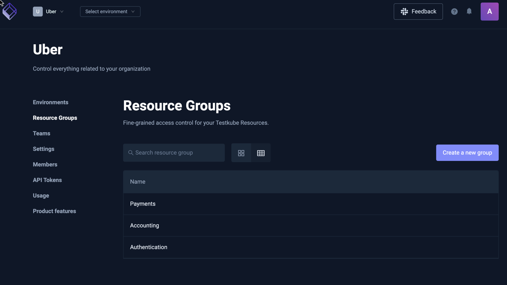
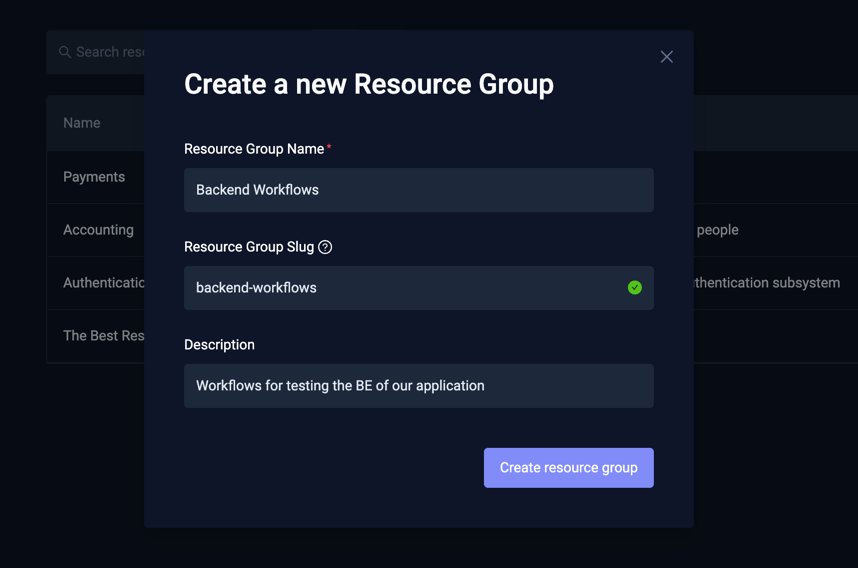
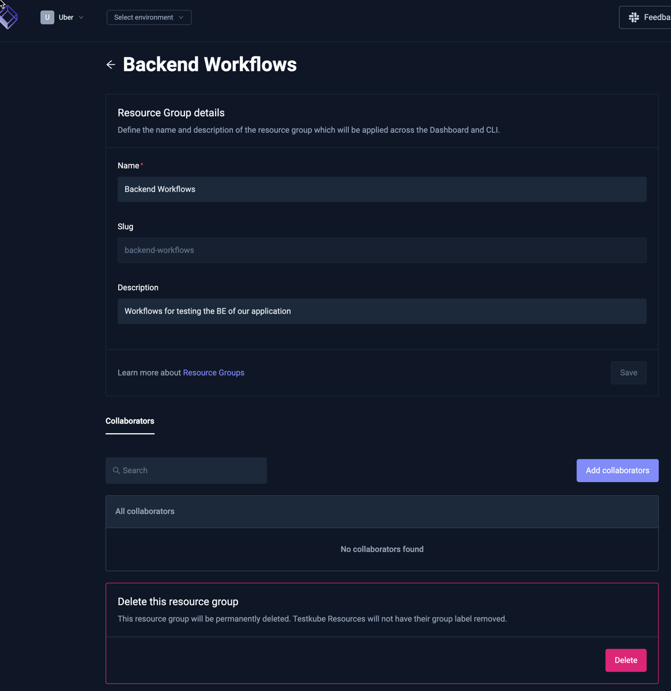
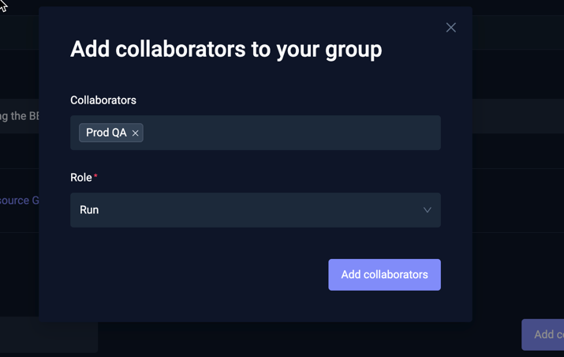
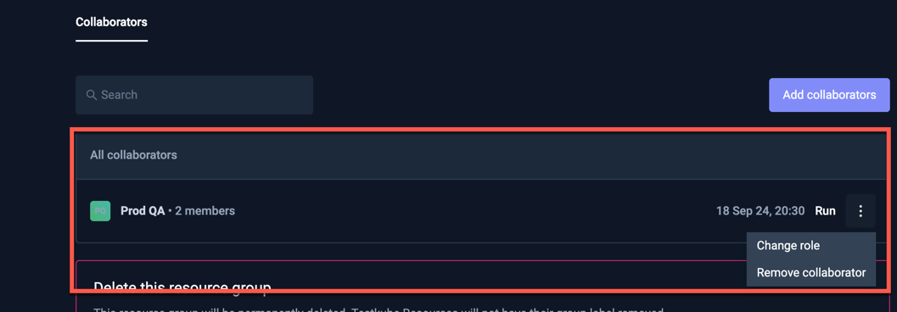
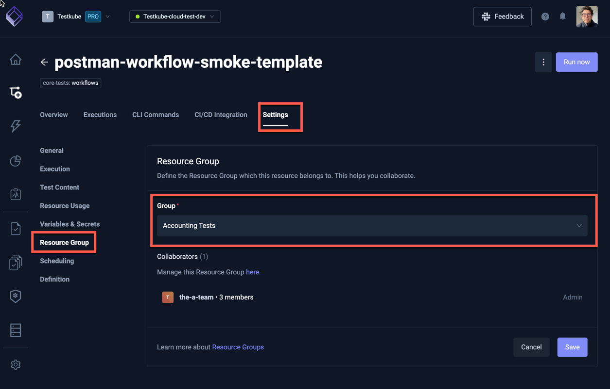
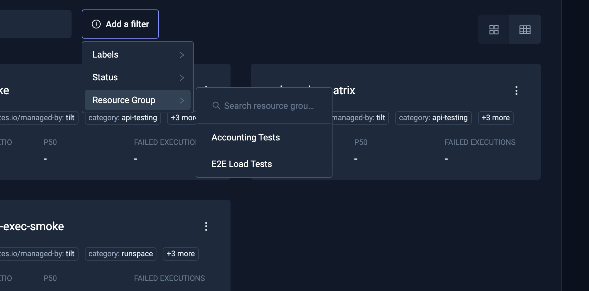

# Resource Groups

Resource Groups allow you to group resources across all your Environments, by whatever criteria meets your needs
(team, application, component, etc.). Once defined, you can assign individual members or teams to a Resource Group
with a specific Role, resulting in those members having corresponding permissions for the resources in that Resource
Group.

The following types of Testkube Resources can currently be added to a Resource Group:

- Workflows - from the "Resource Group" Tab under [Workflow Settings](/articles/testkube-dashboard-workflow-details#workflow-settings-tabs)
- Workflow Templates - from the "Resource Group" Tab under [Workflow Template Settings](/articles/testkube-dashboard-workflows-templates#workflow-template-settings)
- Triggers - from the "Resource Group" Tab under Trigger Settings - [Read More](/articles/test-triggers)
- Webhooks - from the "Resource Group" Tab under Webhook Settings - [Read More](/articles/webhooks)
- AI Agents - linked to the group rather than labelled - [Read More](/articles/ai-agent-access#give-a-resource-group-its-ai-agents)

:::info
Please read [Resource Access Management](/articles/resource-access-management) to get an overview of how Testkube
allows you to manage and apply Resource Access controls.
:::

Selecting "Resource groups" from the Organization Management panel shows a list of all existing Resource Groups:

## Creating a New Resource Group

Select the [Create a new group] button in the overview above and you will be prompted for the name,
slug and description (the slug is a human-friendly identifier used in URLs):

## Resource Group Settings

Selecting an existing Resource Group or creating a new one takes you to the Resource Group Settings page, which
allows you to configure the name, description and Collaborators for the Resource Group (the slug cannot be changed).
There is also an option to delete the Resource Group at the bottom.

## Managing Resource Group Collaborators

Add collaborators to a Resource Group with the "Add collaborators" button, which will prompt for
which Members and/or Teams to add as collaborators, and which Role they should have for this Resource Group.

Once added, you can manage Members in the list at the bottom of this page, use the menu on the right to
change their Role or remove them:

## Managing Resources in a Resource Group

Adding or removing a Testkube resource to/from a Resource Group is done from that Resource's Settings page. For
example, to assign a Workflow to a Resource Group, go to the "Resource Group" Tab of the Workflow Settings and select
which Resource Group the Workflow belongs to ("Accounting Tests" in the below screenshot).

## Listing Resources in a Resource Group

The **Resources** tab of a Resource Group shows everything that belongs to it, in one list. Open
**Organization Management** -> **Resource groups**, open the group, then open the **Resources** tab.

It covers every Environment you can read, not one at a time, and lists all seven kinds a Resource Group
can hold:

| Kind                    | Goes in by                                                                                      |
| ----------------------- | ----------------------------------------------------------------------------------------------- |
| Test Workflows          | the `testkube.io/group` label                                                                   |
| Test Workflow Templates | the `testkube.io/group` label                                                                   |
| Kubernetes Triggers     | the `testkube.io/group` label                                                                   |
| Workflow Triggers       | the `testkube.io/group` label                                                                   |
| Webhooks                | the `testkube.io/group` label                                                                   |
| Webhook Templates       | the `testkube.io/group` label                                                                   |
| AI Agents               | a link to the group, see [AI Agent access](ai-agent-access#give-a-resource-group-its-ai-agents) |

Each row gives the name, the kind and the Environment it lives in, and links to the resource's own page
where it has one. The **⋮** menu on a row has **Go to details** and **Remove from Resource Group**;
removing one takes the group's access to it away and can be undone by adding it back.

Search by name, and narrow the list with the **Type** and **Environment** filters. Both only offer the
values this group actually holds, each with its count, so every value offered leads somewhere on its
own, including a type that isn't on the page you are looking at. The list is paged, 20 at a time.

### Add a resource from this tab

Select **Add resource**, choose an Environment, then a type, then the resources to add. What a type does
depends on the kind:

- For the six labelled kinds, adding writes the group's label on the resource, which is the same thing
  as setting it on the resource's own Settings page. The type is offered only in Environments whose
  resources the control plane holds; in an Environment whose agent owns them, the type reads
  **(managed by its agent)** and the label has to be set there instead.
- **AI Agents** are linked to the group rather than labelled, which needs RBAC in your license and an
  Organization admin or owner. Without both, the type reads **(needs RBAC and an org admin)**. A private
  AI Agent can't be linked, and shows as **Private**.

A resource belongs to one Resource Group at a time, so adding one that is already in another group moves
it. The picker says which group that is before you pick it.

Workflows and Workflow Templates can also be filtered on a Resource Group from their own Overview panels:

