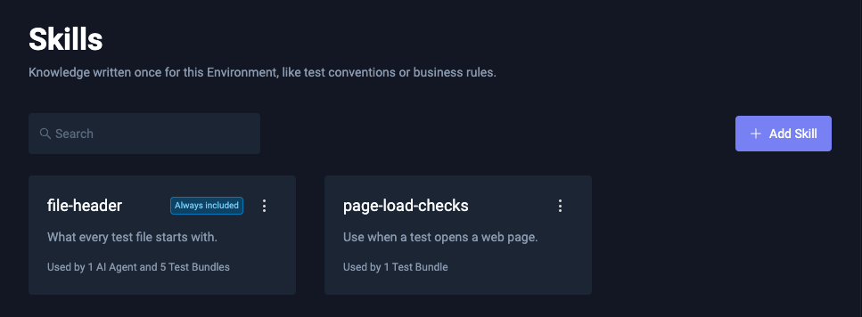
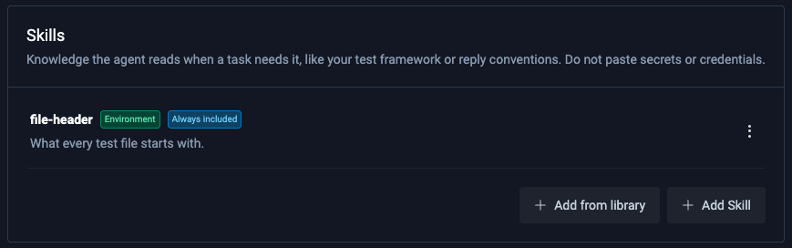
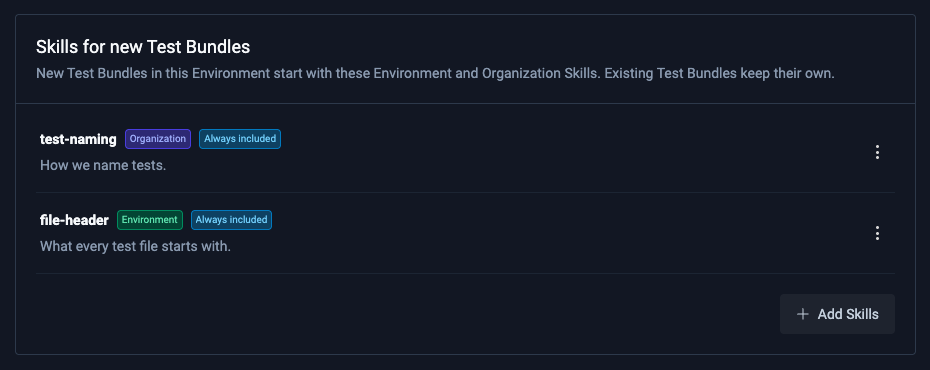
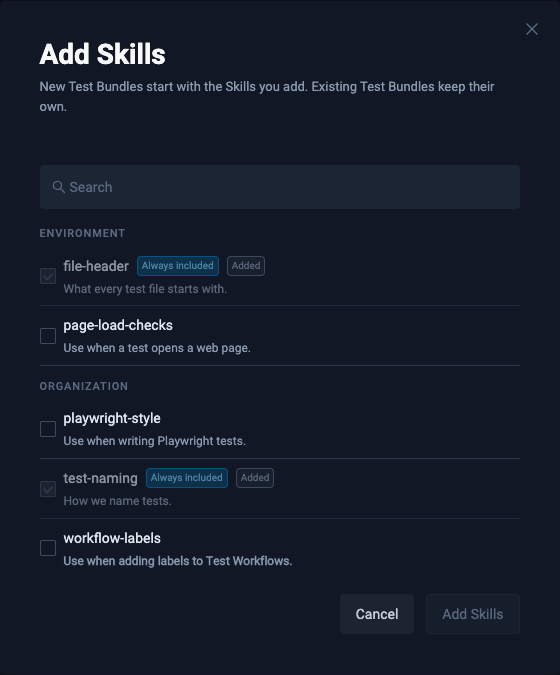
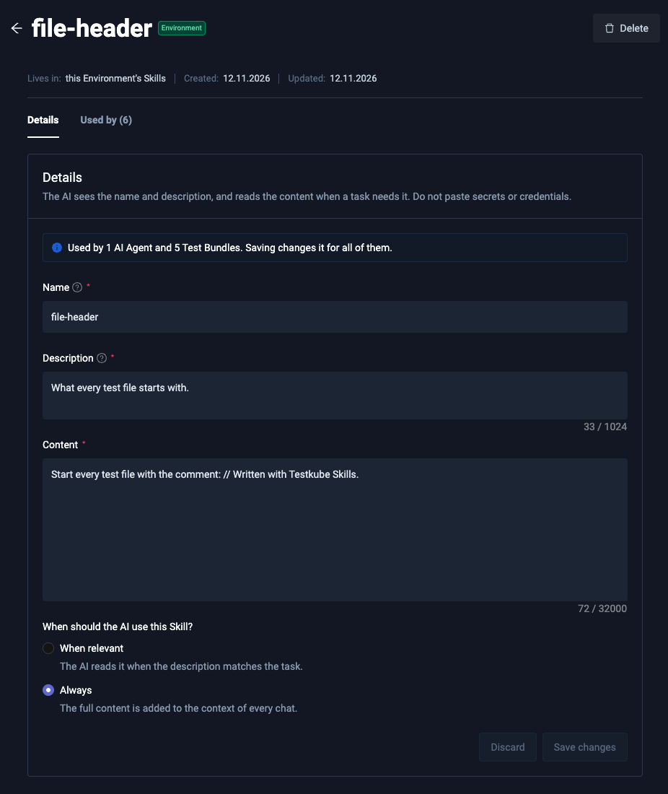
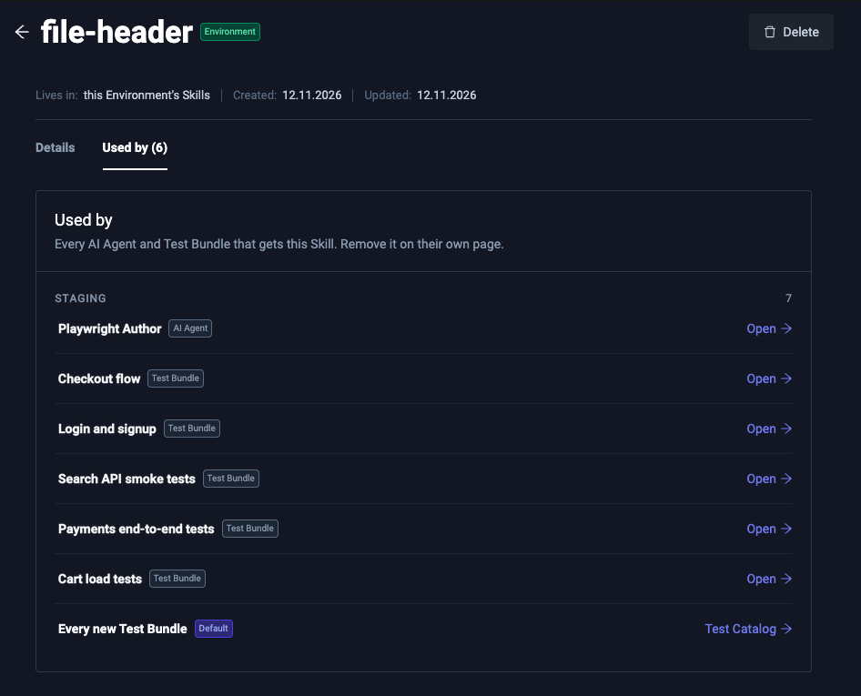

# Skills for AI Agents and Test Bundles

A **Skill** is guidance the AI follows: test conventions, business rules, test data guidance or how your services are set
up. You write it once and give it to the AI Agents and Test Bundles that need it, instead of repeating it in every
instruction or chat.

:::note
These Skills are guidance for the AI in Testkube. To teach a coding agent such as Claude Code or Cursor how to use
Testkube, see [Testkube Agent Skills](testkube-skills).
:::

## What a Skill is

A Skill follows the [Agent Skills](https://agentskills.io/specification) format:

| Field       | What it holds                                                                                                       |
| ----------- | ------------------------------------------------------------------------------------------------------------------- |
| Name        | Up to 64 lowercase letters, numbers and single hyphens, such as `test-naming`. The AI finds the Skill by this name. |
| Description | What the Skill does and when to use it, up to 1,024 characters. The AI reads it to decide when to open the Skill.   |
| Content     | The guidance itself, up to 32,000 characters.                                                                       |

**When should the AI use this Skill?** decides how the AI gets the content:

- **When relevant** (the default): the AI always sees the Skill's name and description, and reads the content when a task
  needs it.
- **Always**: the content is added to every chat.

An AI Agent or a Test Bundle takes up to 32,000 characters of always-included Skills, in the order they are listed. A
shared Skill that doesn't fit is still added, and the AI reads it when relevant there instead; its row shows **Read when
relevant here**. An AI Agent's or Test Bundle's own Skill that doesn't fit is refused when you save it.

Do not put secrets or credentials in a Skill.

## Where Skills live

| Where           | Who uses it                                     | Where to manage it                                       |
| --------------- | ----------------------------------------------- | -------------------------------------------------------- |
| Organization    | AI Agents and Test Bundles in any Environment   | Organization settings → **AI & Governance** → **Skills** |
| Environment     | Any AI Agent or Test Bundle of that Environment | **AI Settings** → **Skills**                             |
| One AI Agent    | Only that AI Agent                              | The AI Agent's page → **Skills**                         |
| One Test Bundle | Only that Test Bundle                           | The Test Bundle's **Settings** → **Skills**              |

Organization and Environment Skills are **shared**: one Skill is used by many AI Agents and Test Bundles, and editing it
changes it everywhere it is used. A Skill created on an AI Agent's or Test Bundle's page stays private to it.

Built-in AI Agents can't have Skills.

## Add a Skill to an AI Agent or Test Bundle

1. Open the AI Agent's page, or the Test Bundle's **Settings**, and go to **Skills**.
2. Select **Add Skill** to write a Skill only this AI Agent or Test Bundle uses, or **Add from library** to add
   Environment and Organization Skills.
3. In the library, select the Skills to add. A Skill whose name the list already uses shows **Unavailable**: one list
   can't hold two Skills with the same name.

A shared Skill's row shows where it lives, **Environment** or **Organization**. Its menu has **Open in Environment
Skills** (or **Organization Skills**) and **Remove from AI Agent** (or **Test Bundle**). Removing it takes it out of
that list only; the Skill stays in its library and in its other AI Agents and Test Bundles.

## Skills for new Test Bundles

Environment admins can pick the Skills every new Test Bundle starts with, in **AI Settings** → **Test Catalog** →
**Skills for new Test Bundles**. Select **Add Skills** to add Environment and Organization Skills.

The Skills are added when a Test Bundle is created. Changing the list later doesn't change existing Test Bundles, and
each Test Bundle can still remove a Skill it started with.

## A Skill's page

Select an Environment Skill's card, or an Organization Skill's name, to open its page:

- The header says where the Skill lives. An Organization Skill's edits reach every Environment.
- **Details** has the Skill's fields. When the Skill is used, a note above them says how many AI Agents and Test Bundles
  an edit reaches.
- **Used by** lists every AI Agent and Test Bundle that uses the Skill, and whether new Test Bundles start with it,
  grouped by Environment. Select **Open** to go to one. AI Agents you can't use, and Environments you can't open, are
  only counted.

Deleting a shared Skill removes it from every AI Agent and Test Bundle that uses it.

## Who can do what

| Action                                      | Who                                                                 |
| ------------------------------------------- | ------------------------------------------------------------------- |
| Create, edit and delete Organization Skills | Organization admins and owners                                      |
| Create, edit and delete Environment Skills  | Environment admins, and Organization admins and owners              |
| Manage an AI Agent's Skills                 | Whoever can edit the AI Agent: Environment admins                   |
| Manage a Test Bundle's Skills               | Whoever can edit the Test Bundle: the Environment write role and up |
| Choose the Skills for new Test Bundles      | Environment admins                                                  |
| See Skills                                  | Every role that can see the Environment                             |

Organization admins and owners can do everything above in every Environment.

## Skills as code

Environment Skills, and an AI Agent's own and shared Skills, can also be managed as YAML with `testkube apply` or a
Runner with the GitOps capability. See [Control Plane resources as code](control-plane-resources#skills).

## Related

- [Managing Testkube AI Agents](defining-ai-agents)
- [Work with Test Bundles and multiple chats](ai-test-creation-test-bundles)
- [AI Governance](ai-governance)
