# Test Insights

Insights turns your Testkube executions into a real-time dataset you can analyze to better understand how you work.
This feature allows teams to track key performance indicators including the number
of test executions, pass/fail rates, execution durations, and more, all within a user-friendly Dashboard.

With Test Insights, DevOps and QA managers can quickly answer crucial questions that impact the testing
cycle and overall software quality, such as:

- Which tests take the longest to execute and why?
- Which tests have the highest failure rates?
- How do test performance metrics vary by type of test or by the tools used?
- How do key test execution metrics change over time?

By integrating Test Insights into your testing workflow, your team can leverage several benefits:

- **Enhanced Visibility:** Gain a clear overview of testing activities and outcomes, helping
  you manage and prioritize testing resources more effectively.
- **Data-Driven Decisions:** Make informed decisions about where to allocate efforts for improving
  test efficiency and reliability.
- **Improved Test Efficiency:** Identify and address inefficiencies in your testing process, leading
  to faster development cycles and higher quality software releases.

## Workflow Metrics

The default metrics exposed for analysis in Test Insights are the metrics collected for each Workflow Execution:

- Workflow Status
- Execution Duration
- Resource Usage - [Read More](/articles/resource-metrics-in-insights).

These can be further filtered and segmented as described below.

## Granular Metrics

Testkube stores tool-specific measurements as named time series data on top of the Workflow metrics outlined above. By default Testkube extracts and exposes granular metrics for
[individual Test Cases](/articles/functional-metrics-in-insights) and [Performance Tests](/articles/performance-metrics-in-insights), but you can provide Testkube with
any [Custom Metric](/articles/custom-metrics-in-insights) that you would like to track together with your test results.

:::note
Granular Metrics requires Postgres as your Testkube Database - they are not supported on Testkube deployments using MongoDB.
:::

### Configuration

Granular metrics are **enabled by default**. The control plane worker service ingests supported reports from workflow
artifacts into time series after each execution completes.

To explicitly enable or disable ingestion, set the `testkube-worker-service.granularMetrics.enabled` Helm value on your deployment:

```yaml
testkube-worker-service:
  granularInsights:
    enabled: false
```

Set the value to `false` to disable granular metrics ingestion, in which case the Insight module will not show
granular measures for executions processed while ingestion is disabled.

### Built in Granular Metrics

Once granular metrics are captured, they appear as measures in an [Executions Time Series](/articles/test-insights#executions-time-series) analysis. Granular metrics are grouped by category to make exploration easier.

| Insights group          | Example metric keys                                                    |
| ----------------------- | ---------------------------------------------------------------------- |
| Junit Test Case Metrics | `test_duration_ms`, `test_count_failed`, `test_count_passed`           |
| Request Latency         | `http_req_duration_p95_ms`, `response_time_mean_ms`, `latency_p99_ms`  |
| Request Throughput      | `http_reqs_rate`, `http_request_rate`, `rps_mean`                      |
| Traffic Volume          | `data_received_count`, `data_sent_count`, `received_kbytes_per_sec`    |
| Request Errors          | `http_req_failed_rate`, `error_count`, `errors_etimedout`              |
| Request Volume          | `http_reqs_count`, `sample_count`, `requests_completed`                |
| Virtual Users           | `vus`, `vusers_created`, `virtual_users`                               |
| Checks & Assertions     | `checks_passes`, `checks_fails`, `assertions_failed`                   |
| Custom Report Metrics   | Any detected report metric that does not match one of the above groups |

Insights chooses a default aggregate based on the selected metric key. Count-style metrics usually default to
**sum**, while latency, rate, percentage, throughput, and byte-rate metrics default to **maximum** so the first chart
highlights the highest observed value in each time bucket. You can still select another available aggregate when a
different view is more useful.

### Segmentation and Filtering

In addition to standard filtering and segmentation, granular metrics support segmentation and filtering based on a set of _identity fields_.
Each series includes identity fields derived from the tool that produced the report. Below is a table of common identity fields
for the supported report sources.

| Report source        | Common identity fields             | Notes                                                                                                                                                                                                                                                           |
| -------------------- | ---------------------------------- | --------------------------------------------------------------------------------------------------------------------------------------------------------------------------------------------------------------------------------------------------------------- |
| JUnit report         | Testcase, Testsuite                | Test cases and suites are uniquely identified by their name. If you have the same test case name across multiple workflows they will be aggregated together (a workflow filter can help mitigate this issue).                                                   |
| Influx line protocol | Tag keys from each line            | Each tag on a line protocol record becomes an identity field (for example `status=200` or `scenario=checkout`). Use stable, low-cardinality tag keys so segments remain readable in Insights.                                                                   |
| k6 summary           | Scenario, Endpoint, k6 metric tags | k6 only writes tagged submetrics to the summary when the script requests them, usually through thresholds. Global metrics such as total received bytes or max VUs may not have scenario or endpoint identity.                                                   |
| Artillery report     | Scenario, Transaction              | Scenario identities come from named Artillery scenarios. Transaction identities come from endpoint-level metrics when the report includes them. Other aggregate metrics remain workflow-level when the report does not include scenario or transaction context. |
| JMeter statistics    | Transaction                        | JMeter dashboard statistics are keyed by transaction label, including `Total`.                                                                                                                                                                                  |

## Using Test Insights

Test Insights are available from the top and left navigation menus. The Insights sidebar helps you navigate between boards:

- **All Boards** — a searchable grid of every board you can access in the Organization
- **Execution Analysis** — the default board with premade charts
- **Pinned Boards** — boards you have pinned for quick access
- **Shared Boards** — boards shared across the Organization
- **Private Boards** — boards visible only to you

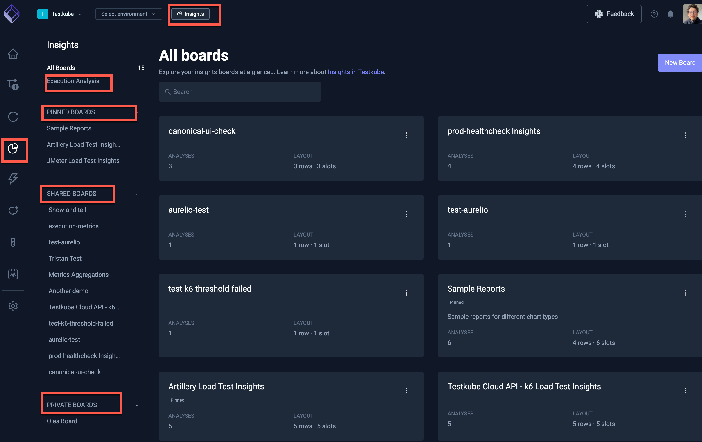

Use **All Boards** to browse, search, and paginate through every board at a glance. Each card shows the board name,
description, analysis count, and layout summary. Click a card to open the board.

You can create a board from **+ Create a new board** at the bottom of the sidebar or from the **New Board** button on
the All Boards page.

:::note
Boards can be **shared across the Organization** or kept **private**. Private boards are visible only to their
creator. Shared boards are visible to all Organization members, but only the creator or an Organization admin can
edit or rearrange them. Deleting a shared board requires Organization admin permissions.

Pinning a board is personal — it adds the board to your **Pinned Boards** section without changing who can access it.

If Insights should not be available in your Organization, disable it from the
[Product Features Panel](/articles/organization-management#product-features).
:::

## Insights Boards

### The Default Execution Analysis Board

The default Execution Analysis board has three sections which all show data over the last month:

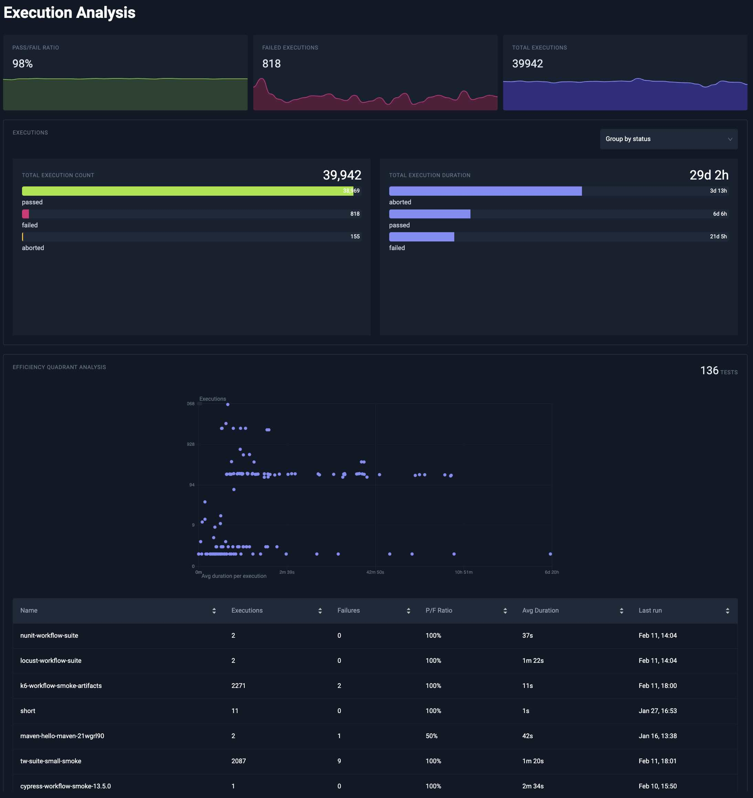

The top part of the Execution Analysis module shows high-level execution metrics.

Underneath you can find a quick overview of execution count and duration.
You can either group your executions by status or workflow by using the selector.

Lastly, the execution efficiency analysis shows tests by execution time and frequency. Tests that
frequently run and take longer to execute appear in the top right quadrant, highlighting them as prime
candidates for optimization to reduce testing bottlenecks, improve cycle times and optimize infrastructure costs

### Board Visibility

When you create or edit a board, you can choose its visibility:

- **Shared across organization** — visible to all Organization members. The creator and Organization admins can edit
  the board and its analyses. Organization admins can also reorder shared boards in the sidebar.
- **Private** — visible only to you. You can edit and delete your private boards.

Private and pinned boards show **Private** and **Pinned** badges on the board page and on cards in All Boards.

### Managing Custom Boards

You can add as many boards as you need to Insights under an Organization and each board can in turn contain
as many analysis charts as needed, allowing you to group your analysis in any way that aligns
with your testing activities.

You can manage a board as follows:

- **Create Board**: Click **+ Create a new board** in the sidebar or **New Board** on the All Boards page.
  In the creation dialog, set the name, slug, description, and visibility, then add your first analysis.

- **Pin Board**: Pin a board from its actions menu (on the board page or on a card in All Boards) or from the pin
  icon next to a board in the sidebar. Pinned boards appear under **Pinned Boards** for quick access.

- **Reorder shared boards**: Organization admins can drag shared boards in the sidebar to change their order for
  everyone in the Organization.

- **Rearrange analyses**: Hover an analysis and use the handle in the top-right corner to drag and drop it.
  You can move it to a new row or place it before or after another analysis. You can only add up to three analyses
  per row. Board layouts are optimized for larger screen sizes.

- **Duplicate analysis**: Open an analysis actions menu and choose **Duplicate Analysis** to copy its configuration
  onto the same board.

- **Update Board**: Click the board title on the board page to rename it inline, or open **Settings** from the actions
  menu to update the name, slug, description, and visibility.

- **Delete Board**: Use **Delete** in the board actions menu, or open **Settings** and delete the board in the danger
  zone at the bottom. Your board and all analyses will be removed; no execution data will be deleted.

## Working with Analyses

You can add as many analyses to a board as needed; use the "Add a new analysis" button on the top right to do so:

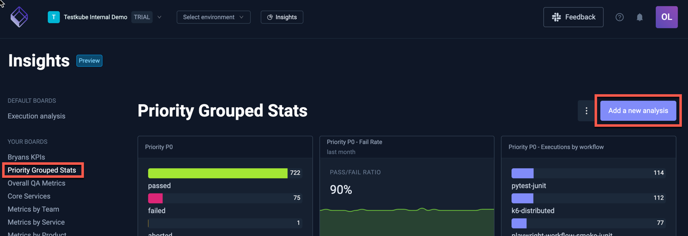

Adding an analysis takes you to the Analysis editor where you can configure what data to show and how to show it.

### The anatomy of the Analysis Editor

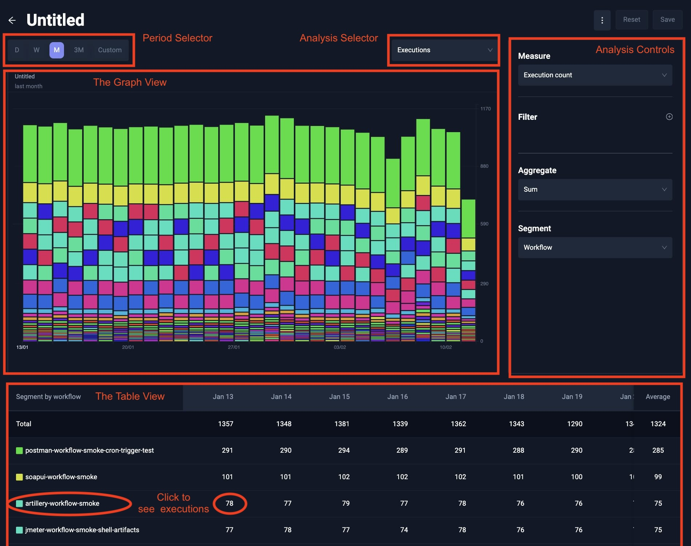

At the top you can see a Period Selector for selecting the last day, week, month, quarter or any custom period.
This sets which executions the analysis covers. How the Executions time series groups them over that range is
a separate choice, the [Aggregation Period](#aggregation-period).

More to the right, you can see the Analysis Selector: it defaults to **Executions** time series, but you can also
select **Executions Bar Chart**, **Efficiency Quadrant Analysis** and **Pass/Fail Statistics** (all described below).

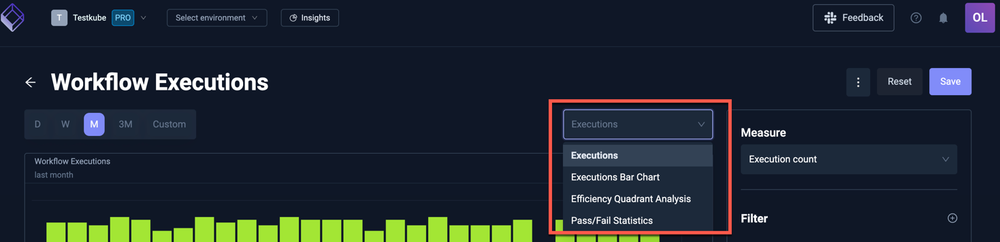

Under the period and analysis selector, you will find your selected chart with its controls on the right side.
The controls vary depending on the selected chart and include the [filters](#filtering-an-analysis) that narrow down
which executions it counts.

### Filtering an Analysis

Select **+** next to **Filter** in the controls of an analysis to narrow it down. Each filter has an operator: click the
operator to switch between the ones that filter offers.

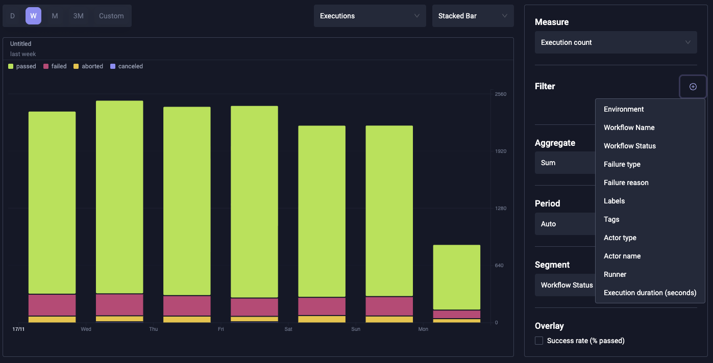

| Filter                           | Operators                                              | What it matches                                                                                                    |
| -------------------------------- | ------------------------------------------------------ | ------------------------------------------------------------------------------------------------------------------ |
| **Workflow Name**                | is, is not, contains, does not contain                 | The name of the Workflow                                                                                           |
| **Environment**                  | is                                                     | The Environment the execution ran in                                                                               |
| **Workflow Status**              | is                                                     | The result of the execution, such as passed, failed or aborted                                                     |
| **Failure type**                 | is                                                     | The kind of [failure](/articles/test-workflows-failure-reasons), such as a step failure or an infrastructure stop  |
| **Failure reason**               | is                                                     | The [reason code](/articles/test-workflows-failure-reasons#reason-codes) of the failure, within the selected types |
| **Labels**                       | is, is not, where (contains, does not contain, exists) | A label of the Workflow, as `key=value`, or a key whose value contains some text                                   |
| **Tags**                         | is, is not, contains, does not contain                 | An [execution tag](/articles/execution-tags), as `key=value`                                                       |
| **Actor type**                   | is, is not                                             | What started the execution: a user or API key, a cron schedule, a test trigger, another Workflow, a CRD or Git     |
| **Actor name**                   | is, is not, contains, does not contain                 | The name of the user, schedule, trigger or Workflow that started the execution                                     |
| **Runner**                       | is                                                     | The Runner Agent that ran the execution                                                                            |
| **Execution duration (seconds)** | at least, at most, between                             | How long the execution ran, in whole seconds. The bounds count as a match                                          |
| Granular metric fields           | is, is not, contains, does not contain                 | The [identity fields](#segmentation-and-filtering) of the selected measure, such as Testcase or Testsuite          |

A few rules apply to all of them:

- **Values of one filter combine with OR, filters combine with AND.** Two Workflow names show executions of either
  Workflow; a Workflow name and a label show executions that match both. Labels are the exception: two labels must
  both be present.
- **The lists of values are sorted alphabetically**, so a custom label, tag or actor name is easy to find.
- **Actor type, Actor name and Runner are recorded from Testkube 2.16 on.** Executions that ended before that
  have none, so these filters never match them.
- **Pass/Fail Statistics offers fewer filters.** It has no Workflow Status, Failure type, Failure reason, Actor,
  Runner or Execution duration filter.
- **Some filters require Postgres.** On a Testkube deployment that uses MongoDB, the Actor type, Actor name, Runner
  and Execution duration filters have no effect, and **is not** and **does not contain** are refused.

### Leaving Values Out

Use **is not** and **does not contain** to remove executions from an analysis rather than to select them. They are
offered on Workflow Name, Labels, Tags, Actor type, Actor name and the granular metric fields.

- **Excluded values always combine with AND.** Workflow Name **is not** `nightly-e2e` and `smoke-tests` leaves out
  both Workflows. Next to an **is** on the same filter, the execution must match one included value and none of the
  excluded ones.
- **An execution without the key is kept.** Labels **is not** `team=payments` keeps executions whose Workflow has no
  `team` label, as a Kubernetes label selector does. Pick only a key, such as `team`, to keep only the executions
  that have no `team` label at all.
- **An execution without an actor is kept** when you leave out an actor type or name.

For example, a Workflow that is expected to fail can flood a failure board. If those Workflows carry the label
`core-tests=expected-fail`, add a **Labels** filter, switch its operator to **is not** and pick
`core-tests=expected-fail`. The board then shows only the failures worth looking at:

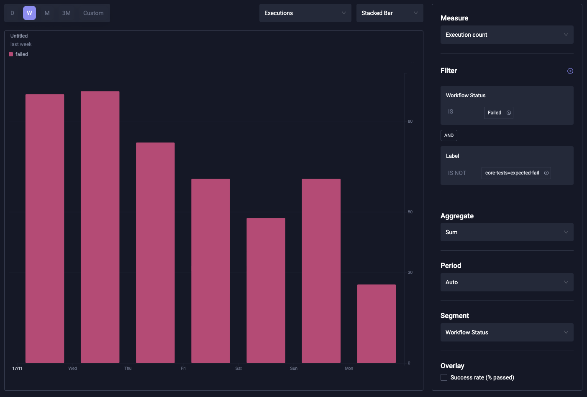

To leave out every smoke-test Workflow by name, add a **Workflow Name** filter with **does not contain** and type
`smoke`:

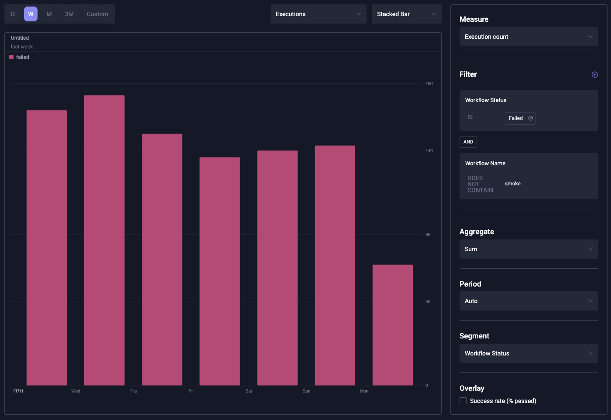

:::note
**Environment**, **Workflow Status**, **Failure type**, **Failure reason** and **Runner** have no **is not**: select
the values you want to keep instead.
:::

## Executions Time Series

The execution time series allows you to analyse your executions over time.

### Executions Measure

The x-axis will always be the time, whereas the y-axis is defined by your **Measure**. There are three categories of measures that are supported.

- **Execution measures**: These measures give high level summary information about your executions.
  - **Execution count**: Use this to see how many Workflows were executed
  - **Execution duration**: Use this to understand how much time your tests are taking.
  - **JUnit Case count**: The number of JUnit tests execution based on extracted [JUnit Reports](/articles/test-workflows-reports).
- **Resource measures**: See resource usage across executions. Read more about [Resource Aggregates in Insights](/articles/resource-metrics#resource-aggregates-in-insights).
  - **CPU Usage**: Use this to analyze CPU consumption of your Workflow executions.
  - **Memory Usage**: Use this to analyze Memory consumption of your Workflow executions.
  - **Network Usage**: Use this to analyze Network usage of your Workflow executions.
  - **Disk Usage**: Use this to analyze Disk usage of your Workflow executions.
- **Granular Metrics**: When [granular metrics](/articles/performance-metrics-in-insights) are enable you will see additional measure options depending on the types of reports your workflows produce.

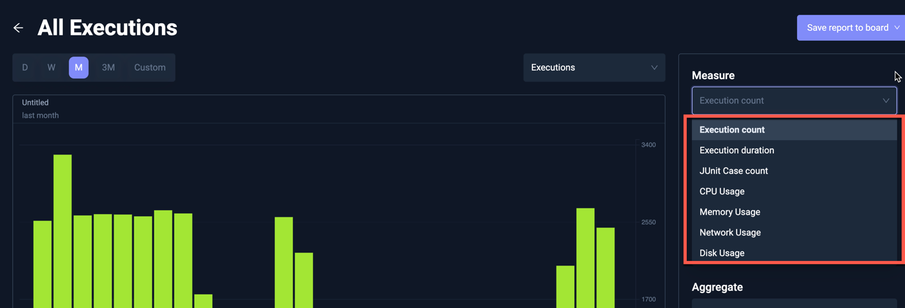

### Executions Aggregate

You can use the **Aggregate** to decide how to treat multiple executions of the same workflow within
each interval. For example, for the **Execution duration** you can aggregate on **sum**, **average**, **minimum** or **maximum**.

:::note
The actual aggregate(s) available will depend on which Executions Measure you selected.
:::

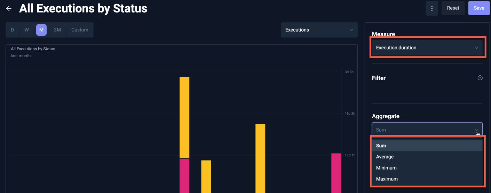

### Aggregation Period

The **Period** control sets how the time series groups executions over time: each point or bar of the chart is one
period. It sits between **Aggregate** and **Segment**.

| Period             | Each point covers                                                                                             |
| ------------------ | ------------------------------------------------------------------------------------------------------------- |
| **Auto** (default) | A size picked from the date range: an hour for a range under two days, then a day, up to a week for a quarter |
| **Day**            | One calendar day                                                                                              |
| **Week**           | One calendar week, starting on Monday                                                                         |
| **Month**          | One calendar month                                                                                            |
| **Quarter**        | One calendar quarter, such as Q1 2026                                                                         |
| **Year**           | One calendar year                                                                                             |

Use a longer period to read a trend over a long range. Over twelve months, **Auto** still draws a point per week and
**Day** a point per day, which is hard to read; **Month** draws twelve. Combine it with a **Segment** to compare,
for example, how many executions each testing tool ran per month.

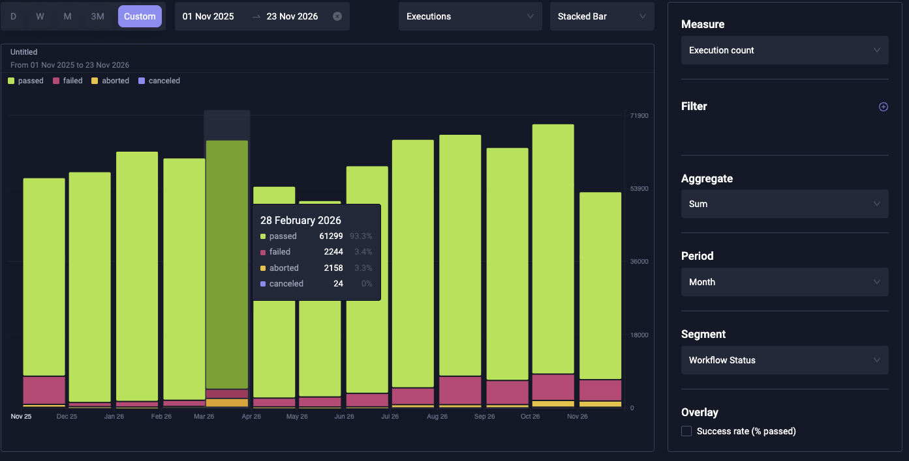

A few things to know:

- **The periods follow the calendar in UTC.** The x-axis labels them in UTC, such as `Jan 26`, `Q1 2026` or `2026`.
- **The first and last periods can be partial.** A range that starts on 15 March and is grouped by month starts with
  half a month, so its first point counts fewer executions.
- **The choice is saved with the analysis.** Analyses saved before this option existed use **Auto**.
- **A range can hold at most 2000 periods.** A longer combination, such as **Day** over six years, is refused; pick a
  longer period.
- **It requires Postgres.** On a Testkube deployment that uses MongoDB, only **Auto** works; any other period is
  refused.

### Executions Segment

Lastly, you can set a **Segment** which will break down your executions.
You can do this by the **status** to see which executions passed or failed,
by **workflow name** or by any of the **labels** found on the executions.

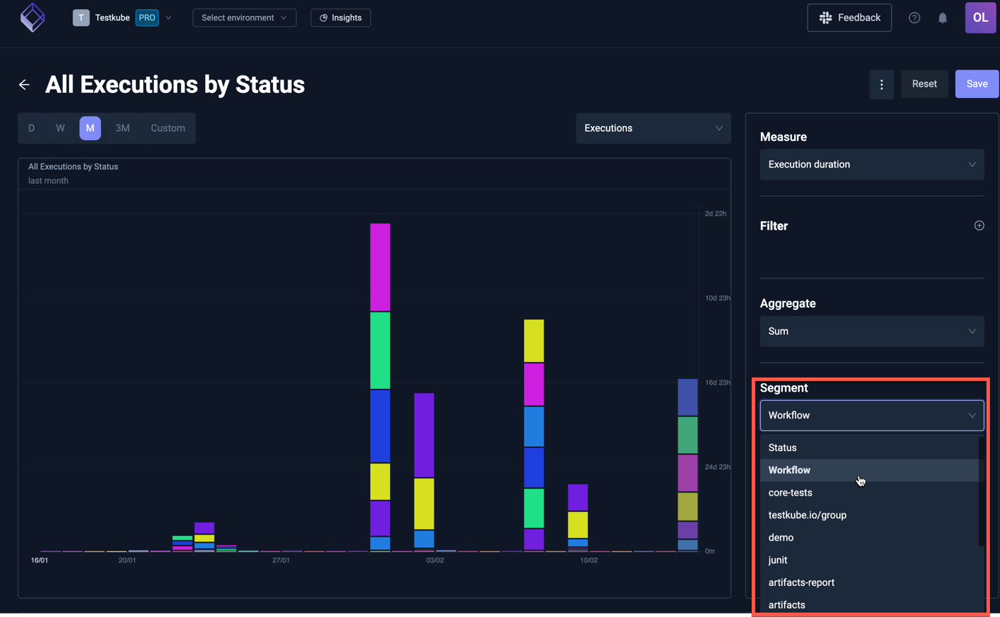

### Chart Types

The **Chart Type** selector in the analysis editor header controls how segmented execution data is visualized over time.
Eight chart types are available:

| Chart Type            | Description                                                                                                                                               |
| --------------------- | --------------------------------------------------------------------------------------------------------------------------------------------------------- |
| **Stacked Bar**       | The default. Segments are stacked within each time bucket to show totals and composition.                                                                 |
| **Grouped Bar**       | Segments are drawn side-by-side within each bucket, making it easier to compare individual segment values.                                                |
| **100% Stacked Bar**  | Each bucket is normalized to 100%, showing the relative share of each segment rather than absolute values.                                                |
| **Stacked Line**      | A stacked area chart — the line equivalent of stacked bars. Useful for seeing how segment composition changes over time.                                  |
| **Line**              | One independent line per segment. Each segment is scaled to its own peak, which highlights trends for individual segments.                                |
| **100% Stacked Area** | A normalized area chart where each time bucket sums to 100%, showing segment share over time.                                                             |
| **Heatmap**           | A time-by-segment grid where color intensity encodes value. Works well when you have many segments and stacked bars or lines become hard to read.         |
| **Horizon**           | One small area chart per segment, stacked vertically as small multiples. All segments share a common scale so you can compare magnitudes across segments. |

:::tip
Use **100% Stacked Bar** or **100% Stacked Area** when you care about proportions (for example, the pass/fail mix) rather than absolute counts. Use **Heatmap** or **Horizon** when segmenting by a high-cardinality dimension such as workflow name or test case.
:::

Segmented charts display a color legend above the chart. Hovering a legend entry, a chart segment, or a row in the
drilldown table cross-highlights that segment across every time bucket (dimming the rest), making it easy to follow a
single segment through the full period.

### Success Rate Overlay

When your analysis is specifically looking at test counts (using the measure **Execution count** and segmenting by **Status**) an **Overlay** option appears in
the controls panel. This will include an overlay showing the pass rate over time on top of the raw counts.

### Executions Table and Drill Down

Besides a graph view, the Executions time series analysis also comes with a table view.
This is useful to see trend across a single segment.
Currently, segmentation within a graph is also limited to 25 largest segments.
For segmentation with a high cardinality, you can view the remaining segments within the table, which are
most often too tiny to see within the Graph View.

You can click on either the segment name or a table cell value to drill down on the execution references that relate to this.
Imagine that you filter on failed executions for a certain label, and you wonder which executions are failing.
Drilling down easily allows you to analyse and troubleshoot these executions.

For example - the following Analysis shows all Executions labeled `junit=true`, with February 7th highlighted when there
were 12 failed executions:

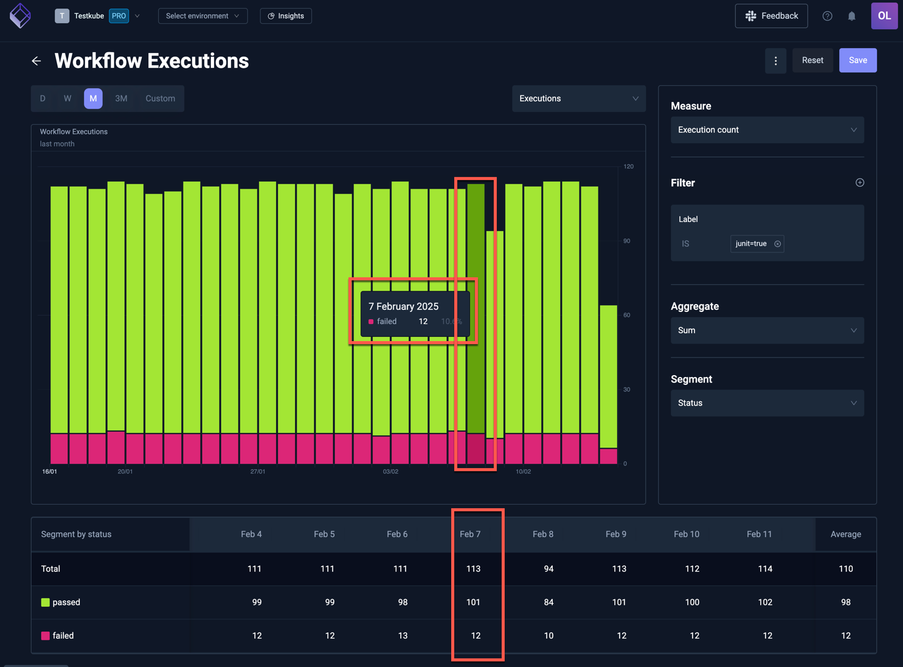

Clicking on the "12" in the table will show those 12 executions in a table:

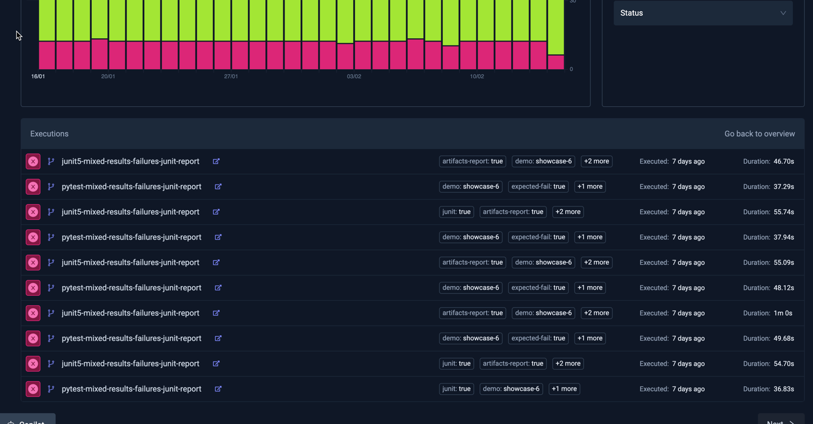

- Selecting an execution will open the corresponding [Workflow Execution Details](/articles/testkube-dashboard-execution-details) panel.
- Selecting the "Back to overview" link on the top right of the table will take you back to the table view above.

## Executions Bar Chart

This shows a bar chart with the number of executions for each selected segment. For example, the below Analysis
shows the top failing Workflows over the last week:

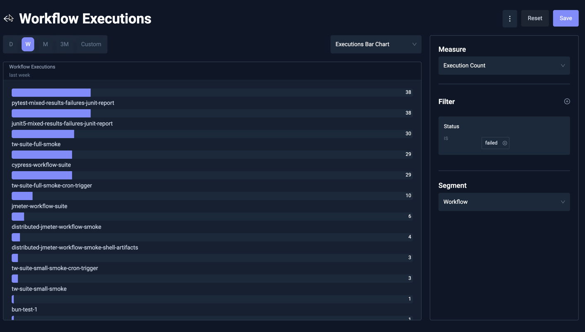

## Efficiency Quadrant Analysis

The execution efficiency analysis shows tests by execution time and frequency. Tests that
frequently run and take longer to execute appear in the top right quadrant, highlighting them as prime
candidates for optimization to reduce testing bottlenecks, improve cycle times and optimize infrastructure costs:

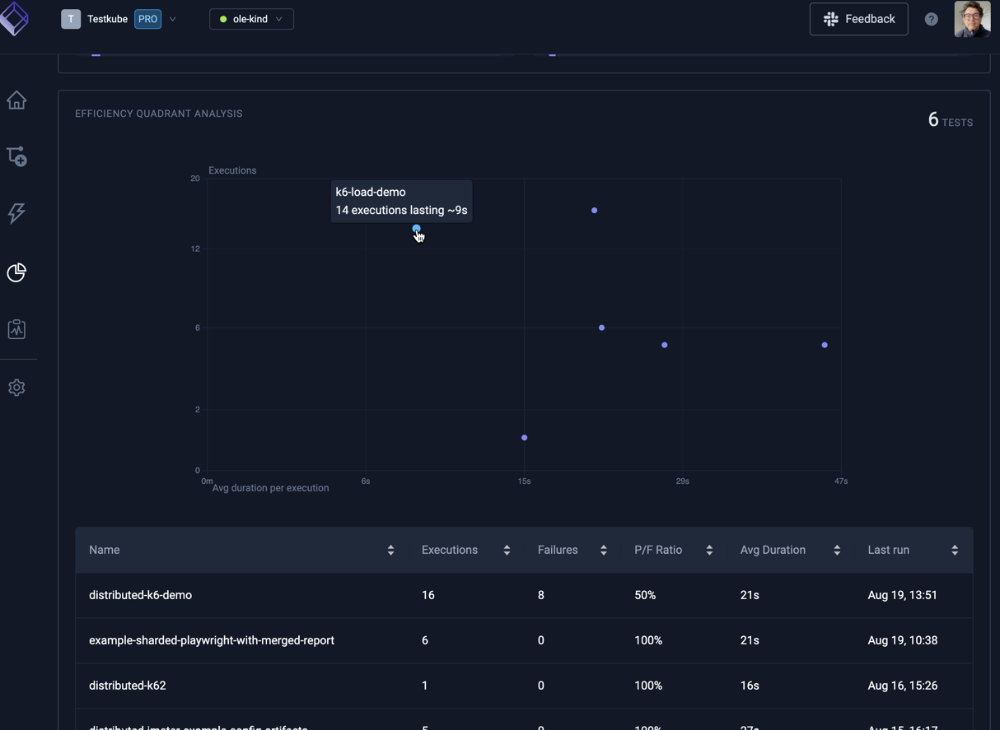

Hovering a marker in the chart reveals the corresponding Workflow.

The table below the chart shows plotted Workflows sortable by a number of attributes.

## Pass/Fail Stats

The pass/fail stats shows details about workflow executions that failed or passed.
These analysis are useful to quickly understand if certain workflows need attention.

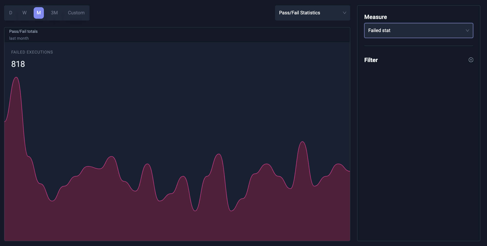

:::tip
Pass/Fail stats can also be overlayed over Execution charts as [described above](#success-rate-overlay).
:::

## The Default Workflow Insights Board

A fixed Insights board is also available at the Workflow level, containing default chart to visualize general
functional and operational metrics for the Workflow:

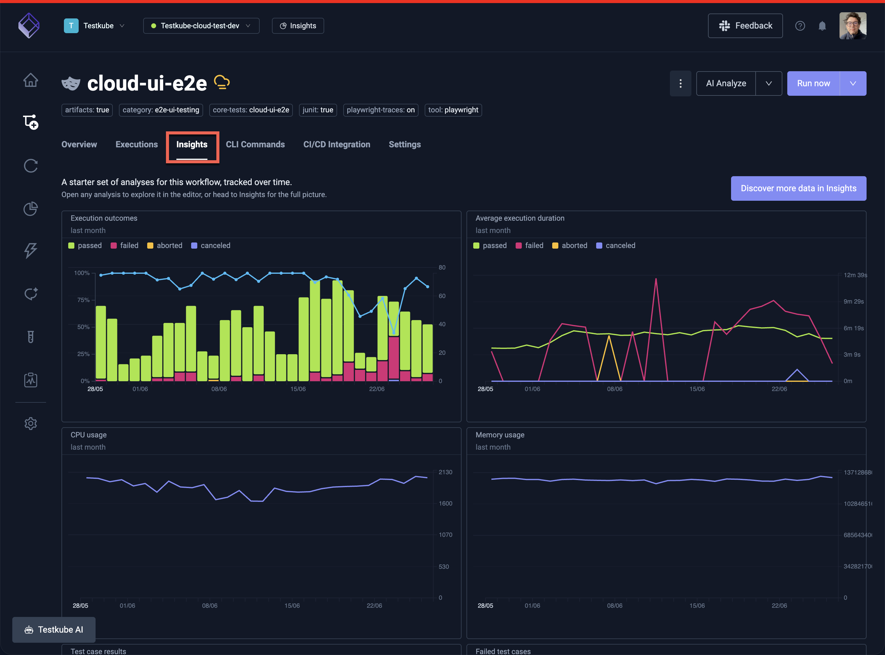

### Customizing

Opening an analysis on this board allows you to customize the analysis as outlined above but any changes must be saved to a separate Insights Board, as indicated by the notice on the top:

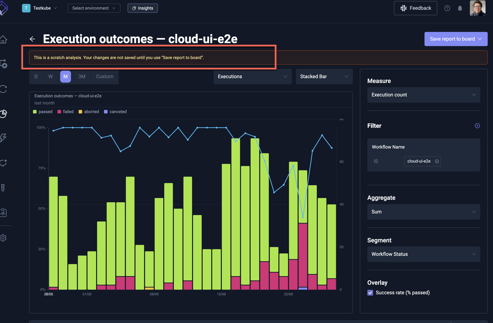
