# Testkube Executions

The **Executions** dashboard is the central repository for all Executions that run in your **Environment**. Since insight specific to Executions is contained in a single location,
the dashboard allows you to troubleshoot issues more quickly. The dashboard also allows you to **Search** and **Add a filter** – collectively enabling you to create Custom Views.
These views allow you to quickly identify Executions based on filters such as **Workflow Labels**, **Execution Tags**, **Status**, **Health**, and **Runners**. For additional information,
read [Custom Views](../articles/testkube-dashboard-custom-views.md). Leveraging the **Executions** dashboard ensures less clicks through less pages to access the information you need.
This increased efficiency also extends itself to an improved user experience.

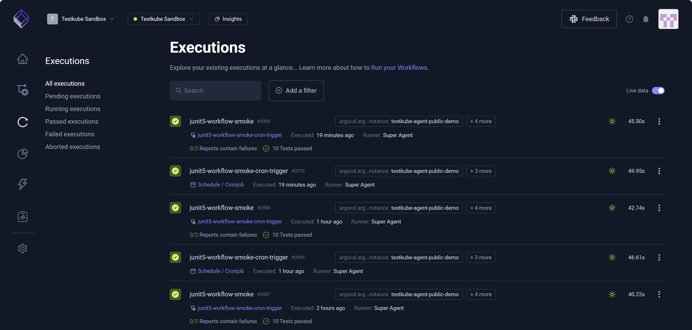

**Live data** allows you to view running Executions. ON is the default setting. Toggle the setting left or OFF to operate
in a seemingly offline mode, where you will not see running Executions. This mode is helpful if, for example, you are debugging or analyzing
a specific Execution and need to focus solely on this test without visual distractions from running Executions. Toggle the setting
right or ON to resume viewing live data.

The three vertical dots associated with each test – More Options/Quick Actions – provide immediate access to details such as **Download Logs**,
**Open Execution Logs**, and **View Artifacts**.

As its name suggests, **Workflow health** (**Perfect**, **Excellent**, **Good**, **Fair**, **Poor**, **Critical**) provides insight into the fitness or state of each Workflow.
These symbols mirror a weather forecast. While the sun aligns with **Perfect** Workflow health, a cloud with a bolt of thunder aligns with **Critical** Workflow health.
After Execution completion, calculations track flakiness (pass/fail flip rate or inconsistency) and other metrics that combine to determine
the Workflow's overall health. As a matter of information, flakiness is not _test_ specific. For example, there could be flakiness in your infrastructure. For more information,
read [Workflow Health & Flakiness](../articles/workflow-health.mdx).

Test Execution **Status** symbols:

- A green checkmark denotes a successful Execution.
- An encircled red 'x' represents a failed Execution.
- A group of revolving circles depicts a current run.
- A red warning sign (exclamation mark enclosed in a triangle) indicates an aborted Execution.

You can select an Execution to examine its details, view logs, and troubleshoot issues.

## Timeline View

The **Timeline** view shows when your Executions ran and how they overlap. Use the toggle next to **Live data** to switch between the
**List** of Executions and the **Timeline**. The **Timeline** uses the same search, filters, and Custom Views as the list, and a Custom View
remembers which of the two you saved it in.

Each Workflow has its own row, and each Execution is a bar that starts and ends when the Execution did. Bars are colored by **Status**,
and running Executions grow up to the "now" line. Executions that overlap stack into separate lanes. Workflows with many overlapping
Executions show a compact strip that you can click to expand into separate lanes.

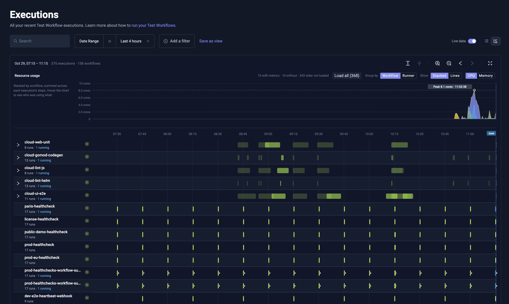

Hover over a bar to see the Execution's details, and select it to open the Execution. Hover anywhere else on the timeline to see which
Executions were running at that moment.

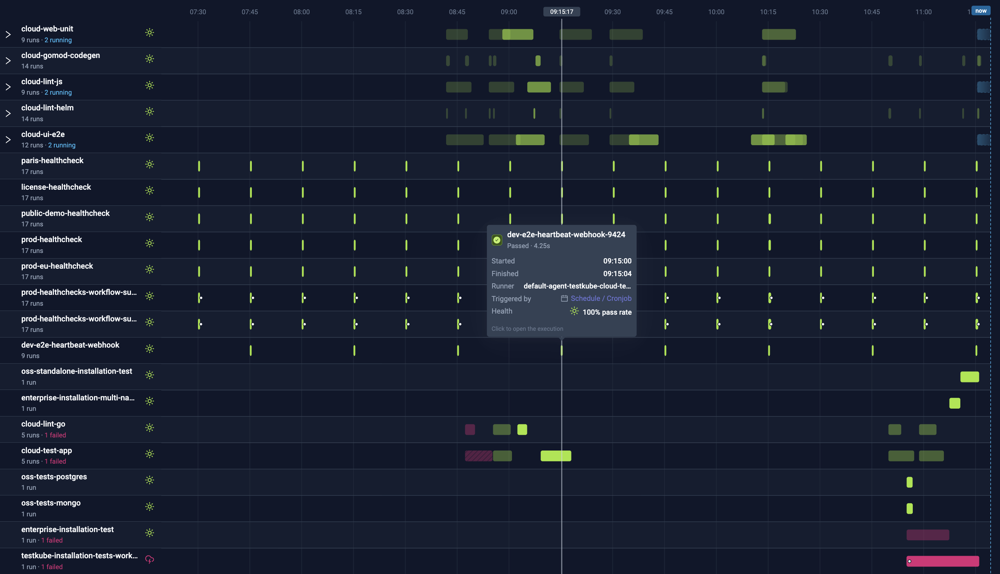

To move through time, drag the timeline sideways or use the **Earlier** and **Later** buttons. Hold Shift and drag across a period to zoom
in on it, or use the **Zoom in** and **Zoom out** buttons. **Back to now** returns to the current time. **Full screen** shows only the
timeline, which is useful on a monitoring screen.

The **Resource usage** panel below the timeline shows the CPU or memory used by the Executions in the selected period, grouped by
Workflow or by Runner. The panel loads the most recent Executions first; select **Load all** to include every Execution in the period.

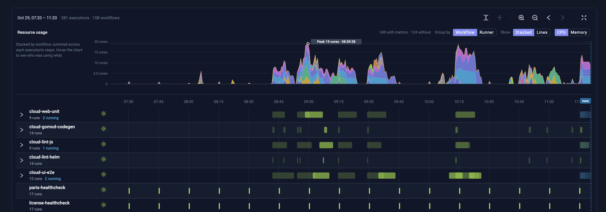

## Pending Executions

A Testkube **Pending execution** is a test that is slated to run. There could be several reasons
a test Execution has a **Pending** status. For example, the test could be awaiting other Executions because
there are too many tests running, or the Execution might be waiting for the requested runner to become available.

You can **Reset all filters** to remove filters.

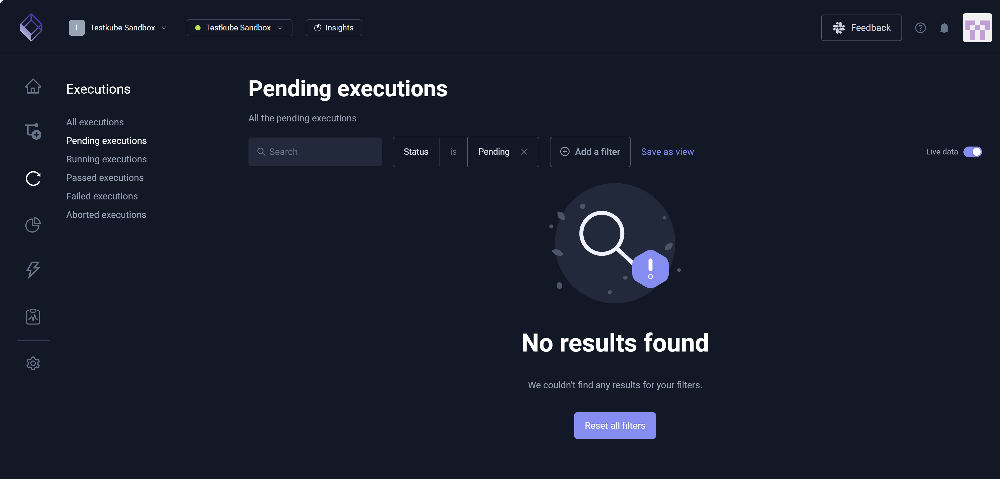

## Running Executions

A Testkube **Running execution** is a test in progress.

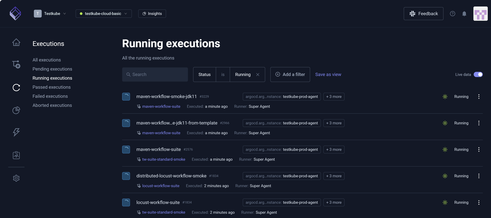

## Passed Executions

A Testkube **Passed execution** is a test that has run, satisfied required checks, and completed successfully.

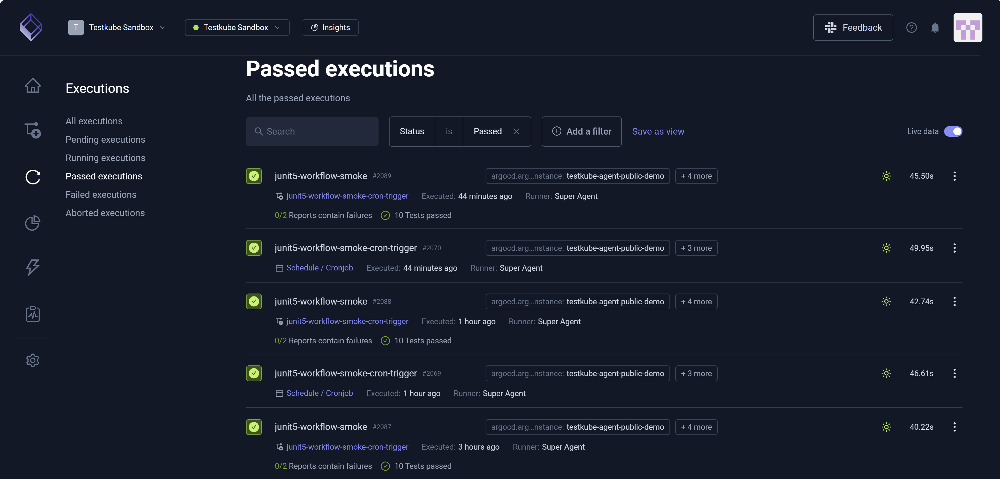

## Failed Executions

A Testkube **Failed execution** is a test that has completed but did not pass all required checks.

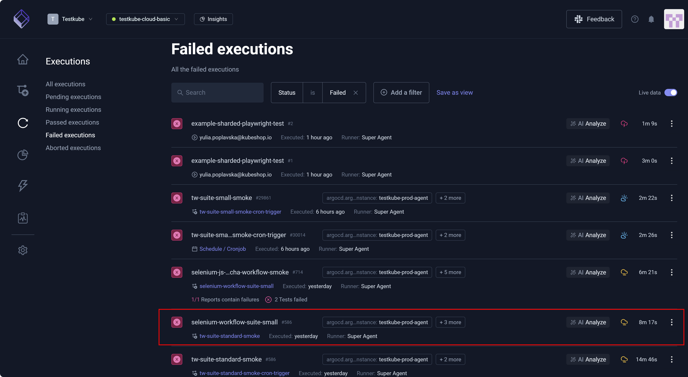

As with any Execution on the dashboard, you can select to view details and, if necessary, debug.

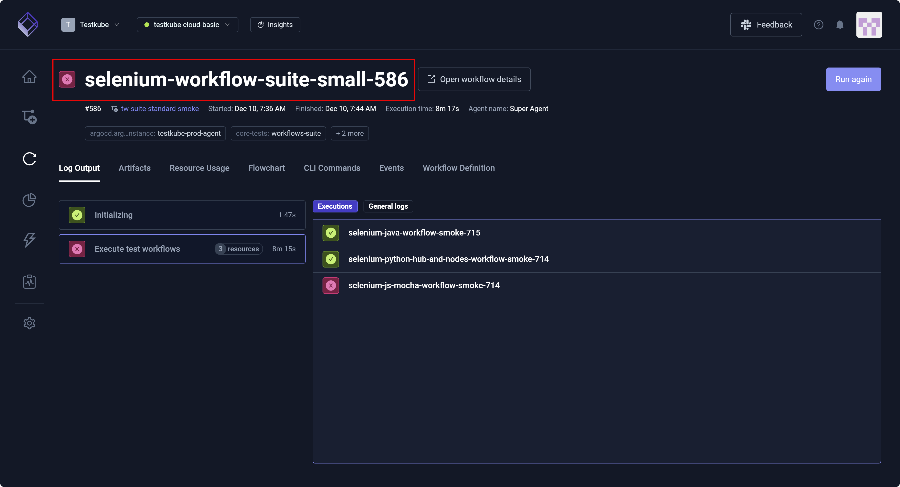

## Aborted Executions

A Testkube **Aborted execution** is a test that is interrupted or stopped before completion.

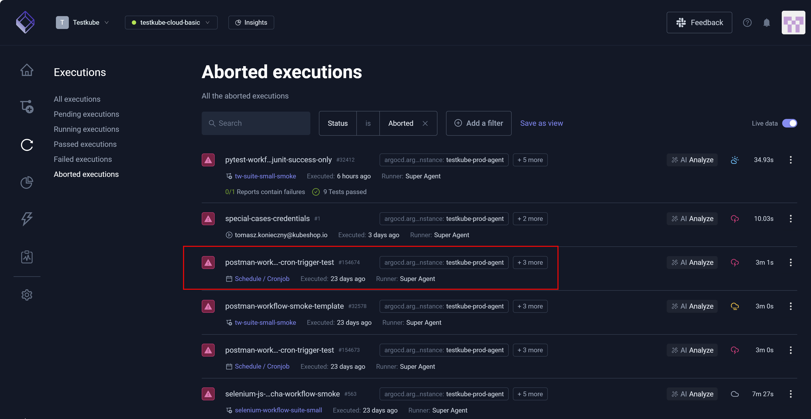

Execution details provide additional insight into aborted tests.

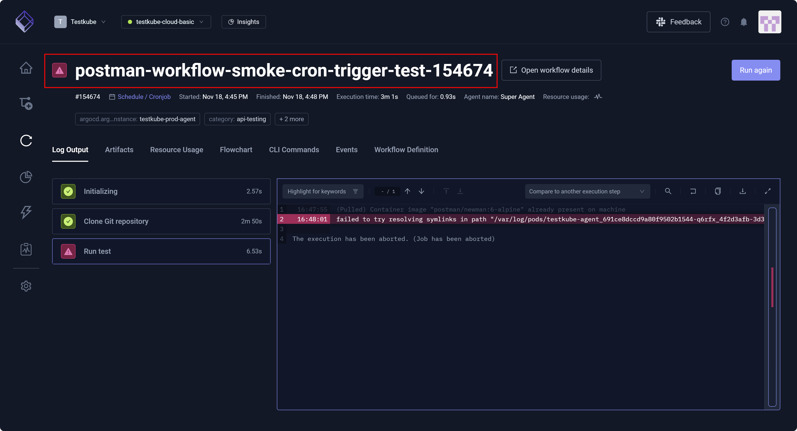
