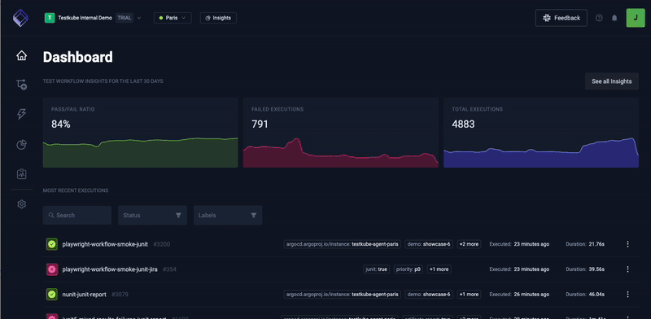

# Try Testkube on your machine

Install Testkube On-Prem on your own computer with one command.

## Before you start

- A Testkube license key. You get it by email after you [sign up for the trial][get-license].
- macOS or Linux. On Windows, use [WSL 2][wsl].
- [Docker][docker], running, with at least 4 CPUs, 6 GB of memory, and 10 GB of free disk. On Docker Desktop, change these
  in **Settings > Resources**.

## Run the installer

```bash
curl -fsSL https://trial.testkube.io | TESTKUBE_LICENSE=<key> bash
```

Replace `<key>` with the license key from your email.

The installer checks your machine, creates its own cluster inside Docker and installs Testkube there. Your own Kubernetes
setup is not changed. The first run takes 5 to 10 minutes, mostly downloads.

## Open Testkube

When the installer finishes, it opens the dashboard and shows how to log in. To see the address and login again later,
run:

```bash
testkube status local
```

## Run your first workflow

1. Open **Test Workflows** and select **Add a new Test Workflow**.
2. Pick an example from the catalogue.
3. Select **Save and run**.

After a minute, the execution shows as passed, with its logs.



## Manage your trial

```bash
testkube status local      # see if Testkube is running, its address and login
testkube uninstall local   # remove Testkube, keep your data
```

:::warning
`testkube uninstall local --delete-data` also deletes your test results and settings. You cannot undo this.
:::

## Next steps

- [Create your own Test Workflows][create-workflows]
- Install in a Kubernetes cluster you already have: run the installer and choose that option.
- [Try Testkube with your team][team-evaluation-quickstart]
- [Talk to an engineer][contact]

[get-license]: https://testkube.io/get-started/on-prem
[wsl]: https://learn.microsoft.com/en-us/windows/wsl/install
[docker]: https://docs.docker.com/get-started/get-docker/
[create-workflows]: /articles/test-workflows-create-wizard
[team-evaluation-quickstart]: /articles/tutorial/quickstart/team-evaluation
[contact]: https://testkube.io/contact
